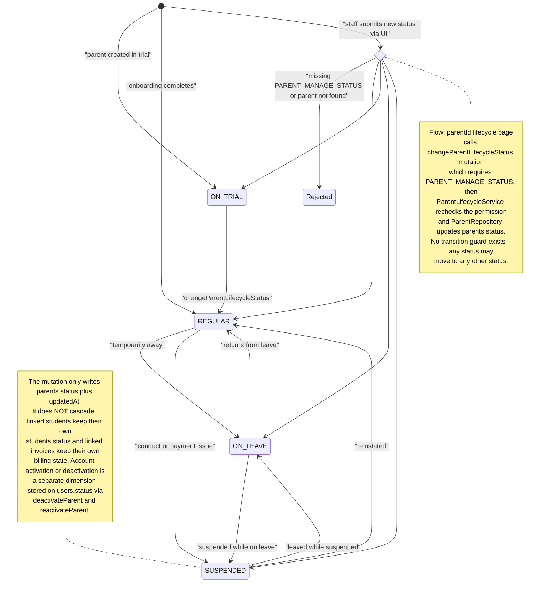

# Parent Lifecycle

The parent lifecycle workflow manages the `parents.status` field, which takes one of four values: `REGULAR`, `ON_LEAVE`, `SUSPENDED`, or `ON_TRIAL`. A staff member opens the dashboard page at `app/(dashboard)/parents/[id]/lifecycle`, which is wrapped in `withPageAuth` and server-renders the parent's profile via `ParentLifecycleService.getParentLifecycleData` (redirecting to `/parents` when the parent does not exist). The client container then runs the GraphQL mutation `changeParentLifecycleStatus`, which is gated by the `PARENT_MANAGE_STATUS` permission both as an authScope on the Pothos field and again inside `ParentLifecycleService.changeLifecycleStatus`. The service delegates to `ParentRepository.changeLifecycleStatus`, which verifies the parent row exists (throwing a localized `parentNotFound` error otherwise) and updates only `parents.status` and `updatedAt`. There is no transition guard, so any status may move to any other status. Importantly, the change does not cascade: linked students keep their own `students.status` and linked invoices keep their own billing state, since those rows are related only by foreign key (`students.parentId`, `invoices.parentId`). A separate, orthogonal dimension — account activation versus deactivation on `users.status` — is handled by `deactivateParent` and `reactivateParent` in the repository, which also raise conflict errors when the account is already in the target state.

## Key sources

- `app/(dashboard)/parents/[id]/lifecycle/page.tsx` — server page: auth wrapper, profile fetch, not-found redirect, renders client container
- `frontend/common/views/dashboard/parents/lifecycle/ParentLifecycleClientContainer.tsx` — Apollo `useMutation` wiring for `changeParentLifecycleStatus`
- `backend/graphql/mutation/parents/parent-lifecycle.mutation.ts` — Pothos mutation field with `PARENT_MANAGE_STATUS` authScope
- `backend/services/parent/parent-lifecycle.service.ts` — permission recheck, localized errors, logging, delegation to repository
- `backend/db/repo/parents/parent.repository.ts` — `changeLifecycleStatus` (status update), `deactivateParent` / `reactivateParent` (account status via `UserRepository.updateStatus`), parent-not-found and already-(de)activated error paths
- `shared/constants/parent.enum.ts` — `ParentStatus` enum (`REGULAR`, `ON_LEAVE`, `SUSPENDED`, `ON_TRIAL`)
- `backend/db/schema/students/students.ts` and `backend/db/schema/billing/billing.ts` — `students.parentId` and `invoices.parentId` foreign keys linking dependent records to the parent

Machine-checkable copy: [lifecycle.mmd](./lifecycle.mmd)
