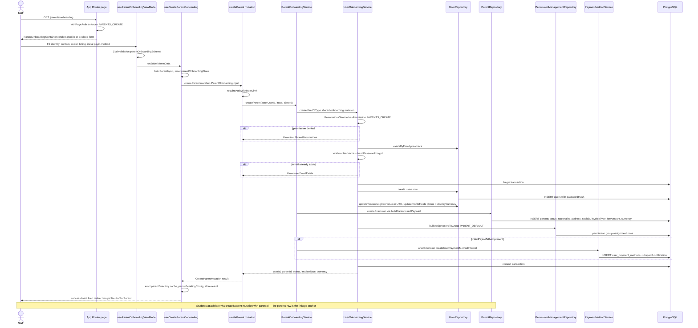

# Parent Onboarding

Staff (admin or manager) with the `PARENTS_CREATE` permission create a new parent account from the dashboard page at `app/(dashboard)/parents/onboarding`, whose `withPageAuth` wrapper enforces the permission server-side. The page renders a mobile-or-desktop form (via `ParentOnboardingContainer` and `useParentOnboardingViewModel`) backed by react-hook-form and a Zod schema, capturing identity fields, contact info (phone, address, WhatsApp/Facebook/Twitter socials), billing configuration (invoice type, fee amount, currency), timezone, an optional avatar, and an optional initial payin payment method. On submit, `useCreateParentOnboarding` maps the form to a `ParentOnboardingInput` and calls the `createParent` GraphQL mutation (`backend/graphql/mutation/shared/onboarding.mutation.ts`), which applies auth + rate limiting and delegates to `ParentOnboardingService.createParent`. That service rides the shared `UserOnboardingService.createUserOfType` skeleton: a permission check and email-uniqueness pre-check, bcrypt password hashing, then a single DB transaction that inserts the `users` row, writes timezone (defaulting to UTC) / phone / display currency profile fields, inserts the `parents` extension row via `buildParentInsertPayload`, assigns the `PARENT_DEFAULT` permission group, and — when an initial payin method was provided — creates it inside the same transaction through `PaymentMethodService.createUserPaymentMethodInternal`. The whole flow is atomic: insufficient permission, a duplicate email, or any payment-method failure rolls everything back with a localized error surfaced in the form. After success the frontend evicts the `parentDirectory` Apollo cache entry, optionally persists a meeting config for the new user, and redirects to the new parent's profile.

The parents row created here is the linkage anchor for student onboarding: students are attached afterwards through the separate `createStudent` mutation / `StudentOnboardingService`, which takes a `parentId` and validates the parent exists before inserting the student row.

## Key sources

- `app/(dashboard)/parents/onboarding/page.tsx` — route entry; `withPageAuth([AppPermission.PARENTS_CREATE])`
- `frontend/common/views/dashboard/admin/parents/onboarding/ParentOnboardingContainer.tsx` — container with responsive view switch
- `frontend/common/views/dashboard/admin/parents/onboarding/useParentOnboardingViewModel.ts` — form state, Zod schema, submit/success UX
- `frontend/common/hooks/useCreateParentOnboarding.ts` — mutation hook, input mapping, cache eviction, meeting config persist
- `backend/graphql/mutation/shared/onboarding.mutation.ts` — `createParent` GraphQL field
- `backend/services/parent/parent-onboarding.service.ts` — domain service orchestrating the shared skeleton
- `backend/services/user/user-onboarding.service.ts` — `createUserOfType` shared onboarding transaction skeleton
- `backend/services/parent/__shared__/buildParentInsertPayload.ts` — parents-row insert payload builder
- `backend/services/payment-method/payment-method.service.ts` — `createUserPaymentMethodInternal` for the initial payin method
- `backend/services/student/student-onboarding.service.ts` — later student ↔ parent linkage via `parentId`

## Diagram

Machine-checkable copy: [onboarding.mmd](./onboarding.mmd)
