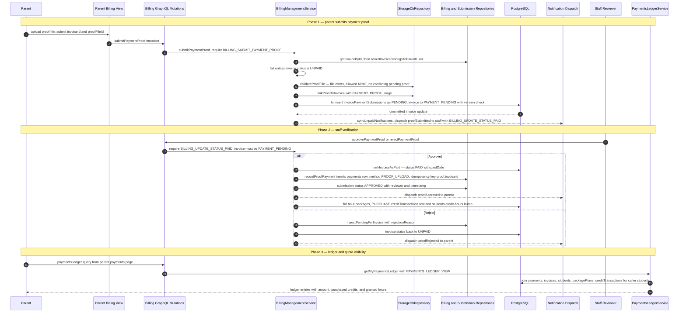

# Parent Payment Submission

A parent pays an open invoice offline (bank transfer or cash) and records it in Siraj by uploading a proof file from the parent billing view; the page at `app/(dashboard)/parent/payments` (`PAYMENTS_LEDGER_VIEW`) is where the resulting ledger is reviewed. The `submitPaymentProof` GraphQL mutation runs `BillingManagementService.submitPaymentProof`, which checks the `BILLING_SUBMIT_PAYMENT_PROOF` permission, verifies the invoice exists, belongs to the calling parent, and is still `UNPAID`, then validates the proof file (exists in storage, allowed MIME type, no conflicting pending submission). Inside one transaction it links the file to the invoice with the `PAYMENT_PROOF` usage, inserts an `invoicePaymentSubmissions` row as `PENDING`, and moves the invoice to `PAYMENT_PENDING` with an optimistic-version check; after commit it syncs the unpaid-notification tray and fans a `proofSubmitted` notification out to all staff holding `BILLING_UPDATE_STATUS_PAID`. Staff then review the proof: `approvePaymentProof` marks the invoice `PAID`, records a `payments` row with method `PROOF_UPLOAD` (idempotency key `proof:{invoiceId}`) and a proof snapshot, flips the submission to `APPROVED`, and for hour packages this purchase feeds `creditTransactions` (`PURCHASE`, `sourcePaymentId`) plus the student's credit-hours balance, whereas `rejectPaymentProof` marks the submission `REJECTED` with a reason and rolls the invoice back to `UNPAID`. Notification dispatch failures are always logged but never fail the mutation. Key edge cases: invoice not found, invoice already paid or already under review, proof file of a disallowed type, a different proof file already pending, and a stale `expectedVersion` all abort before any state change.

## Key sources

- `app/(dashboard)/parent/payments/page.tsx`
- `frontend/common/views/dashboard/billing/useParentBillingViewModel.ts`
- `frontend/common/graphql/sharedDocuments/billing/billing-management.documents.ts`
- `backend/graphql/mutation/billing/billing-management.mutation.ts`
- `backend/services/billing/billing-management.service.ts`
- `backend/services/billing/billing-payment-proof.helpers.ts`
- `backend/services/billing/accounting-payment.service.ts`
- `backend/db/repo/billing/billing.repository.ts`
- `backend/services/payments-ledger/payments-ledger.service.ts`

## Diagram

Machine-checkable copy: [payments.mmd](payments.mmd)
