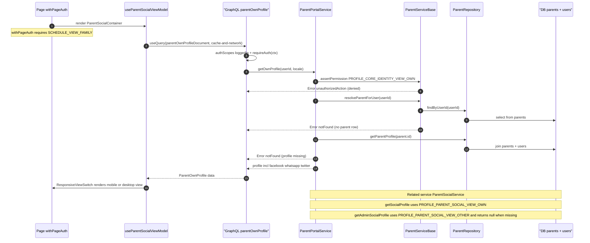

# Parent Social/Community

The parent social page (`/parents/social`) is a read-only surface that shows a parent's own social and contact links (phone, Facebook, WhatsApp, Twitter); despite the spec title, there is no community feed, no posts/reactions, and no moderation hooks in the codebase — the feature is contact-link display. The page entry point `app/(dashboard)/parents/social/page.tsx` wraps the view in `withPageAuth` requiring `SCHEDULE_VIEW_FAMILY`, then renders `ParentSocialContainer`, whose `useParentSocialViewModel` hook issues the `parentOwnProfile` GraphQL query with `cache-and-network`. The Pothos query field enforces a logged-in actor via `requireAuth`, then delegates to `ParentPortalService.getOwnProfile`, which checks `PROFILE_CORE_IDENTITY_VIEW_OWN` through `ParentServiceBase.assertPermission`, resolves the parent row with `findByUserId`, and loads the profile through `ParentRepository.getParentProfile` (a join of the `parents` and `users` tables). A companion service `ParentSocialService` exposes the narrower social-fields-only getters `getSocialProfile` (own, gated by `PROFILE_PARENT_SOCIAL_VIEW_OWN`) and `getAdminSocialProfile` (gated by `PROFILE_PARENT_SOCIAL_VIEW_OTHER`). Edge cases: missing permission throws the localized `unauthorizedAction` error, a missing parent row or profile throws `notFound` in the portal path while the social service returns `null` for a missing profile, and the frontend renders either an error state or a responsive mobile/desktop view of the returned profile.

## Key sources

- `app/(dashboard)/parents/social/page.tsx`
- `frontend/common/views/dashboard/parent/social/ParentSocialContainer.tsx`
- `frontend/common/views/dashboard/parent/social/useParentSocialViewModel.ts`
- `frontend/common/views/dashboard/parent/social/ParentSocialView.tsx`
- `frontend/common/graphql/sharedDocuments/parents/parent-portal.documents.ts`
- `backend/graphql/query/parents/parent-portal.query.ts`
- `backend/services/parent/parent-portal.service.ts`
- `backend/services/parent/parent-social.service.ts`
- `backend/services/parent/__shared__/parentServiceBase.ts`
- `backend/db/repo/parents/parent.repository.ts`

[Standalone diagram file](./social.mmd)
