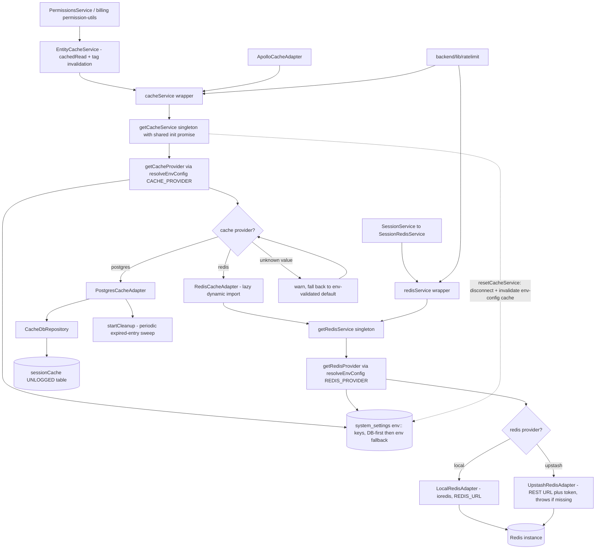

# Cache & Redis Abstraction Layer

The platform layers all volatile-state storage (sessions, permissions, entity caches, rate limits) behind two abstract interfaces — `ICacheService` and `IRedisService`, both aliases of `ICacheServiceBase` — so the backing store is swappable without touching call sites. `getCacheService()` in `CacheServiceFactory.ts` is a lazily-initialized singleton that resolves the provider DB-first via `resolveEnvConfig("CACHE_PROVIDER")` (a `system_settings` row named `env::CACHE_PROVIDER` wins over the environment variable, which wins over the env-validated default) and instantiates either `RedisCacheAdapter` or `PostgresCacheAdapter` — the Redis import is dynamic so Postgres-only deployments never load the Redis client. The Postgres path serves as a dependency-free fallback: all operations go through `CacheDbRepository` to an UNLOGGED `sessionCache` table with TTL columns, and a periodic sweep (`startCleanup`) reaps expired entries. The Redis path delegates through `getRedisService()` in `RedisServiceFactory.ts`, which applies the same DB-first resolution for `REDIS_PROVIDER` and per-adapter credentials, choosing `LocalRedisAdapter` (ioredis, `REDIS_URL`) or `UpstashRedisAdapter` (REST URL + token, throwing a clear error when credentials are absent). Higher-level consumers sit on top: `SessionService` registers a `SessionRedisService` factory (key prefixes `session:` / `user_sessions:` with TTLs) into the session repository, while permissions checks and entity caches go through `EntityCacheService`'s `cachedRead` with tag-indexed invalidation (`ec:` / `tag:` key prefixes) on the shared `cacheService`. Edge cases are uniform: unknown provider strings log a warning and fall back to the env-validated default, initialization failures clear the in-flight promise so the next call retries, and `resetCacheService` / `resetRedisService` disconnect the instance and invalidate the env-config cache so a Settings override takes effect on the next resolution.

## Key sources

- `backend/services/cache/CacheServiceFactory.ts` — cache singleton factory, DB-first `CACHE_PROVIDER` resolution, `cacheService` wrapper
- `backend/services/cache/RedisCacheAdapter.ts` — Redis-backed `ICacheService` delegating to `getRedisService()`
- `backend/services/cache/PostgresCacheAdapter.ts` — Postgres-backed `ICacheService` via `CacheDbRepository` + expiry sweep
- `backend/services/cache/EntityCacheService.ts` — `cachedRead`/tag-indexed entity caching used by permissions and domain services
- `backend/services/redis/RedisServiceFactory.ts` — Redis singleton factory, `REDIS_PROVIDER` (local/upstash) + credential resolution
- `backend/services/redis/IRedisService.ts` — Redis service contract (`ICacheServiceBase`)
- `backend/services/redis/SessionRedisService.ts` — session storage on Redis with `session:`/`user_sessions:` key prefixes and TTL
- `backend/services/auth/session.service.ts` — registers the `SessionRedisService` factory into the session repository
- `backend/services/system/environment-config.service.ts` — `resolveEnvConfig` DB-first override mechanism (`env::*` keys)
- `backend/services/billing/permission-utils.ts` — example permission caching via `cachedRead` + tag invalidation
- `backend/services/redis/README.md` — adapter-pattern architecture overview

Machine-checkable copy: [cache-redis-abstraction.mmd](./cache-redis-abstraction.mmd)
