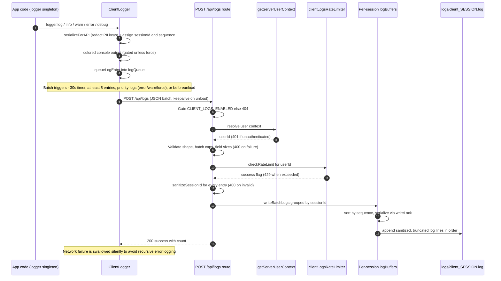

# Client Log Ingestion

Browser-side diagnostics are captured by a singleton `ClientLogger` (`frontend/common/lib/logger/index.ts`) that redacts PII keys from serialized arguments, tags every entry with a timestamped `sessionId` and a monotonically increasing `sequence`, mirrors entries to the browser console, and queues them for batched delivery. A batch is flushed on a 30-second timer when at least 5 entries are queued, immediately for priority entries (error/warn level or `force: true`), and on `beforeunload` via a `keepalive` fetch POST of `{ logs: LogEntry[] }` to `/api/logs`. The route handler (`app/api/logs/route.ts`) first gates on `CLIENT_LOGS_ENABLED` (development, or production with `ENABLE_LOGGING=true`; otherwise 404), then requires an authenticated user via `getServerUserContext` (401), validates the payload shape plus hard caps of 100 entries / 256 KiB / 4000 chars per field (400), enforces a per-user rate limit through `clientLogsRateLimiter` (429), and rejects any `sessionId` outside the alphanumeric-plus-hyphen allowlist to prevent path traversal (400). Accepted entries are grouped by session in in-memory `logBuffers`, serialized through a per-session `writeLock`, sorted by `sequence`, and appended as sanitized, ANSI-stripped, HTML-escaped lines to `logs/client_<sessionId>.log`; an optional cleanup step (`CLEANUP_ENABLED`) deletes prior client log files once per session. Network failures on the client are swallowed silently so a logging failure can never recurse into more logging. This workflow touches no database tables — its only persistence is the filesystem log files used for triaging browser-side issues such as the auth recovery path.

## Key sources

- `app/api/logs/route.ts` — POST handler: gating, auth, validation, rate limiting, session-ID sanitization, ordered buffered writes, cleanup
- `frontend/common/lib/logger/index.ts` — `ClientLogger` singleton: PII redaction, session/sequence assignment, batching policy, `keepalive` flush
- `frontend/common/lib/logger/README.md` — logger usage documentation
- `frontend/common/providers/apollo/utils.ts` — example consumer invoking the client logger

## Diagram

Machine-checkable copy: [client-log-ingestion.mmd](./client-log-ingestion.mmd)
