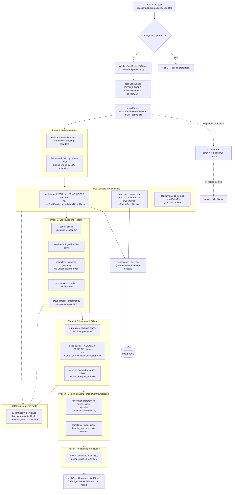

# Database Seeding Framework

The seed pipeline populates a local/dev/test database with a deterministic demo academy. It is triggered by `bun run db seed` (`backend/db/scripts/drizzleSeed.ts`), which hard-aborts when `NODE_ENV=production`, validates required seed assets for the `standard` profile, then calls the master controller `runAllSeeds` in `backend/db/seeds/index.ts`. `loadSeedConfig` resolves a `SeedConfig` from `SEED_PROFILE` (minimal/standard) plus an anchor date, controlling extra persona counts and feature gates for billing, communications, and audit seeds. The controller runs domain seeders in strict dependency order — reference data and migration-owned permission groups first, then demo users (`INTERNAL_DEMO_USERS` plus faker-generated extras via `UserSeedService`), personas (teachers, parents, students via `PersonaSeedService`/`StudentSeedService`), schedules and lessons (recurring schedules → days → class instances, lesson reports, group classes), billing (invoices, payments, and PACKAGE/PERIODIC quotas via `QuotaService.seedOrGetQuotaBatch` plus an on-demand recurring class), and communications (notification preferences, device tokens, deliveries, complaints). Every seeder is idempotent ("seed or get", usually via `orchestrateSeedMany` look-before-create with duplicate-race recovery), receives dependencies through the shared `SeedContext`, and may only write through service bootstrap methods — direct DB access from seeders is forbidden by ESLint. Each step is wrapped by `runSeedStep`, which logs failures and continues; failed step names land in `context.failedSteps` and are fed to `verifySeedCoverage`, which reports per-table row coverage distinguishing empty tables from upstream failures. All write paths are protected by `assertSeedWriteAllowed`, which hard-blocks on Vercel production while allowing local dev and CI test servers.

## Key sources

- `backend/db/scripts/drizzleSeed.ts` — CLI entry point, production guard, asset validation
- `backend/db/seeds/index.ts` — master controller `runAllSeeds`, `SeedContext`, step ordering
- `backend/db/seeds/lib/seed-config.ts` — `SeedConfig`, minimal/standard profiles
- `backend/db/seeds/lib/run-seed-step.ts` — per-step error capture
- `backend/db/seeds/lib/orchestrate-seed-many.ts` — idempotent look-before-create helper
- `backend/db/seeds/users/seed-users.ts` — demo user + avatar seeding
- `backend/db/seeds/billing/seed-quotas.ts` — quota + on-demand schedule seeding
- `backend/db/seeds/shared/verify-coverage.ts` — post-run table coverage verifier
- `backend/services/seed/user-seed.service.ts` — idempotent demo user upserts
- `backend/services/seed/persona-seed.service.ts` — teacher/parent persona upserts
- `backend/lib/bootstrap-gate.ts` — `assertSeedWriteAllowed` production gate

## Diagram

Machine-checkable copy: [database-seeding.mmd](./database-seeding.mmd)
