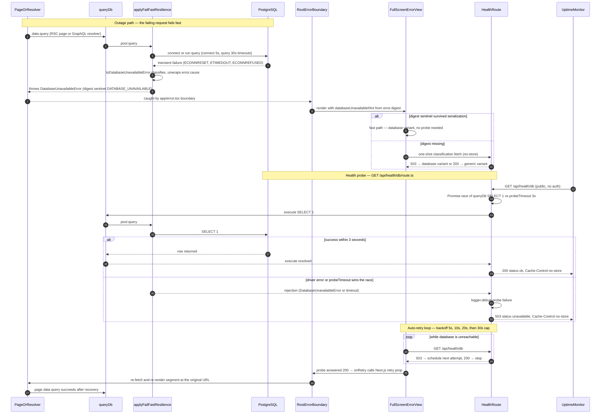

# Database Health Probe & Fail-Fast

Siraj fails fast when PostgreSQL is unreachable instead of hanging on sockets: `backend/db/factory.ts` bounds both pool types with a 5s connect timeout and a 30s query timeout, and `applyFailFastResilience` translates transient driver errors into `DatabaseUnavailableError` (a `DomainError` carrying a `DATABASE_UNAVAILABLE` digest sentinel that survives Next.js production error serialization). Any Server Component or GraphQL resolver that hits this error is caught by the root error boundary in `app/error.tsx`, which renders `FullScreenErrorView` and uses the digest as a zero-latency fast path to the "database unavailable" variant; when the digest is missing, the view fires a one-shot classification probe to `GET /api/health/db` because Drizzle error wrapping makes error identity unreliable across layers. The probe route (`app/api/health/db/route.ts`) runs `SELECT 1` via `queryDb()` raced against a 3-second timeout, answering 200 `{status: "ok"}` or 503 `{status: "unavailable"}` with `Cache-Control: no-store`, no auth, and no sensitive payload — also usable by external uptime monitors. While the outage persists, the view polls the same probe on a 5s → 10s → 20s → 30s-capped backoff and calls the Next.js 16 `retry()` prop as soon as the probe answers 200, re-fetching and re-rendering the failing segment so the user lands back on the originally requested page. Edge cases: callback-style `pool.query` invocations bypass the wrapper, transaction paths (`pool.connect`) rely on `connectionTimeoutMillis` only, and no implicit retry happens at the pool layer (idempotent call sites use `retryTransient` instead).

## Key sources

- `app/api/health/db/route.ts` — the probe route (`SELECT 1` raced against a 3s timeout, 200/503 responses)
- `app/error.tsx` — root error boundary selecting the error variant via the digest sentinel
- `frontend/common/views/errors/FullScreenErrorView.tsx` — one-shot classification probe + auto-retry polling loop (5/10/20/30s backoff)
- `backend/db/factory.ts` — pool timeouts (5s connect, 30s query) and `applyFailFastResilience` wrapping `pool.query`
- `backend/lib/errors.ts` — `DatabaseUnavailableError` with the `DATABASE_UNAVAILABLE` digest sentinel and GraphQL `extensions.code`
- `docs/backend/db-availability-fail-fast.md` — canonical design doc for the fail-fast + full-screen error page system

## Diagram

Machine-checkable copy: [db-health-probe.mmd](./db-health-probe.mmd)
