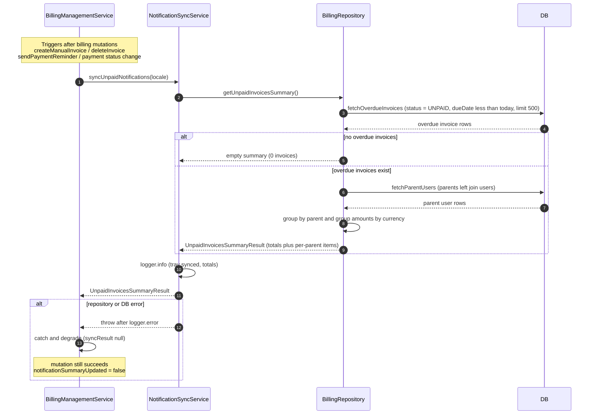

# Notification Warning Sync

This workflow keeps the admin notification-tray overdue-invoice warning/balance state synchronized with the authoritative billing data. The trigger is post-mutation: after `BillingManagementService` operations such as `createManualInvoice` (only when `sendEmail` is set), `deleteInvoice`, `sendPaymentReminder`, or an invoice payment-status change, the service calls `NotificationSyncService.syncUnpaidNotifications` (`backend/services/system/notification-sync.service.ts`). That service delegates entirely to `BillingRepository.getUnpaidInvoicesSummary`, which reads overdue `invoices` (`status = UNPAID`, `dueDate` before today, capped at 500 rows), joins `parents` to `users`, groups invoices by parent, and aggregates amounts per currency into an `UnpaidInvoicesSummaryResult` of global totals plus per-parent items. The sync is a pure recomputation — it stores no derived state, so the tray always reflects the live billing tables. Failure handling is deliberate: the sync service logs and rethrows, but every billing caller wraps it in `.catch` so a sync failure never rolls back the underlying mutation, and mutation results carry `notificationSummaryUpdated: false` (or `success: false` for reminders) to signal the degrade. Edge cases include zero overdue invoices (a `createEmptySummary` short-circuit), parents without a linked user (skipped in `buildSummaryItems`), and multi-currency balances (per-currency buckets with a single primary amount).

## Key sources

- `backend/services/system/notification-sync.service.ts` — `NotificationSyncService.syncUnpaidNotifications` (tray sync entry)
- `backend/services/billing/billing-management.service.ts` — mutation call sites and non-blocking `.catch` degrade pattern
- `backend/db/repo/billing/billing.repository.ts` — `getUnpaidInvoicesSummary`, `fetchOverdueInvoices`, `fetchParentUsers`, `buildSummaryItems`
- `backend/services/notification/notification-alerts.service.ts` — related admin alert feed (complaints + notification deliveries) that consumes the same notification tray
- `backend/services/billing/billing-alerts.service.ts` — read-side `BillingAlertsService.getUnpaidInvoices` sharing the same repository summary

- Diagram source: [notification-warning-sync.mmd](./notification-warning-sync.mmd)
