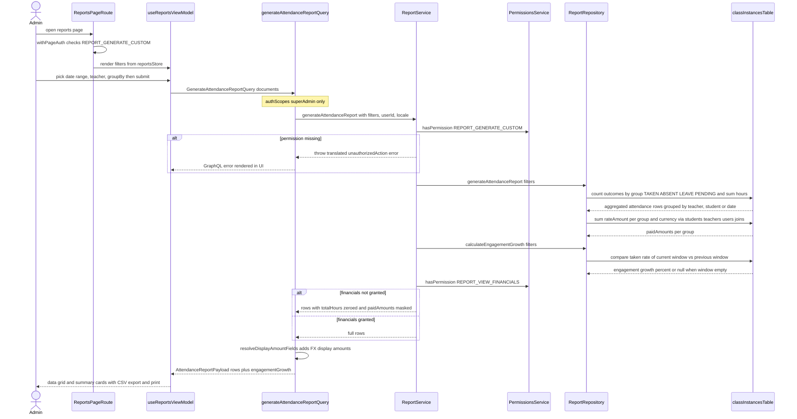

# Class Performance Analytics

The Class Performance Analytics workflow aggregates per-class performance — attendance outcomes (taken, absent, leave, pending), hours taught, paid amounts per currency, and engagement growth — and renders it in the Reports dashboard. A super-admin opens `app/(dashboard)/reports/page.tsx`, which is gated by `withPageAuth` on `REPORT_GENERATE_CUSTOM` and mounts `ReportsContainer`; filters (date range, teacher, grouping mode) live in the `reportsStore` Zustand store and are surfaced through `useReportsViewModel`. On submit, the client runs the `GenerateAttendanceReport` GraphQL query (`backend/graphql/query/books/report.query.ts`, `authScopes: superAdmin`), which delegates to `ReportService.generateAttendanceReport`. The service re-checks `REPORT_GENERATE_CUSTOM` via `PermissionsService`, then asks `ReportRepository` to aggregate the `class_instances` table grouped by teacher, student, or date (dialect-aware SQL for PostgreSQL/SQLite), and to compute engagement growth by comparing the taken-attendance rate of the requested window against the immediately preceding window of equal length. Field-level RBAC then applies: without `REPORT_VIEW_FINANCIALS`, `totalHours` and `paidAmounts` are masked before the resolver enriches paid amounts with FX display amounts via `resolveDisplayAmountFields`. Edge cases: missing generate permission throws a translated unauthorized error; an empty previous or current window yields `engagementGrowth: null`; repository failures are logged and re-thrown as translated permission errors. Separately, per-class performance snapshots (attendance rate, average grade, engagement score, heatmap) are materialized into the `class_instance_performance` table via `ClassPerformanceService.logPerformance` / `upsertManyPerformance` (keyed and upserted by `classInstanceId`) and are read back by `ClassSessionService.getClassInstanceDetail` for the teacher class-details `PerformanceOverviewCard`.

## Key sources

- `app/(dashboard)/reports/page.tsx` — permission-gated reports page route
- `frontend/common/views/dashboard/reports/ReportsContainer.tsx` and `useReportsViewModel.ts` — container/ViewModel, filter state from `reportsStore`
- `frontend/common/graphql/sharedDocuments/reports/report.documents.ts` — `GenerateAttendanceReport` query document
- `backend/graphql/query/books/report.query.ts` — `generateAttendanceReport` query field, superAdmin authScope, FX display enrichment
- `backend/graphql/pothos/books/report.pothos.ts` — `AttendanceReportFiltersInput`, `AttendanceReportPayload` types
- `backend/services/report/report.service.ts` — permission checks, financial masking, error translation
- `backend/db/repo/books/report.repository.ts` — SQL aggregation over `class_instances`, engagement-growth computation
- `backend/services/performance/class-performance.service.ts` — per-class performance snapshot read/upsert facade
- `backend/db/repo/classes/class-performance.repository.ts` — `class_instance_performance` table access (get, upsert, batch)
- `backend/db/seeds/classes/seed-class-performance.ts` — example writer of performance metric rows
- `backend/services/session/class-session.service.ts` — class-details read path consuming performance rows

Machine-checkable copy: [class-performance-report.mmd](./class-performance-report.mmd)
