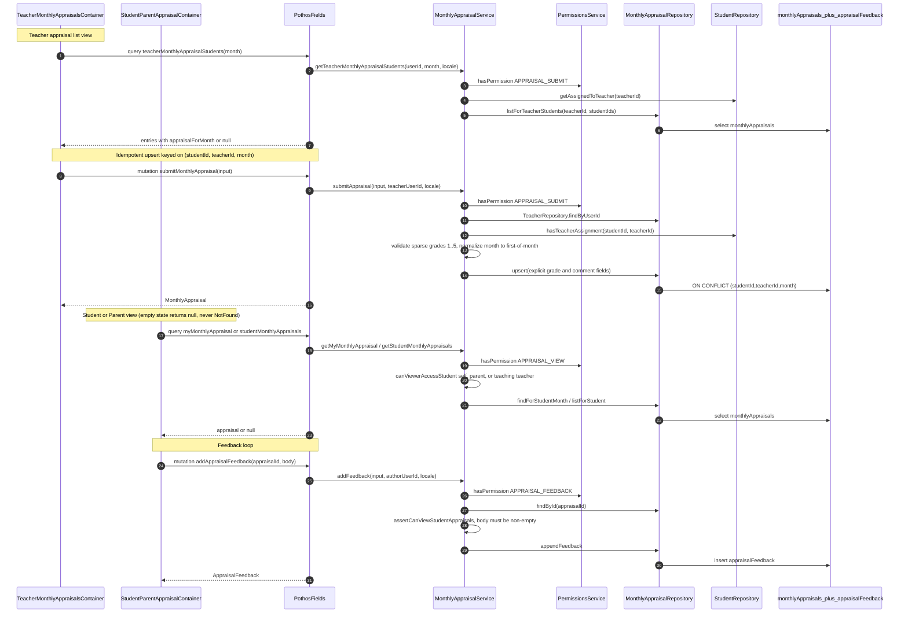

# Monthly Appraisal Review

Teachers submit a structured monthly evaluation for each student they teach through `submitMonthlyAppraisal`, which is an idempotent upsert keyed on `(studentId, teacherId, month)` with the month normalized to the first of the month. The service layer never trusts client-supplied identities: `teacherId` is resolved from the auth context, the teacher must actually teach the student (`hasTeacherAssignment`), and sparse rubric grades are validated to be integers in 1..5 or null before the repository upsert. Students and parents read appraisals via `myMonthlyAppraisal` / `studentMonthlyAppraisals` behind `APPRAISAL_VIEW`, where the viewer must be the student themselves, the owning parent, or a teaching teacher (`canViewerAccessStudent`), a missing appraisal returns `null` as an empty state rather than a NotFound error. The teacher's list view (`teacherMonthlyAppraisalStudents`, behind `APPRAISAL_SUBMIT`) returns assigned students with an optional `appraisalForMonth` summary so the UI can distinguish "no appraisal yet" from "appraisal exists". Parents and students close the loop by appending feedback through `addAppraisalFeedback` (behind `APPRAISAL_FEEDBACK`), which requires the appraisal to exist, the same tenancy check, and a non-empty body. The student-facing route `app/(dashboard)/student/monthly-appraisals/page.tsx` is a thin `withPageAuth(APPRAISAL_VIEW)` wrapper around the shared `StudentParentAppraisalContainer`. Permission failures raise `UnauthorizedError`, tenancy violations `ForbiddenError`, and bad grades or empty feedback bodies raise `ValidationError` with localized messages.

## Key sources

- `backend/services/monthly-appraisal/monthly-appraisal.service.ts` — `MonthlyAppraisalService` business-logic hub (identity resolution, tenancy checks, grade validation, month normalization)
- `backend/graphql/query/reports/monthly-appraisal.query.ts` — Pothos query fields: `myMonthlyAppraisal`, `studentMonthlyAppraisals`, `teacherMonthlyAppraisalStudents`
- `backend/graphql/mutation/reports/monthly-appraisal.mutation.ts` — Pothos mutation fields: `submitMonthlyAppraisal`, `addAppraisalFeedback`
- `backend/db/repo/students/monthly-appraisal.repository.ts` — `MonthlyAppraisalRepository` over the `monthlyAppraisals` and `appraisalFeedback` tables
- `app/(dashboard)/student/monthly-appraisals/page.tsx` and `app/(dashboard)/__shared__/makeStudentParentAppraisalPage.tsx` — auth-gated student/parent page wiring

## Diagram

Standalone diagram file: [monthly-appraisal.mmd](./monthly-appraisal.mmd)
