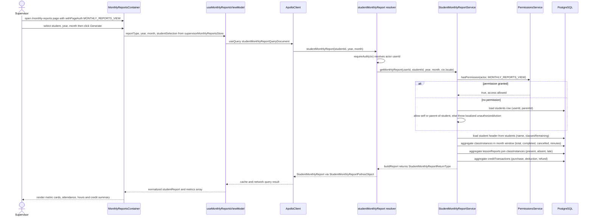

# Student Monthly Report Generation

The student monthly report aggregates a single student's lessons, attendance, and credit-ledger activity for a chosen calendar month on demand — there is no cron or background job; aggregation happens live at query time. A supervisor opens the `/monthly-reports` dashboard page (guarded by `withPageAuth` with `MONTHLY_REPORTS_VIEW`), picks a student plus a year and month in `MonthlyReportsContainer`, and `useMonthlyReportsViewModel` fires the `studentMonthlyReport` GraphQL query through Apollo `useQuery` with `cache-and-network`. The Pothos `studentMonthlyReport` query field resolves the actor via `requireAuth` and delegates to `StudentMonthlyReportService.getMonthlyReport`, which first enforces access: anyone holding `AppPermission.MONTHLY_REPORTS_VIEW` passes, otherwise the actor may only view their own report or their child's report via `ParentRepository`. The service then runs four reads against PostgreSQL: the student header from `students` (name, `classesRemaining`), lesson counts and completed minutes from `classInstances`, present/absent/late counts from `lessonReports` joined to `classInstances`, and purchase/deduction/refund sums from `creditTransactions`, all filtered to the UTC month window `[Date.UTC(year, month - 1), Date.UTC(year, month))`. `buildReport` merges these into `StudentMonthlyReportReturnType` (deriving `totalHours` from minutes and `creditsBalance` from `classesRemaining`), which the UI renders as metric cards. Edge cases: a missing student throws the localized `studentNotFound` error, and an actor without the permission who is neither the student nor the parent receives a localized `unauthorizedAction` error.

## Key sources

- `backend/services/report/student-monthly-report.service.ts` — `StudentMonthlyReportService.getMonthlyReport`, permission check, and the four aggregation queries
- `backend/graphql/query/reports/monthly-report.query.ts` — wires the `studentMonthlyReport` query field
- `backend/graphql/query/reports/__shared__/makeMonthlyReportQueryField.ts` — shared Pothos query-field factory with `requireAuth`
- `backend/graphql/pothos/reports/monthly-report.pothos.ts` — `StudentMonthlyReportPothosObject` field mappings
- `app/(dashboard)/monthly-reports/page.tsx` — page entry point, `withPageAuth([MONTHLY_REPORTS_VIEW])`
- `frontend/common/graphql/sharedDocuments/reports/monthly-reports.documents.ts` — Apollo query document
- `frontend/common/views/dashboard/supervisor/monthly-reports/useMonthlyReportsViewModel.ts` — query orchestration and metrics mapping
- `frontend/common/stores/supervisorMonthlyReportsStore.ts` — report type, year, month, and student selection state

## Diagram

Machine-checkable copy: [student-monthly-report.mmd](./student-monthly-report.mmd)
