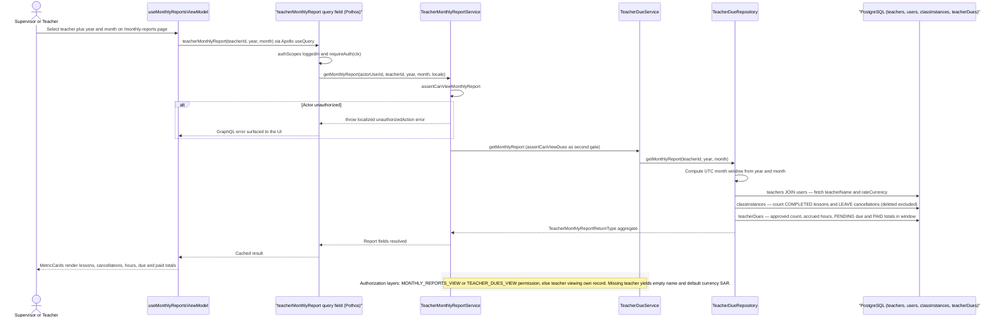

# Teacher Monthly Report Generation

A supervisor (or the teacher themselves) opens the monthly-reports dashboard page, picks a teacher plus a year and month, and the report for that period is compiled on demand — there is no scheduler; each selection triggers a fresh `teacherMonthlyReport` GraphQL query. The Pothos query field (`makeTeacherMonthlyReportQueryField`) enforces authentication via `requireAuth`, then `TeacherMonthlyReportService.getMonthlyReport` authorizes the actor: anyone holding the `MONTHLY_REPORTS_VIEW` or `TEACHER_DUES_VIEW` permission may view any teacher, while a teacher may only view their own record (resolved through `TeacherRepository.findByUserId`), otherwise a localized `unauthorizedAction` error is thrown. `TeacherDueService.getMonthlyReport` repeats the dues-scope authorization as a second gate and delegates to `TeacherDueRepository.getMonthlyReport`, which computes a UTC window for the chosen month and runs three aggregate queries: teacher identity (`teachers` joined to `users` for name and rate currency), class-instance aggregates (completed lessons as `lessonsTaught`, `LEAVE` outcomes as `cancelledCount`, soft-deleted rows excluded), and dues aggregates over `teacherDues` (`approvedCount`, total accrued hours, `PENDING` amount as total due, `PAID` amount as total paid). The returned `TeacherMonthlyReportReturnType` is cached by Apollo and rendered as metric cards for teacher review and payroll preparation. Edge cases: a missing teacher row yields an empty teacher name and defaults the currency to SAR, and actors without any of the three authorization paths receive a localized authorization error surfaced in the UI.

Key sources:

- `backend/graphql/query/reports/__shared__/makeMonthlyReportQueryField.ts` — Pothos query-field factory, authScopes + `requireAuth`
- `backend/graphql/query/reports/monthly-report.query.ts` — `teacherMonthlyReport` field registration
- `backend/services/report/teacher-monthly-report.service.ts` — service entry point and `assertCanViewMonthlyReport`
- `backend/services/teacher/teacher-due.service.ts` — `getMonthlyReport` delegation and `assertCanViewDues`
- `backend/db/repo/teachers/teacher-due.repository.ts` — `getMonthlyReport` and the three aggregate queries
- `frontend/common/views/dashboard/supervisor/monthly-reports/useMonthlyReportsViewModel.ts` — Apollo query invocation and metric assembly
- `app/(dashboard)/monthly-reports/page.tsx` — dashboard route hosting the report UI
- `app/(dashboard)/teachers/dashboard/page.tsx` — teacher dashboard entry point (redirects to `/dashboard`)

Diagram source: [teacher-monthly-report.mmd](./teacher-monthly-report.mmd)
