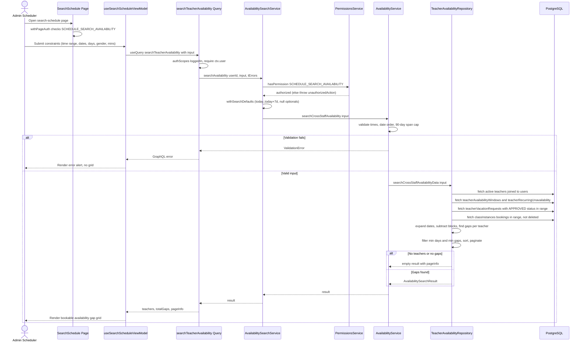

# Emergency Slot Search

An administrator or scheduler opens the `/search-schedule` dashboard page to find substitute or open teacher slots when classes need coverage. The page is gated by `withPageAuth` with the `SCHEDULE_SEARCH_AVAILABILITY` permission, and the client renders `SearchScheduleContainer` / `useSearchScheduleViewModel`, which issues the `searchTeacherAvailability` GraphQL query with constraints such as time-of-day range, date window, days of week, gender, name search, and minimum availability thresholds. The Pothos query field requires a logged-in user and delegates to `AvailabilitySearchService.searchAvailability`, which re-checks the permission via `PermissionsService` and applies default search values (today plus seven days) before delegating to `AvailabilityService.searchCrossStaffAvailability`. The service layer performs business validation — start before end time, coherent date order, and a 90-day maximum span — throwing a localized `ValidationError` on violation. `TeacherAvailabilityRepository.searchCrossStaffAvailabilityData` then batch-loads active teachers (joined with `users`), their availability windows, recurring unavailability, approved vacation requests, and existing class instance bookings, computes free gaps per calendar date by subtracting blocked ranges from windows, filters by minimum days/gaps, and returns a sorted, paginated result with `pageInfo` for the grid. Edge cases include unauthorized access (error before any DB access), validation failures rendered as an error alert, and empty matches, which return an empty teacher list with valid pagination info rather than an error.

## Key sources

- `app/(dashboard)/search-schedule/page.tsx`
- `frontend/common/views/dashboard/search-schedule/SearchScheduleContainer.tsx`
- `frontend/common/views/dashboard/search-schedule/useSearchScheduleViewModel.ts`
- `backend/graphql/query/scheduling/availability-search.query.ts`
- `backend/services/schedule/availability-search.service.ts`
- `backend/services/scheduling/availability.service.ts`
- `backend/db/repo/teachers/teacher-availability.repository.ts`

## Diagram

Machine-checkable copy: [availability-search.mmd](./availability-search.mmd)
