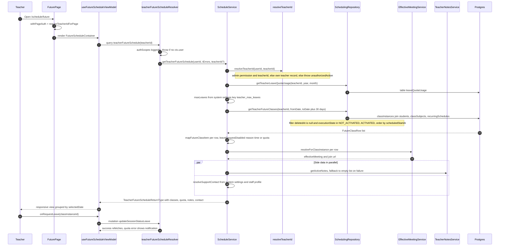

# Future Schedule Projection

The Future Schedule page projects a teacher's upcoming class instances over a fixed 30-day horizon so teachers (and admins) can plan ahead. The entry point is `app/(dashboard)/schedule/future/page.tsx`, a server page guarded by `withPageAuth` and `requireTeacherIdForPage`, which renders `FutureScheduleContainer`, the client ViewModel `useFutureScheduleViewModel` issues the `teacherFutureSchedule` GraphQL query. The resolver (`backend/graphql/query/classes/class-session.query.ts`) requires a logged-in user and delegates to `ScheduleService.getTeacherFutureSchedule`, which first resolves the effective teacher via `resolveTeacherId` — admins with schedule/staff permissions may pass an explicit `teacherId`, otherwise the caller's own teacher record is used, and failure throws a locale-aware `unauthorizedAction` error. The service then queries monthly leave-quota usage (`leaveQuotaUsage` table plus the `teacher_max_leaves` system setting) and fetches projected rows from `classInstances` (joined to `students`, `classSubjects`, `recurringSchedules`) limited to non-deleted instances in `NOT_ACTIVATED`/`ACTIVATED` execution state between today and today + 30 days. Each row is mapped with an `EffectiveMeetingService` join URL and a `leaveRequestDisabled` flag whose reason is `time` (class already started) or `quota` (monthly leaves exhausted), and important notes plus an optional support contact are loaded in parallel (notes degrade to an empty list on failure). The returned payload (`classes`, `leaveQuotaUsed/Total`, `totalClasses`, `importantNotes`, `supportContact`) is rendered responsive mobile/desktop, the main side effect is the `updateSessionStatusLeave` mutation, which re-checks the leave quota server-side and triggers a refetch on success or a quota/leave error notification on failure.

## Key sources

- `app/(dashboard)/schedule/future/page.tsx` — server page, auth wrapper, metadata
- `frontend/common/views/dashboard/teachers/futureSchedule/FutureScheduleContainer.tsx` — container, lazy mobile/desktop views
- `frontend/common/views/dashboard/teachers/futureSchedule/useFutureScheduleViewModel.ts` — Apollo query, leave/support mutations, notifications
- `backend/graphql/query/classes/class-session.query.ts` — `teacherFutureSchedule` query field
- `backend/graphql/mutation/classes/class-session.mutation.ts` — `updateSessionStatusLeave` mutation
- `backend/services/schedule/schedule.service.ts` — `getTeacherFutureSchedule`, `mapFutureClassItem`, `resolveSupportContact`
- `backend/services/schedule/schedule-query.service.ts` — related permission-gated query service (status tracking, not this flow)
- `backend/services/schedule/__shared__/resolveTeacherId.ts` — admin vs. own-record teacher resolution
- `backend/db/repo/scheduling/scheduling-queries.repository/teacher-schedule.repository.ts` — `getTeacherFutureClasses` (30-day window, state filter)
- `backend/db/repo/scheduling/scheduling-queries.repository/leave-quota.repository.ts` — leave quota usage and enforcement

Machine-checkable copy: [future-schedule.mmd](./future-schedule.mmd)
