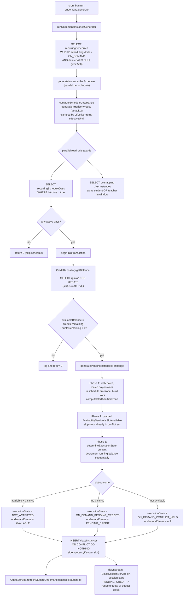

# Pre-Generated Instance Materialization

The on-demand instance generator (`scripts/ondemand-instance-generator.ts`) is a daily cron entry point (invoked via `bun run ondemand:generate`) that materializes upcoming `classInstances` ahead of time from active recurring schedules whose `schedulingMode` is `ON_DEMAND`. For each schedule it computes a rolling generation window (default 2 weeks, per `generationHorizonWeeks`, clamped by `effectiveFrom`/`effectiveUntil`), loads the active `recurringScheduleDays` and any overlapping existing instances, and short-circuits when the schedule has no active days. Inside a per-schedule transaction it locks the student's active quotas (`SELECT FOR UPDATE`) and combines credit balance with remaining quota; students with zero combined balance are skipped entirely. Each candidate slot is matched by day-of-week in the schedule's IANA timezone, checked against `AvailabilityService.isSlotAvailable` in a batched `Promise.all`, and then classified sequentially (so a running balance is tracked): `NOT_ACTIVATED` when the slot is free and balance remains, `ON_DEMAND_PENDING_CREDITS` when balance is exhausted, and `ON_DEMAND_CONFLICT_HELD` when the slot is unavailable. New rows are inserted with `ON CONFLICT DO NOTHING` keyed by a deterministic idempotency key, so concurrent or repeated runs cannot double-insert; afterwards `QuotaService.refreshStudentOndemandInstances` re-reconciles the student's on-demand instances. Downstream, `ClassSessionService` redeems an open quota or deducts credits when a `PENDING_CREDIT` instance actually starts.

## Key sources

- `scripts/ondemand-instance-generator.ts` — entry point, window computation, slot building, batched availability checks, transactional quota lock + insert, quota refresh
- `backend/services/session/class-session.service.ts` — downstream consumption: session-start quota redemption / credit deduction for `PENDING_CREDIT` on-demand instances
- `docs/billing/quota-system.md` — cron cadence context for the generator

Machine-checkable copy: [instance-generation.mmd](instance-generation.mmd)
