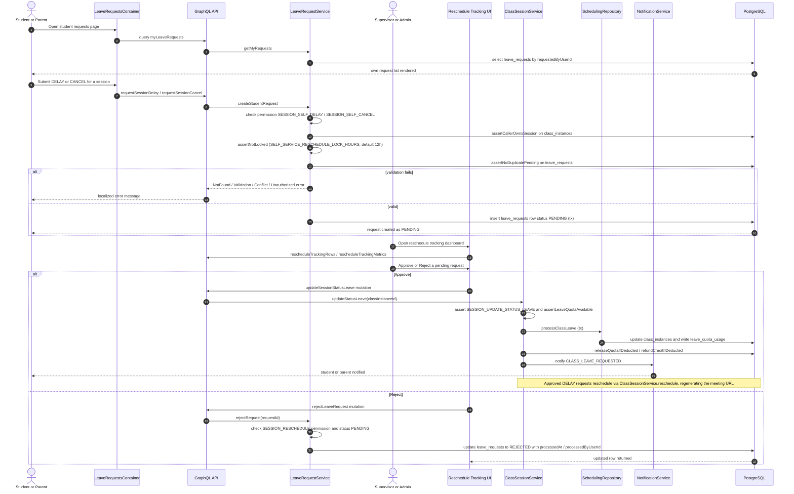

# Leave Request Workflow

The leave request workflow lets students (or their parents) self-serve a delay or cancellation for an upcoming session instead of contacting staff. From the student requests page (`app/(dashboard)/student/requests`), the caller submits via the GraphQL mutations `requestSessionDelay` or `requestSessionCancel`, which funnel into `LeaveRequestService.createStudentRequest`. The service enforces the self-service permission (`SESSION_SELF_DELAY` / `SESSION_SELF_CANCEL`), verifies the class instance exists, rejects requests inside the time-lock window (`SELF_SERVICE_RESCHEDULE_LOCK_HOURS`, default 12 hours before start), and guards against duplicate pending requests for the same instance before inserting a `PENDING` row into `leave_requests` inside a transaction. Any precondition failure surfaces as a localized `UnauthorizedError`, `NotFoundError`, `ValidationError`, or `ConflictError`.

Supervisors and admins review pending requests on the reschedule tracking dashboard. Approving calls the `updateSessionStatusLeave` mutation, which runs `ClassSessionService.updateStatusLeave`: it checks `SESSION_UPDATE_STATUS_LEAVE`, asserts teacher leave-quota availability, then `SchedulingRepository.processClassLeave` updates `class_instances` and writes `leave_quota_usage` in one transaction, releasing reserved quota or refunding deducted credit as needed, and finally fires the `CLASS_LEAVE_REQUESTED` notification to the student/parent. Per the R3 design decision, self-service cancels are quota-exempt for students — approved delays instead go through the existing `ClassSessionService.reschedule` flow which regenerates the meeting URL. Rejecting calls the dedicated `rejectLeaveRequest` mutation (`LeaveRequestService.rejectRequest`), which requires `SESSION_RESCHEDULE`, only acts on still-`PENDING` rows, and stamps `REJECTED` with `processedAt`/`processedByUserId`. The caller can track all of their own requests through the `myLeaveRequests` query backed by `LeaveRequestService.getMyRequests`.

Key sources:

- `backend/services/leave-request/leave-request.service.ts` — create/reject/getMyRequests service logic, lock-window and duplicate-pending guards
- `backend/graphql/mutation/scheduling/leave-request.mutation.ts` — `requestSessionDelay`, `requestSessionCancel`, `rejectLeaveRequest` mutations
- `backend/graphql/pothos/scheduling/leave-request.pothos.ts` — `LeaveRequest` object type and input constraints
- `backend/graphql/query/scheduling/leave-request.query.ts` — `myLeaveRequests` query
- `backend/services/session/class-session.service.ts` — `updateStatusLeave` approval path (quota, refund, notification)
- `backend/graphql/mutation/classes/class-session.mutation.ts` — `updateSessionStatusLeave` mutation used to approve
- `backend/enum/scheduling/scheduling.enum.ts` — `LeaveRequestStatus`, `LeaveRequestType`, `LeaveRequesterType` enums
- `app/(dashboard)/student/requests/page.tsx` and `app/(dashboard)/__shared__/makeLeaveRequestsPage.tsx` — student entry page wired to `LeaveRequestsContainer`
- `frontend/common/views/dashboard/reschedule/tracking/useRescheduleTrackingViewModel.ts` — supervisor approve/reject UI wiring

Full machine-checkable copy: [leave-requests.mmd](./leave-requests.mmd)
