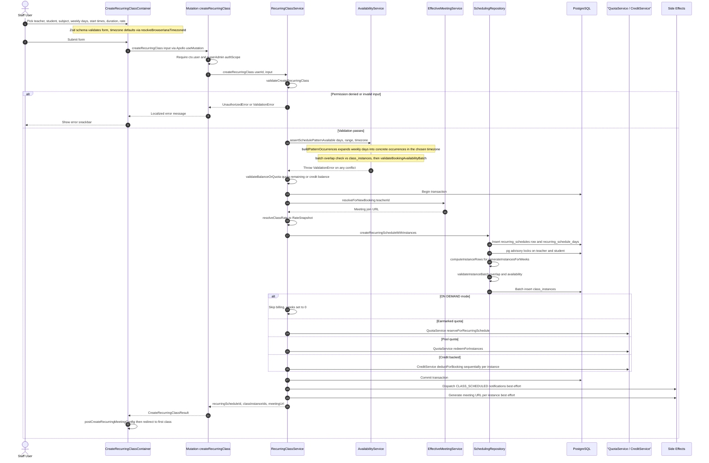

# Recurring Schedule Creation

A staff user opens the recurring-schedules dashboard (`app/(dashboard)/recurring-schedules`) and fills the `CreateRecurringClassContainer` form with teacher, student, subject, weekly days and start times, duration, rate, and timezone (defaulted from the browser via `resolveBrowserIanaTimezoneId`). On submit, `useCreateRecurringClassViewModel` runs the Zod-validated form through the GraphQL `createRecurringClass` mutation (a parallel server-action entry exists at `app/(dashboard)/classes/new/actions.ts`), which forwards the input to `RecurringClassService.createRecurringClass`. The service first validates the caller's `SCHEDULE_CREATE_CLASS` permission, required fields, and subject, then resolves the timezone-aware schedule pattern and asks `AvailabilityService.assertSchedulePatternAvailable` to build concrete occurrences and batch-check them against existing `class_instances` and the teacher's availability windows — any conflict throws a localized `ValidationError`. It also verifies the student has quota remaining or a positive credit balance before persisting. Inside a single transaction, `SchedulingRepository.createRecurringScheduleWithInstances` inserts the `recurring_schedules` row plus its `recurring_schedule_days`, takes advisory locks, computes instance rows for the configured number of weeks, and batch-inserts the `class_instances`, billing then runs in one of three branches (earmarked quota reservation, pool-quota redemption, or sequential `CreditService.deductForBooking` per instance), skipped entirely for `ON_DEMAND` mode. After commit, best-effort side effects fire: `CLASS_SCHEDULED` notifications to parent/teacher/student and per-instance meeting URL generation — neither failure type surfaces to the caller. The client receives the schedule id, instance ids, and first meeting URL, optionally posts the meeting config, and redirects to the first class instance.

## Key sources

- `app/(dashboard)/recurring-schedules/page.tsx` — list page entry (also `app/(dashboard)/classes/new/actions.ts` server action)
- `frontend/common/views/dashboard/classes/recurring/CreateRecurringClassContainer.tsx` and `useCreateRecurringClassViewModel.ts` — form, timezone defaulting, mutation submit
- `backend/graphql/mutation/scheduling/schedule.mutation.ts` — `createRecurringClass` mutation field
- `backend/graphql/pothos/classes/recurring-class.pothos.ts` — input/result object definitions
- `backend/services/schedule/recurring-class.service.ts` — orchestration: validation, transaction, billing branches, notifications, meeting URLs
- `backend/services/scheduling/availability.service.ts` — `assertSchedulePatternAvailable` conflict checks
- `backend/db/repo/scheduling/recurring.ts` — `createRecurringScheduleWithInstances` persistence
- `backend/services/schedule/resolve-viewer-timezone.ts` — viewer timezone resolution (user profile, then system default)

Standalone copy: [recurring-schedule-creation.mmd](./recurring-schedule-creation.mmd)
