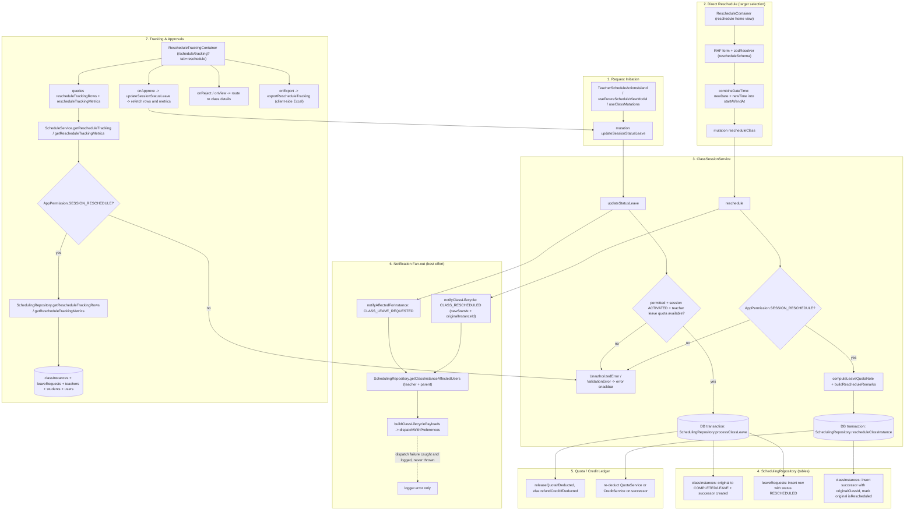

# Reschedule Request & Tracking

The reschedule workflow has two entry paths for the same domain. On the client, a teacher (or an authorized admin) submits a leave/reschedule request against a class instance from the teacher dashboard, future-schedule, or class-details surfaces via the `updateSessionStatusLeave` GraphQL mutation; alternatively, an admin uses the `RescheduleContainer` form to pick a new date/time (target selection) and calls the `rescheduleClass` mutation. Both mutations land in `ClassSessionService`, which enforces permissions (`SESSION_UPDATE_STATUS_LEAVE` / `SESSION_RESCHEDULE`), validates the session is ACTIVATED and the teacher's monthly leave quota is available, then runs a DB transaction: the leave path marks the original instance COMPLETED/LEAVE, creates a successor instance and a `leaveRequests` row (status RESCHEDULED); the direct-reschedule path inserts a successor linked by `originalClassId` and marks the original `isRescheduled`. Quota/credit accounting runs inside the same transaction — the original's deduction is released or credit-refunded and re-deducted against the successor, so no free class leaks. After commit, a best-effort notification fan-out (`CLASS_LEAVE_REQUESTED` or `CLASS_RESCHEDULED`) resolves the affected teacher and parent users and dispatches via `dispatchWithPreferences`; dispatch failures are caught and logged, never thrown. The tracking page (`/schedule/tracking?tab=reschedule` — the `reschedule` route itself just redirects to this tab) guards on `SESSION_RESCHEDULE`, reads joined `classInstances`/`leaveRequests`/`teachers`/`students`/`users` rows plus metrics, and lets approvers approve a pending request (which re-enters `updateSessionStatusLeave` and the fan-out) or reject/view by navigating to the class details page. Edge cases handled client-side: missing `originalClassId` on a tracking row blocks approve/reject with an error snackbar, an invalid date/time combination aborts the form submission before the mutation fires, and mutation errors surface as notifications.

## Key sources

- `app/(dashboard)/schedule/tracking/reschedule/page.tsx`
- `app/(dashboard)/schedule/tracking/page.tsx`
- `frontend/common/views/dashboard/reschedule/home/RescheduleContainer.tsx`
- `frontend/common/views/dashboard/reschedule/home/useRescheduleViewModel.ts`
- `frontend/common/views/dashboard/reschedule/tracking/useRescheduleTrackingViewModel.ts`
- `frontend/common/views/dashboard/teachers/futureSchedule/useFutureScheduleViewModel.ts`
- `frontend/common/graphql/sharedDocuments/scheduling/class-session.documents.ts`
- `backend/graphql/mutation/classes/class-session.mutation.ts`
- `backend/graphql/query/scheduling/schedule.query.ts`
- `backend/services/session/class-session.service.ts`
- `backend/services/schedule/schedule.service.ts`
- `backend/db/repo/scheduling/state-changes.ts`
- `backend/db/repo/scheduling/scheduling-queries.repository/reschedule-tracking.repository.ts`

Machine-checkable copy: [reschedule-tracking.mmd](./reschedule-tracking.mmd)
