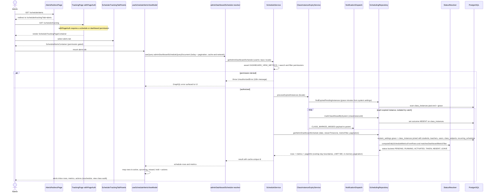

# Schedule Alerts Inbox

The Schedule Alerts Inbox is how admins SEE schedule anomalies — missed classes, frozen (on-hold) sessions, and active or upcoming sessions needing attention — on the dashboard. The legacy route `/schedule/alerts` only redirects to `/schedule/tracking?tab=alerts`, where `withPageAuth` gates the page on schedule or dashboard-metrics permissions and `ScheduleTrackingTabPanels` lazily renders the permission-gated alerts tab. The client entry point is `useScheduleAlertsViewModel`, which issues the Apollo query `adminDashboardScheduleQueryDocument` (today's date, paginated, `cache-and-network`). The GraphQL resolver calls `ScheduleService.getAdminDashboardSchedule`, which first enforces `DASHBOARD_VIEW_METRICS` (plus search/filter permissions when those args are present), then runs `ClassInstanceExpiryService.processExpiredInstances` as a foreground sweep: any `class_instances` row still pending past its end time plus the grace window (`session_missed_grace_minutes` from `system_settings`) is auto-marked ABSENT via `markClassMissedBySystem`, and the parent is notified with a `CLASS_MARKED_MISSED` payload inside an isolated try/catch so one failure never breaks the response. `SchedulingRepository.getAdminDashboardSchedule` then loads the day's rows (overlap-based day boundaries, joins to `students`, `teachers`, `users`, `class_subjects`, `recurring_schedules`, LIMIT 500) and `computeDailyScheduleMetricsFromRows` buckets each row by resolved dashboard status (PENDING, RUNNING, ACTIVATED, TAKEN, ABSENT, LEAVE) for the metrics cards. Finally the view-model maps rows to alert statuses — `active`, `upcoming`, `missed`, or `hold` (when `isFrozen`) — and derives the row action (`leave_enabled`, `leave_disabled`, `view_class_audit`, `contact_admin`); admins act via navigation to `/schedule/tracking/reschedule?classInstanceId=...` or `/classes/{id}/audit`. Edge cases: an invalid date parameter falls back to today, unauthorized access throws an i18n `UnauthorizedError` (logged as a domain error), and `ScheduleQueryService.getStatusTrackingSchedule` powers the sibling status tab with the same rows plus `EffectiveMeetingService` join links.

## Key sources

- `app/(dashboard)/schedule/alerts/page.tsx` — redirect entry point
- `app/(dashboard)/schedule/tracking/page.tsx` — `withPageAuth` permission gate
- `frontend/common/views/dashboard/schedule/tracking/ScheduleTrackingTabPanels.tsx` — alerts tab wiring
- `frontend/common/views/dashboard/schedule/alerts/useScheduleAlertsViewModel.ts` — client view-model, query, status/action mapping
- `frontend/common/views/dashboard/schedule/alerts/types.ts` — `ScheduleAlert` types and statuses
- `frontend/common/views/dashboard/schedule/alerts/ScheduleAlertsContainer.tsx` — container
- `backend/graphql/query/scheduling/schedule.query.ts` — `adminDashboardSchedule` query field
- `backend/services/schedule/schedule.service.ts` — `getAdminDashboardSchedule` orchestration and permission checks
- `backend/services/schedule/schedule-query.service.ts` — sibling status-tracking read service (from the spec)
- `backend/services/session/class-instance-expiry.service.ts` — auto-mark-missed sweep and parent notification
- `backend/db/repo/scheduling/scheduling-queries.repository/daily-schedule.repository.ts` — dashboard schedule query assembly
- `backend/db/repo/scheduling/scheduling-queries.repository/daily-schedule.utils.ts` — day-boundary filters and row hydration
- `shared/lib/schedule/schedule-instance-dashboard-status.ts` — status resolution and metric bucketing

View the standalone diagram: [schedule-alerts.mmd](schedule-alerts.mmd)
