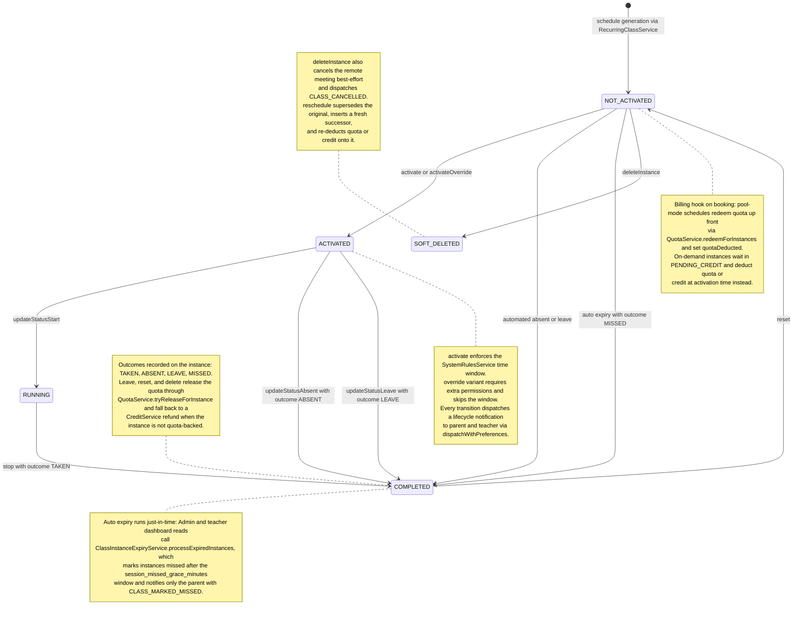

# Class Session Lifecycle & Expiry

A class instance is born as a `NOT_ACTIVATED` row (outcome `PENDING`) generated from a recurring schedule — pool-mode schedules redeem student quota up front via `QuotaService.redeemForInstances` and stamp `quotaDeducted`, while on-demand instances wait in `PENDING_CREDIT` and deduct quota or credit when activated. Staff (or admins via override) activate the instance once `SystemRulesService` accepts the activation time window, then mark it started (`RUNNING`) and finally stop it into `COMPLETED`/`TAKEN`; alternatively they mark it `ABSENT` (after the absent waiting period) or `LEAVE` (which releases quota or refunds credit). Auto-expiry is cronless and just-in-time: admin and teacher dashboard reads call `ClassInstanceExpiryService.processExpiredInstances`, which finds instances past the `session_missed_grace_minutes` window, marks them `COMPLETED`/`MISSED` via `markClassMissedBySystem`, and notifies only the parent with `CLASS_MARKED_MISSED`. Every manual transition is permission-gated, validated against the allowed state machine, and followed by a cache invalidation plus a `CLASS_*` lifecycle notification to parent and teacher via `dispatchWithPreferences`. Admins can additionally `deleteInstance` (soft-delete with quota release or credit refund and best-effort meeting cancel), `reschedule` (supersede the original, insert a fresh successor, and re-deduct quota or credit onto it), or `reset` the instance back to `NOT_ACTIVATED` with the same refund-or-release handling. Edge cases: dispatch failures are logged and never fail the action, quota release on a quota-backed instance that fails does NOT trigger a phantom credit refund, and missing `recurringScheduleId` on a deducted instance is logged as `quota_release_skipped_no_schedule`.

## Key sources

- `backend/services/session/class-session.service.ts`
- `backend/services/session/class-instance-expiry.service.ts`
- `backend/services/scheduling/state-change-validation.service.ts`
- `backend/services/schedule/recurring-class.service.ts`
- `backend/services/schedule/schedule.service.ts`
- `backend/services/teacher/teacher-dashboard.service.ts`
- `backend/db/repo/scheduling/state-changes.ts`

## Diagram

Machine-checkable copy: [session-lifecycle.mmd](./session-lifecycle.mmd)
