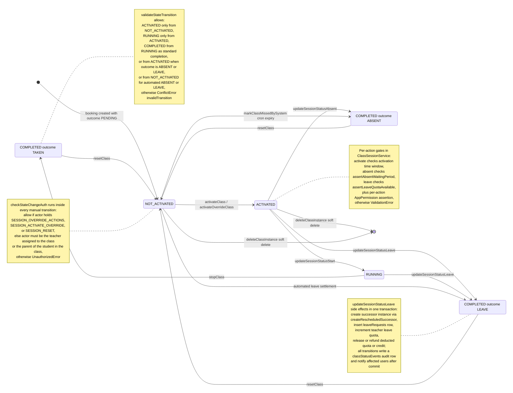

# Schedule Status Change & Validation

A class instance moves through the `executionState` machine `NOT_ACTIVATED → ACTIVATED → RUNNING → COMPLETED`, with `COMPLETED` rows carrying a final `outcome` of `TAKEN`, `ABSENT`, or `LEAVE`. Actors are the assigned teacher, the student's parent, or a privileged admin; manual transitions enter through the dashboard tracking/status surfaces (the `/schedule/tracking/status` route redirects to `/schedule/tracking?tab=status`) and teacher dashboard actions, which call the GraphQL mutations `activateClass`, `updateSessionStatusStart`, `updateSessionStatusAbsent`, `updateSessionStatusLeave`, `stopClass`, `resetClass`, and `deleteClassInstance` in `class-session.mutation.ts`. `ClassSessionService` in `backend/services/session/class-session.service.ts` first asserts the action-specific permission (`SESSION_UPDATE_STATUS_*`, `SESSION_RESET`, etc.) and system rules (activation time window, absent waiting period, teacher leave quota), then delegates to `SchedulingRepository` state-change functions that `runStateChange` inside one transaction. Every manual transition additionally runs two hooks from `state-change-validation.service.ts`: `checkStateChangeAuth` (privileged-override permission, else teacher-of-class or parent-of-student, else `UnauthorizedError`) and `validateStateTransition` (legal per-state moves only, else `ConflictError invalidTransition`). Each applied transition updates `classInstances` and appends a `classStatusEvents` audit row, then a lifecycle notification (`CLASS_STARTED`, `CLASS_MARKED_ABSENT`, `CLASS_LEAVE_REQUESTED`, ...) is dispatched to affected users after commit. Edge paths: the expiry cron path `markClassMissedBySystem` auto-completes stale `NOT_ACTIVATED` rows as `ABSENT`; the leave path completes the original as `LEAVE` and creates a rescheduled successor instance plus a `leaveRequests` row and teacher leave-quota increment, all transactionally; `resetClass` (admin only) returns any finished or live instance to `NOT_ACTIVATED`/`PENDING`, and `deleteClassInstance` soft-deletes with quota/credit release.

## Key sources

- `app/(dashboard)/schedule/tracking/status/page.tsx` — redirects to `/schedule/tracking?tab=status`
- `app/(dashboard)/schedule/tracking/page.tsx` — renders `ScheduleTrackingPageContainer`
- `frontend/common/views/dashboard/teachers/dashboard/components/TeacherScheduleActionsIsland.tsx` — client component issuing the status mutations
- `backend/graphql/mutation/classes/class-session.mutation.ts` — GraphQL entry points for all status actions
- `backend/services/session/class-session.service.ts` — `ClassSessionService` permission asserts, system-rule checks, transaction orchestration, notifications
- `backend/services/scheduling/state-change-validation.service.ts` — `checkStateChangeAuth`, `validateStateTransition`, `validateRescheduleState`
- `backend/db/repo/scheduling/state-changes.ts` — `runStateChange`, `updateInstanceState`, `markClassAbsent`, `processClassLeave`, `resetClassInstance`, `markClassMissedBySystem`
- `backend/services/session/class-instance-expiry.service.ts` — cron-style automated `ABSENT` settlement of expired pending instances

## Diagram

Machine-checkable copy: [status-change.mmd](./status-change.mmd)
