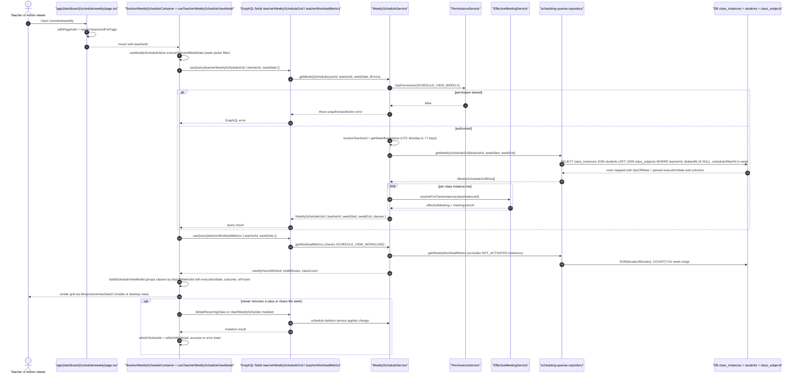

# Weekly Schedule Board

The Weekly Schedule Board renders a teacher's week as a grid of class instances. Entry is the App Router page `app/(dashboard)/schedule/weekly/page.tsx`, which wraps auth via `withPageAuth`, resolves the viewer's teacher with `requireTeacherIdForPage`, and mounts `TeacherWeeklyScheduleContainer`; its ViewModel (`useTeacherWeeklyScheduleViewModel`) reads the selected week from `useWeeklyScheduleStore` and issues the `teacherWeeklyScheduleGrid` and `teacherWorkloadMetrics` GraphQL queries with `{ teacherId, weekDate }` as the effective filters. On the backend, `WeeklyScheduleService.getWeeklySchedule` enforces the `SCHEDULE_VIEW_WEEKLY` permission (throwing `unauthorizedAction` otherwise), resolves the target teacher via `resolveTeacherId`, derives UTC Monday-to-Monday week boundaries from `weekDate` in `getWeekBoundaries`, and loads rows through `getWeeklyScheduleGrid` in `scheduling-queries.repository/teacher-schedule.repository.ts`, which joins `class_instances` to `students` and `class_subjects` for the week range, excluding soft-deleted instances, and tags each row with a UTC `dayOfWeek` plus parsed `executionState`, `outcome`, and `isFrozen` flags. Each instance is additionally enriched with an effective meeting configuration and `meetingJoinUrl` via `EffectiveMeetingService.resolveForClassInstance`; `getWorkloadMetrics` separately enforces `SCHEDULE_VIEW_WORKLOAD` and aggregates weekly hours and class count, excluding `NOT_ACTIVATED` instances. Note that the day-boundary/timezone-aware viewer variant (`resolveViewerTimezone`) lives in the sibling `schedule.service.ts`/`schedule-query.service.ts`; the weekly board itself buckets by UTC week and UTC day-of-week. On the client, `buildScheduleViewModel` reshapes classes per day/slot for the mobile or desktop view chosen by `ResponsiveViewSwitch`, and side-effect mutations (`deleteRecurringClass`, `clearWeeklySchedule`, `createRecurringClass`) refetch both queries and surface a success or error toast on completion.

## Key sources

- `app/(dashboard)/schedule/weekly/page.tsx` — auth-gated page entry, teacher resolution, container mount
- `frontend/common/views/dashboard/teachers/schedule/weekly/TeacherWeeklyScheduleContainer.tsx` — responsive view switch + permission-gated create dialog
- `frontend/common/views/dashboard/teachers/schedule/weekly/useTeacherWeeklyScheduleViewModel.ts` — week-filter store, queries, mutations, refetch/toast flow
- `backend/graphql/query/scheduling/__shared__/makeWeeklyScheduleQueryField.ts` — `teacherWeeklyScheduleGrid` / `teacherWorkloadMetrics` Pothos fields
- `backend/services/schedule/weekly-schedule.service.ts` — permission checks, week boundaries, grid assembly, workload metrics
- `backend/services/schedule/resolve-viewer-timezone.ts` — viewer timezone helper (used by sibling schedule services, not the weekly grid)
- `backend/db/repo/scheduling/scheduling-queries.repository/teacher-schedule.repository.ts` — `getWeeklyScheduleGrid` / `getWeeklyWorkloadMetrics` SQL over `class_instances`, `students`, `class_subjects`

## Diagram

Machine-checkable copy: [weekly-schedule-view.mmd](./weekly-schedule-view.mmd)
