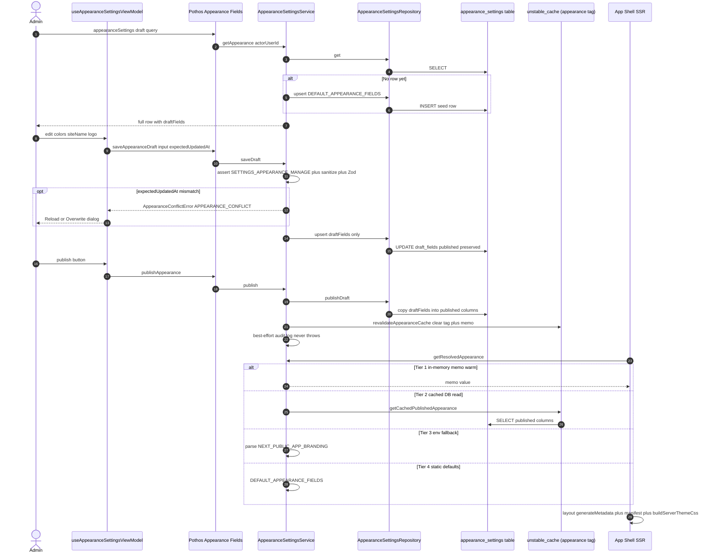

# Appearance Settings

Appearance settings manage the site's theme colors, logo, site name/title/description, and default color scheme through a single global `appearance_settings` row that keeps **published** columns separate from a **draft** JSONB payload. An admin edits branding in the Settings → Appearance tab (or the customize overlay), which drives the GraphQL `saveAppearanceDraft` / `publishAppearance` / `resetAppearanceDraft` mutations into `AppearanceSettingsService`. `saveDraft` enforces the `SETTINGS_APPEARANCE_MANAGE` permission, sanitizes and Zod-validates the input, replaces only `draft_fields` (published columns stay live), and supports optimistic concurrency via `expectedUpdatedAt` — a mismatch throws `AppearanceConflictError`, which the frontend surfaces as a Reload/Overwrite dialog. `publish` copies the draft into the published columns, calls `revalidateAppearanceCache()` (`revalidateTag("appearance")` plus clearing the in-memory memo), and emits a best-effort audit entry; the first admin access seeds the row with preset-driven defaults. The effective appearance reaches the app shell through `getResolvedAppearance()`, a 4-tier resolution ladder: a 15-second in-memory memo, an `unstable_cache`-tagged DB read, the `NEXT_PUBLIC_APP_BRANDING` env fallback, and finally the static `DEFAULT_APPEARANCE_FIELDS`. `app/layout.tsx` (`generateMetadata`, `buildServerThemeCss`) and `app/manifest.ts` consume this on every SSR render, so a publish invalidates the cache and the next request paints the new branding without redeploy.

## Key sources

- `backend/services/appearance/appearance-settings.service.ts` — service: getAppearance, saveDraft/publish/resetDraft, getResolvedAppearance ladder, conflict error, defaults
- `backend/graphql/query/system/site-appearance-settings.query.ts` — `appearanceSettings` query with draft permission gate
- `backend/graphql/mutation/system/site-appearance-settings.mutation.ts` — `saveAppearanceDraft` / `publishAppearance` / `resetAppearanceDraft` mutations
- `backend/db/schema/appearance/appearance-settings.schema.ts` — single-row table: published columns + `draft_fields` JSONB
- `app/(dashboard)/settings/page.tsx` — settings page entry (`withPageAuth`, includes `SETTINGS_APPEARANCE_MANAGE`)
- `frontend/common/views/dashboard/settings/tabs/appearance/useAppearanceSettingsViewModel.ts` — ViewModel owning the mutations and toasts
- `app/layout.tsx` — SSR consumption: `generateMetadata`, theme-mode resolution, inline server theme CSS
- `frontend/common/lib/server-theme-css.ts` — `buildServerThemeCss` / `resolveServerThemeMode`
- `app/manifest.ts` — PWA manifest built from published appearance

## Diagram

Machine-checkable copy: [appearance.mmd](./appearance.mmd)
