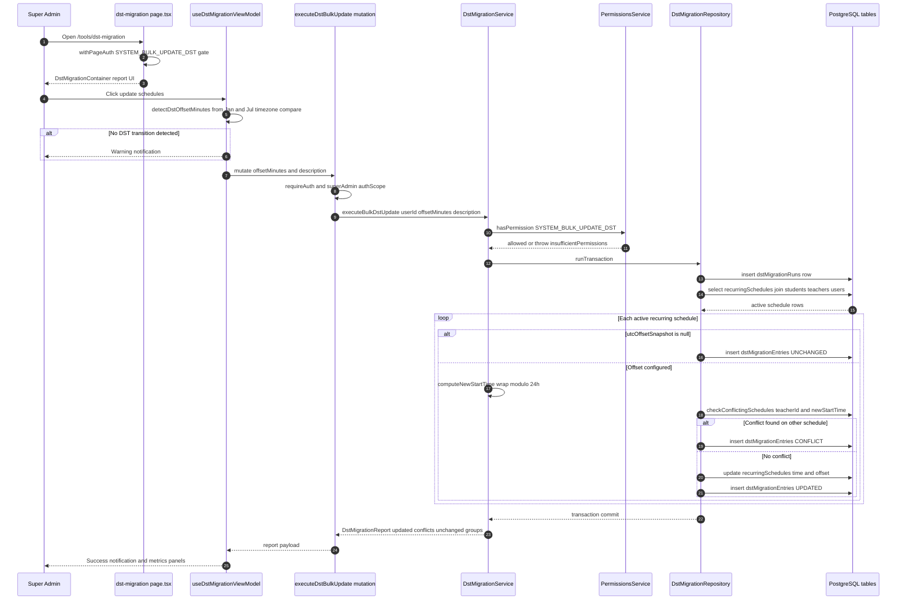

# DST Migration Tool

The DST Migration Tool is a super-admin maintenance screen that bulk-shifts all active recurring class schedules by the detected daylight-saving offset. An admin opens the `tools/dst-migration` page, which is guarded by the `SYSTEM_BULK_UPDATE_DST` permission in `withPageAuth`. On click, the frontend view model detects the browser's DST offset by comparing January and July `Date` timezone offsets and aborts with a warning when no transition is active. Otherwise it calls the `executeDstBulkUpdate` GraphQL mutation (superAdmin auth scope + `requireAuth`), which delegates to `DstMigrationService.executeBulkDstUpdate`. The service re-checks the permission, then runs the whole migration inside a single Drizzle transaction: it records a `dstMigrationRuns` audit row, loads all non-deleted `recurringSchedules` (joined to `students`/`teachers`/`users`), and processes each schedule sequentially. Schedules lacking a `utcOffsetSnapshot` are logged as UNCHANGED entries; otherwise the service computes a new start time with 24-hour wrap-around, checks for a conflicting schedule at the same time for the same teacher, and either records a CONFLICT entry or updates the schedule's `defaultStartTime`/`utcOffsetSnapshot` and records an UPDATED entry in `dstMigrationEntries`. The aggregated report — counts, updated sessions, per-teacher conflict groups, and skipped items — is returned to the UI, which renders metrics panels and a success/error notification.

## Key sources

- `app/(dashboard)/tools/dst-migration/page.tsx` — permission-gated page entry (`withPageAuth` + `SYSTEM_BULK_UPDATE_DST`)
- `frontend/common/views/dashboard/tools/dst-migration/DstMigrationContainer.tsx` — report UI container
- `frontend/common/views/dashboard/tools/dst-migration/useDstMigrationViewModel.ts` — DST offset detection, mutation wiring, notifications
- `backend/graphql/mutation/classes/dst-migration.mutation.ts` — `executeDstBulkUpdate` mutation definition
- `backend/services/system/dst-migration.service.ts` — permission check, per-schedule process loop, conflict grouping
- `backend/db/repo/classes/dst-migration.repository.ts` — transaction wrapper and all `dstMigrationRuns` / `dstMigrationEntries` / `recurringSchedules` reads and writes

## Diagram

Machine-checkable copy: [dst-migration-tool.mmd](./dst-migration-tool.mmd)
