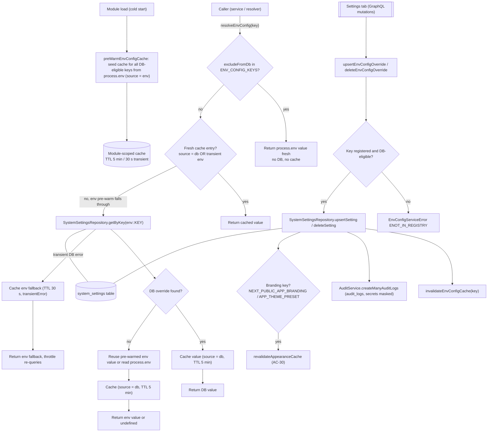

# Environment Config Service

The environment-config service is the single source of truth for resolving configuration values that can be overridden per-environment through the database. At module load — i.e. on every serverless cold start — `preWarmEnvConfigCache()` seeds a module-scoped in-memory cache with `process.env` values for every DB-eligible key, so the first real lookups avoid redundant env re-reads. Callers (backend services and resolvers) use `resolveEnvConfig(key)` / `resolveEnvConfigMany(keys)`, which resolve each key with DB-first / env-fallback precedence: `excludeFromDb` keys in the `ENV_CONFIG_KEYS` registry bypass the DB and cache entirely and are always read fresh from `process.env`, while DB-eligible keys consult `system_settings` under the `env::<KEY>` prefix and cache the result for 5 minutes (`ENV_CONFIG_CACHE_TTL_MS`). Crucially, pre-warmed `source = "env"` entries are non-authoritative and fall through to one DB lookup on first access, so DB overrides always win; transient DB errors (cold-start connectivity) are cached with a short 30-second TTL to throttle re-queries against a failing database. Writes come from the Settings → Environment Config tab GraphQL mutations (`upsertEnvConfigOverride` / `deleteEnvConfigOverride`), which validate the key against the registry (rejecting unknown or excluded keys with a typed `EnvConfigServiceError`), persist via `SystemSettingsRepository`, invalidate the resolver cache, and — for branding keys (`NEXT_PUBLIC_APP_BRANDING`, `APP_THEME_PRESET`) — best-effort invalidate the SSR appearance cache (AC-30) so the next render picks up the change. Every change is audited via `AuditService.createManyAuditLogs` with secret values masked as `"***"`, and the list path (`listEnvConfigEntries`) masks secrets and omits env-only keys so they never reach GraphQL or the frontend.

## Key sources

- `backend/services/system/environment-config.service.ts` — read/write/delete/list/audit paths, module-scoped TTL cache, and module-load pre-warm
- `backend/lib/env-config-keys.ts` — `ENV_CONFIG_KEYS` registry with `excludeFromDb` / `isSecret` / `displayStrategy` descriptors
- `backend/graphql/pothos/system/environment-config.pothos.ts` — GraphQL object types, auth guards (`canViewEnvironmentConfig`), audit-wrapped mutation executor (`executeEnvConfigMutation`)

## Diagram

Machine-checkable copy: [environment-config.mmd](./environment-config.mmd)
