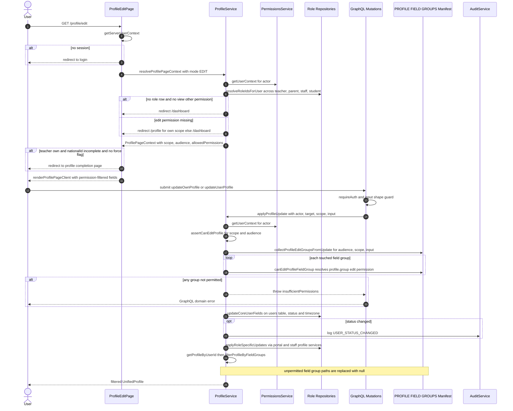

# Profile Edit with Field-Level ACL

The profile edit flow lets a teacher, parent, staff member, or an admin acting on another user edit profile data, with every field gated by a role-aware permission manifest. The SSR page at `app/(dashboard)/profile/edit` first resolves the actor's session and calls `ProfileService.resolvePageContext` in `EDIT` mode, which derives the target's audience (teacher/parent/staff/student) from role rows, checks the actor's `AppPermission` set via `PermissionsService`, and redirects to `/profile` or `/dashboard` when access is denied. Teachers editing their own profile are additionally redirected to a forced profile-completion flow when `nationalIdComplete` is false. On submit, the client calls the `updateOwnProfile` or `updateUserProfile` GraphQL mutations, which delegate to `ProfileService.applyProfileUpdate`: after a scope/audience-level edit assertion, `collectProfileEditGroupsFromUpdate` maps the submitted input keys onto field groups from `PROFILE_FIELD_GROUPS`, and each group is checked with `canEditProfileFieldGroup` (`profile.<group>.edit_own|edit_other`); any unauthorized group throws an `insufficientPermissions` domain error before any write happens. Permitted writes fan out to `UserRepository` core fields (with an `AuditService` `USER_STATUS_CHANGED` log for status changes) plus the teacher/parent/staff role services. The mutation returns a rebuilt profile via `getProfileByUserId`, where `filterProfileByFieldGroups` nulls out every field group the actor lacks a view permission for, so the response itself is field-filtered per role.

## Key sources

- `app/(dashboard)/profile/edit/page.tsx` — SSR entry point: session guard, `resolveProfilePageContext(EDIT)`, teacher `nationalIdComplete` completion-redirect gate
- `backend/services/profile/profile.service.ts` — `resolvePageContext`, `applyProfileUpdate`, `updateCoreUserFields`, role-specific update dispatch, audit logging
- `backend/services/profile/profile-field-manifest.ts` — `PROFILE_FIELD_GROUPS` manifest mapping field paths to per-group view/edit permissions per audience and scope
- `backend/services/profile/profile-field-filter.ts` — `filterProfileByFieldGroups`, `canEditProfileFieldGroup`, `collectProfileEditGroupsFromUpdate`
- `backend/services/profile/profile-field-filter-bridge.ts` — permission lookup bridging filter context to manifest permissions
- `backend/graphql/mutation/profile/profile.mutation.ts` — `updateOwnProfile` / `updateUserProfile` mutation entry points (`requireAuth`, input guards)

## Diagram

Machine-checkable copy: [profile-edit.mmd](./profile-edit.mmd)
