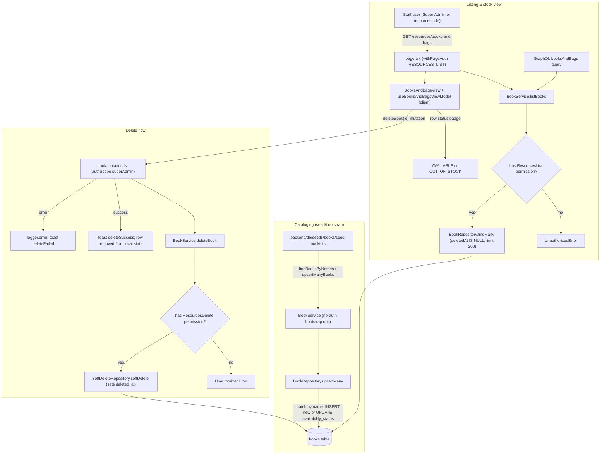

# Books & Learning Resources

The books-and-bags workflow manages the academy's physical book catalog. Cataloging happens at seed/bootstrap time: `seed-books.ts` calls the no-auth `BookService.findBooksByNames` / `BookService.upsertManyBooks`, which match rows by name and either insert new books or update their `availabilityStatus` (`AVAILABLE` / `OUT_OF_STOCK`), giving the academy a stock view of each title. At runtime, a staff user opens `/resources/books-and-bags`, where `page.tsx` (wrapped in `withPageAuth` with `RESOURCES_LIST`) calls `BookService.listBooks` — the same service backs the `booksAndBags` GraphQL query. The service verifies the `ResourcesList` permission via `PermissionsService` and throws `UnauthorizedError` when missing; otherwise `BookRepository.findMany` returns the newest 200 non-soft-deleted rows, which `BooksAndBagsView` renders with a per-book stock-status badge. Deletion flows through the client ViewModel's `deleteBook` mutation (`superAdmin` authScope): `BookService.deleteBook` re-checks `ResourcesDelete`, then `SoftDeleteRepository.softDelete` sets `deleted_at` on the `books` row (records are never hard-deleted), and the ViewModel shows a success/failure toast and prunes the row from local state. Note: books are tracked at catalog level only — there is no per-student assignment table in this slice; distribution is reflected solely through the availability status.

## Key sources

- `app/(dashboard)/resources/books-and-bags/page.tsx` — server page, `withPageAuth` + status mapping
- `backend/services/resource/book.service.ts` — permission checks, list/delete/bootstrap ops
- `backend/db/repo/books/book.repository.ts` — `findMany`, `findById`, soft delete, `upsertMany`
- `backend/db/schema/books/books.ts` — `books` table (id, name, availability_status, created_at, deleted_at)
- `backend/graphql/query/books/book.query.ts` — `booksAndBags` query field
- `backend/graphql/mutation/books/book.mutation.ts` — `deleteBook` mutation (`superAdmin` scope)
- `frontend/common/views/dashboard/resources/books-and-bags/useBooksAndBagsViewModel.ts` — client state, mutation, toasts
- `backend/db/seeds/books/seed-books.ts` — catalog seeding via `findBooksByNames` / `upsertManyBooks`

Machine-readable copy: [resources-books.mmd](./resources-books.mmd)
