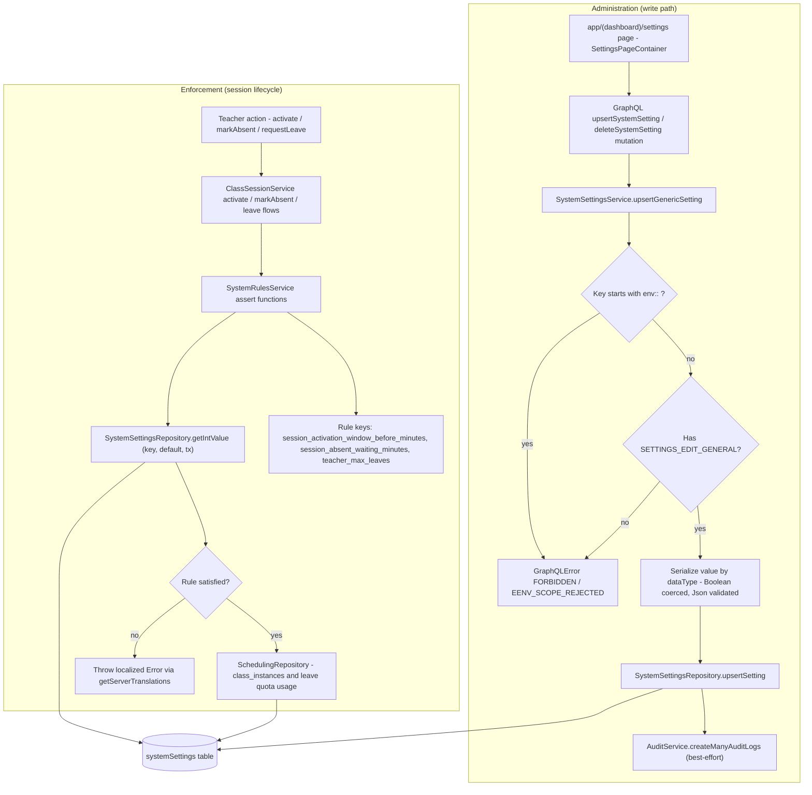

# System Rules Administration

Tenant-level business rules (session activation window, absent-marking waiting period, teacher monthly leave quota) are stored as string rows in the `systemSettings` table and administered from the dashboard Settings page (`app/(dashboard)/settings`), which is guarded by `withPageAuth` and the `SETTINGS_*` permissions. An administrator reads and edits rule values through the GraphQL `systemSettings` query and the `upsertSystemSetting` / `deleteSystemSetting` mutations; the resolver delegates to `SystemSettingsService`, which enforces `SETTINGS_EDIT_GENERAL`, rejects `env::`-prefixed keys with `EENV_SCOPE_REJECTED`, serializes values according to their `dataType` (Boolean coercion, JSON pre-validation), persists via `SystemSettingsRepository.upsertSetting`, and emits a best-effort audit log entry. On the enforcement side, teacher-facing session operations in `ClassSessionService` (activate, mark absent, request leave) call `SystemRulesService` assertions before mutating state; each assertion reads its rule value with `SystemSettingsRepository.getIntValue`, falling back to a hardcoded default (5 minutes, 30 minutes, 2 leaves) when the row is missing or unparseable. If the rule check fails — activation outside the allowed window, an absence marked too early, or a leave quota already exhausted for the current UTC month — the service throws a localized `Error` resolved via `getServerTranslations` so the message reaches the user in their locale; otherwise the flow proceeds through `SchedulingRepository` against `class_instances` and related scheduling tables.

## Key sources

- `backend/services/system/system-rules.service.ts` — the three rule assertions (`assertActivationTimeWindow`, `assertAbsentWaitingPeriod`, `assertLeaveQuotaAvailable`)
- `backend/services/system/system-settings.service.ts` — admin write path (`upsertGenericSetting`, `deleteSettingByKey`, permission/env-scope checks, audit logging)
- `backend/db/repo/shared/system-settings.repository.ts` — typed readers (`getIntValue`, `getStringValue`, `getBooleanValue`, `getJsonValue`) and `upsertSetting`
- `backend/graphql/mutation/system/general-settings.mutation.ts` — `upsertSystemSetting` / `deleteSystemSetting` mutations
- `backend/graphql/query/system/general-settings.query.ts` — `systemSettings` / `systemSetting` queries with view-permission guard
- `backend/graphql/pothos/system/general-settings.pothos.ts` — `SystemSetting` object type, input type, and auth helpers
- `backend/services/session/class-session.service.ts` — enforcement call sites for activate / markAbsent / leave flows
- `app/(dashboard)/settings/page.tsx` — permission-gated settings page entry point
- `frontend/common/views/dashboard/settings/tabs/session/useSessionConfigTabViewModel.ts` — client-side settings tab view-model pattern

Machine-checkable copy: [system-rules.mmd](./system-rules.mmd)
