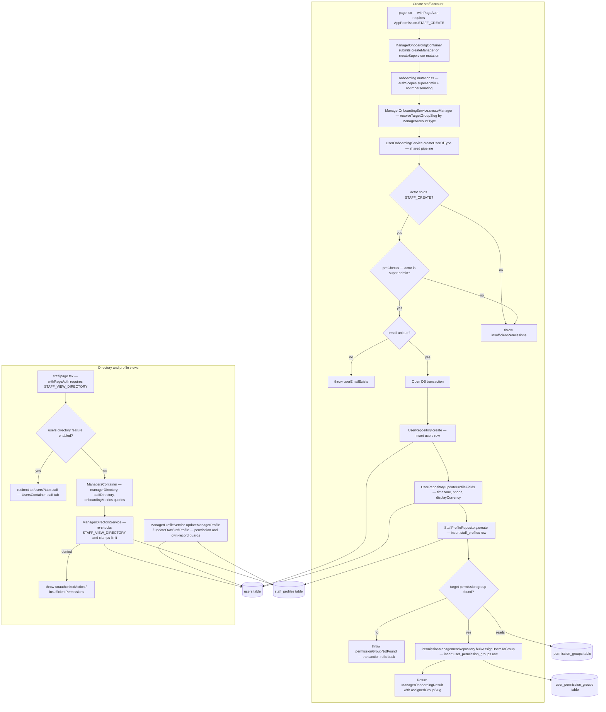

# Staff/Manager Onboarding & Profiles

A super-admin (or holder of the SUPER_ADMIN system group) creates staff accounts from the `/staff/create` dashboard page, which is gated by `withPageAuth` on `AppPermission.STAFF_CREATE` and rendered by `ManagerOnboardingContainer`. The form calls the `createManager` / `createSupervisor` GraphQL mutations (`authScopes: superAdmin, notImpersonating`), which resolve to `ManagerOnboardingService.createManager`; this maps `ManagerAccountType.supervisor` to the `SUPERVISOR_DEFAULT` permission group and everything else to `ACADEMY_ADMIN`. The actual provisioning runs in the shared `UserOnboardingService.createUserOfType` pipeline: it checks the actor's `STAFF_CREATE` permission, runs super-admin pre-checks, verifies email uniqueness, hashes the password, then — inside one DB transaction — inserts the `users` row, writes timezone/phone/displayCurrency profile fields, creates the `staff_profiles` extension row, looks up the target permission group, and assigns it via `user_permission_groups`. Failures (insufficient permissions, duplicate email, missing permission group) throw localized errors and roll everything back; email uniqueness is checked before the transaction, while name/password constraints are enforced by the Pothos input schema. The staff directory page (`/staff`, gated by `STAFF_VIEW_DIRECTORY`) either redirects to `/users?tab=staff` when the unified users directory feature is enabled, or renders `ManagersContainer`, which reads through the `managerDirectory`, `staffDirectory` and `onboardingMetrics` queries into `ManagerDirectoryService` (permission re-check, limit clamping, search/filter). Profile and rate edits go through `ManagerProfileService.updateManagerProfile` (with SUPER_ADMIN / ACADEMY_ADMIN protection rules) or `updateOwnStaffProfile` (own-record phone edits only).

## Key sources

- `app/(dashboard)/staff/create/page.tsx`
- `app/(dashboard)/staff/page.tsx`
- `frontend/common/views/dashboard/staff/onboarding/ManagerOnboardingContainer.tsx`
- `backend/graphql/mutation/shared/onboarding.mutation.ts`
- `backend/graphql/query/teachers/staff-directory.query.ts`
- `backend/graphql/pothos/teachers/manager-onboarding.pothos.ts`
- `backend/services/staff/manager-onboarding.service.ts`
- `backend/services/staff/manager-directory.service.ts`
- `backend/services/staff/manager-profile.service.ts`
- `backend/services/user/user-onboarding.service.ts`
- `backend/db/schema/users/users.ts`, `backend/db/schema/teachers/staff.ts`, `backend/db/schema/permissions/permissions.ts`

Machine-readable copy: [manager-onboarding.mmd](./manager-onboarding.mmd)
