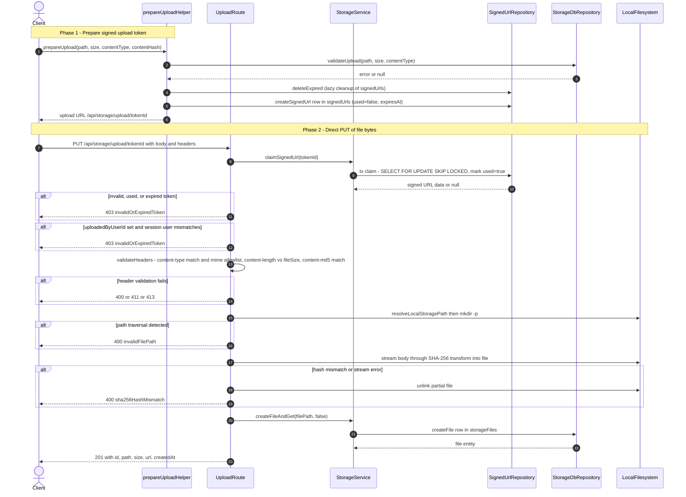

# Direct File Upload Pipeline

Direct upload lets an authenticated client stream raw file bytes to the local-disk storage backend without routing the payload through an app-level buffering step. In a first call, the client asks the storage layer to prepare an upload: `prepareUploadHelper` normalizes the path, validates size/MIME/path via `StorageDbRepository.validateUpload`, lazily purges expired tokens, and inserts a one-shot row into the `signedUrls` table carrying the expected content type, size, SHA-256 `contentHash`, and expiry. It then hands the client an upload URL of the form `/api/storage/upload/{tokenId}`, typically valid for a short signed-URL window. The client issues `PUT /api/storage/upload/[id]` with matching `Content-Type`, `Content-Length`, and `Content-MD5` headers plus the raw body. The route handler atomically claims the token (`SELECT FOR UPDATE SKIP LOCKED`, marking it used so it cannot be replayed), rejects the request if the token is missing/used/expired or if the session user differs from the token's `uploadedByUserId`, and then validates every header against the stored expectations plus the server MIME allowlist. On success the body is streamed through a SHA-256 `Transform` directly into the target file on disk; the final digest is compared with the claimed hash, and any mismatch or stream error deletes the partial file. Finally `StorageService.createFileAndGet` persists the metadata row in `storageFiles` and the handler returns `201` with the file id, path, size, and serving URL. Edge cases are handled conservatively: path-traversal attempts return 400 before any write, header mismatches return 400/411/413, invalid tokens return 403, and any post-write DB failure unlinks the file so disk and database never disagree.

## Key sources

- `app/api/storage/upload/[id]/route.ts` — PUT handler: token claim, session-user check, header validation, SHA-256 streaming write, finalize
- `backend/storage/disk/shared/upload-operations.helper.ts` — `prepareUploadHelper`: path normalization, validation, lazy expiry cleanup, `signedUrls` row creation
- `backend/services/storage/storage.service.ts` — `StorageService.claimSignedUrl`, `createFileAndGet`, `validateUpload`, directory permission checks
- `backend/db/repo/shared/signedUrl.repository.ts` — `claimSignedUrl` (row-locking claim), `createSignedUrl`, `deleteExpired`
- `backend/lib/storage/mime-allowlist.ts` — server-side `ALLOWED_MIME_TYPES` allowlist
- `app/api/storage/vercel-upload/route.ts` — parallel Vercel Blob variant of the same prepare/validate/finalize pattern

## Diagram

Machine-checkable copy: [direct-upload.mmd](./direct-upload.mmd)
