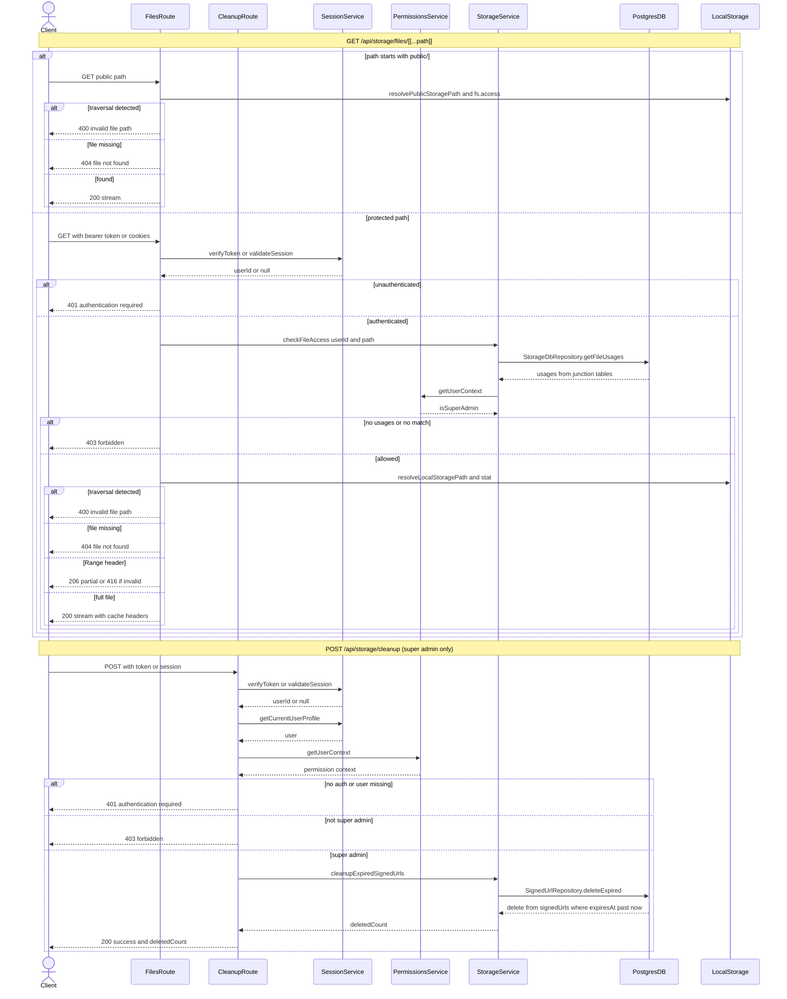

# File Serving & Cleanup

Two API routes manage the local-storage file surface. `GET /api/storage/files/[[...path]]` streams files from the on-disk storage root: paths under `public/` are served anonymously (with path-traversal and existence checks producing 400/404), while all other paths require authentication via bearer token or session cookie and then pass through `StorageService.checkFileAccess`, which default-denies files with no junction-table usages, admits super admins, and otherwise requires a direct user reference or a matching teacher/parent ownership. Successful reads are streamed with hardened headers (`nosniff`, sandboxed CSP, `Content-Disposition: attachment` for non-images), HTTP Range support (206/416), and cache control that is long-lived and immutable for UUID-keyed appearance logos but a one-hour `max-age` for everything else. `POST /api/storage/cleanup` is a manually triggered, super-admin-only maintenance endpoint: it authenticates, loads the user profile, verifies `isSuperAdmin` via `PermissionsService`, then calls `StorageService.cleanupExpiredSignedUrls` → `SignedUrlRepository.deleteExpired` to delete `signed_urls` rows whose `expiresAt` has passed, returning the deleted count (401/403/500 on the failure edges). Note the companion `StorageService.cleanupExpiredFiles` (purges unreferenced file records) exists but is not wired to this route.

## Key sources

- `app/api/storage/files/[[...path]]/route.ts` — authenticated/public GET streaming, range responses, cache-control rules
- `app/api/storage/cleanup/route.ts` — super-admin gated POST that purges expired signed URLs
- `backend/services/storage/storage.service.ts` — `checkFileAccess`, `cleanupExpiredSignedUrls`, `cleanupExpiredFiles`, `validatePath`
- `backend/db/repo/storage/storage.repository.ts` — `getFileUsages` across the junction tables (users, teachers, students, parents, invoices, complaints, learning_resources, staff_profiles, recurring_schedules, class_instances)
- `backend/db/repo/shared/signedUrl.repository.ts` — `deleteExpired` on the `signedUrls` table
- `backend/lib/storage/local-storage-path.ts` — `resolveLocalStoragePath` / `resolvePublicStoragePath` with traversal rejection

Machine-checkable copy: [file-serving-cleanup.mmd](./file-serving-cleanup.mmd)
