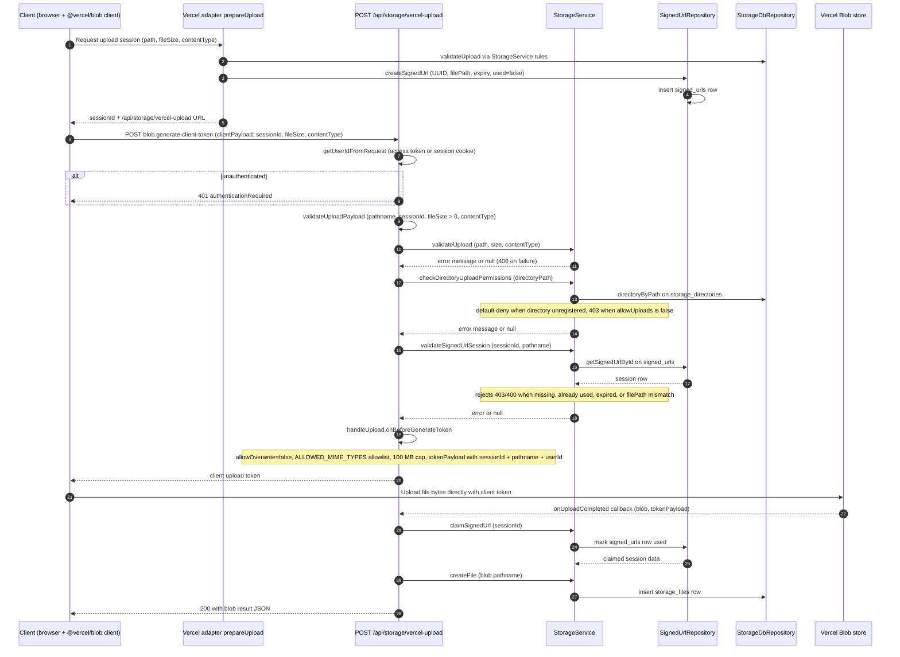

# Vercel Blob Upload Path

The Vercel Blob upload path is the serverless-friendly alternative to direct multipart/buffer uploads: the browser streams file bytes straight to Vercel Blob storage, while the Next.js route only brokers a short-lived client token. The flow begins when the client asks the storage layer for an upload session — the Vercel adapter's `prepareUpload` (via `prepareUploadHelper`) validates the requested path/size/content type, lazily removes expired sessions, persists a `signed_urls` row with a UUID session id and expiry, and points the client at `POST /api/storage/vercel-upload`. The client then uses the `@vercel/blob/client` SDK, which POSTs a `blob.generate-client-token` request carrying the `sessionId`, `fileSize`, and `contentType` in its `clientPayload`. The route authenticates the caller via an access token or session cookie (401 otherwise), re-validates the payload, directory permissions (default-deny when the directory is unregistered, 403 when `allowUploads` is false), and the upload session (403/400 when the session is missing, already used, expired, or its `filePath` mismatches the pathname). If all checks pass, Vercel's `handleUpload` runs `onBeforeGenerateToken`, which enforces a server-side MIME allowlist, a hard 100 MB cap, no overwrite, and embeds `{sessionId, pathname, userId}` in the token payload before returning the client token. The browser then uploads bytes directly to Vercel Blob, and Vercel calls the route's `onUploadCompleted` callback, which claims the signed URL session (marking it used so it cannot be replayed) and creates the `storage_files` record — failures in this final bookkeeping step are logged but not thrown back to the client.

## Key sources

- `app/api/storage/vercel-upload/route.ts` — the POST route: auth, payload/session validation, `handleUpload` token generation, and the `onUploadCompleted` callback.
- `backend/services/storage/storage.service.ts` — `validateUpload`, `checkDirectoryUploadPermissions`, `validateSignedUrlSession`, `claimSignedUrl`, `createFile`.
- `backend/storage/disk/vercel/operations/upload.operations.ts` — `prepareUpload` returning the session id and route URL, buffer-based `put` fallback.
- `backend/storage/disk/shared/upload-operations.helper.ts` — `prepareUploadHelper`: validation, lazy expiry cleanup, and `SignedUrlRepository.createSignedUrl`.

## Diagram

Machine-checkable copy: [vercel-upload.mmd](./vercel-upload.mmd)
