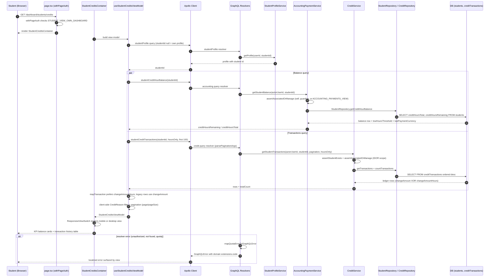

# Student Credit Balance & Consumption View

A logged-in student opens `/dashboard/students/credits`, which is gated by `withPageAuth` against `AppPermission.STUDENT_VIEW_OWN_DASHBOARD` and renders `StudentCreditsContainer`. The container's view model first runs the `studentProfile` query with a null student id so the server resolves the logged-in student's own id, both follow-up queries are skipped until that id exists. It then issues two Apollo queries in parallel: `studentCreditHourBalance`, which flows through `AccountingPaymentService.getStudentBalance` (IDOR-scoped via `assertAssociatedOrManage`) to `StudentRepository.getCreditHourBalance` reading `creditHoursRemaining`/`creditHoursTotal` from the `students` table, and `studentCreditTransactions`, which flows through `CreditService.getStudentTransactions` to `CreditRepository.getTransactions`/`countTransactions` against the `creditTransactions` ledger table. Each ledger row is hour-based or legacy class-based (an XOR between `changeAmountHours` and `changeAmount`), and the view model prefers `changeAmountHours` so hour grants never display as zero, filtering by `CreditReason` and pagination happen client-side over the first 100 rows. The legacy class-unit balance (`studentCreditBalance`) deliberately does not feed this page's KPI cards — it is the hour-domain view only. Result sets are rendered by lazy-loaded mobile or desktop views via `ResponsiveViewSwitch`, and resolver failures are translated to domain GraphQL errors by `mapQuotaErrorToGraphQLError`.

Key sources:

- `app/(dashboard)/students/credits/page.tsx` — auth-gated route entry point
- `frontend/common/views/dashboard/student/credits/StudentCreditsContainer.tsx` — container + responsive view switch
- `frontend/common/views/dashboard/student/credits/useStudentCreditsViewModel.ts` — view model, queries, client-side filter/pagination
- `backend/graphql/query/students/student-profile.query.ts` — `studentProfile` resolver (resolves own student id)
- `backend/graphql/query/billing/accounting.query.ts` — `studentCreditHourBalance` resolver
- `backend/graphql/query/billing/credit.query.ts` — `studentCreditTransactions` resolver
- `backend/services/billing/accounting-payment.service.ts` — `AccountingPaymentService.getStudentBalance`
- `backend/services/billing/credit.service.ts` — `CreditService.getStudentTransactions` / `getStudentHourBalance`
- `backend/db/repo/students/student.repository.ts` — `getCreditHourBalance` (reads `students` table)
- `backend/db/repo/billing/credit.repository.ts` — `getTransactions` (reads `creditTransactions` ledger)

Machine-checkable copy: [credits-view.mmd](./credits-view.mmd)
