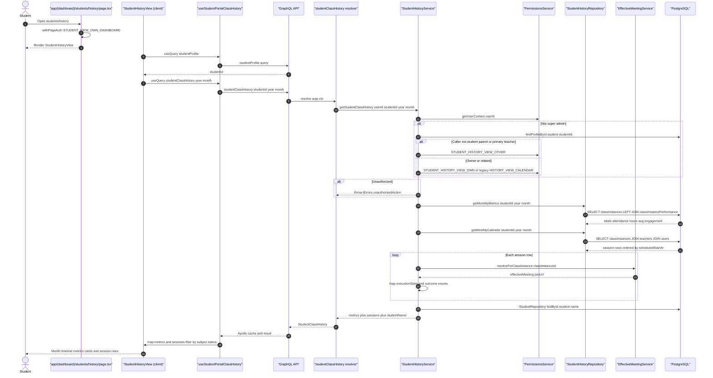

# Student Full History

The student history page gives one student a month-by-month aggregated timeline of their class sessions plus rollup metrics (total completed classes, attendance rate, hours studied, average engagement). A student's own visit flows through `withPageAuth` on the Next.js page, then the client-side `StudentHistoryView` first resolves the caller's student profile to obtain a `studentId`, then fires the `studentClassHistory` GraphQL query for the selected year and month from the `useStudentPortalHistoryStore`. The `StudentHistoryService` performs a strict authorization chain: super-admins pass immediately; otherwise the caller must be the student, their parent, or their primary teacher (validated against `ParentRepository` and `TeacherRepository`), or hold `STUDENT_HISTORY_VIEW_OTHER`, with a legacy `HISTORY_VIEW_CALENDAR` fallback for owners. `StudentHistoryRepository` then queries `classInstances` (joined to `teachers`/`users` for instructor names and to `classInstancePerformance` for engagement scores) filtered by the UTC month window and excluding soft-deleted rows. Each session row is enriched by `EffectiveMeetingService.resolveForClassInstance` with a concrete meeting join URL, and raw `executionState`/`outcome` strings are coerced into typed `ClassExecutionState`/`ClassOutcome` enums with safe defaults. On the client, sessions are mapped by day, filtered by subject and status, and rendered as metric cards plus a timeline. Edge cases include missing student profiles (`studentNotFound`), missing session detail (`notFound`), unauthorized actors (`unauthorizedAction`), and a separate `studentClassSessionDetail` query guarded by `HISTORY_VIEW_DETAILS` that re-checks per-student ownership on the detail view. Note: despite the name, this flow aggregates class-session history only — payments, quotas, and status-change audit events are not part of this code path.

## Key sources

- `app/(dashboard)/students/history/page.tsx` — page entry, `withPageAuth(STUDENT_VIEW_OWN_DASHBOARD)`
- `frontend/common/views/dashboard/student/history/StudentHistoryContainer.tsx` — view container
- `frontend/common/views/dashboard/student/history/hooks/useStudentPortalHistoryData.ts` — Apollo queries, store-backed month navigation, client-side filtering/mapping
- `backend/graphql/query/students/student-history.query.ts` — `studentClassHistory` and `studentClassSessionDetail` resolvers
- `backend/services/history/student-history.service.ts` — authorization chain and session/metric aggregation
- `backend/db/repo/students/student-history.repository.ts` — SQL over `classInstances`, `teachers`, `users`, `classInstancePerformance`

Machine-checkable copy: [history.mmd](./history.mmd)
