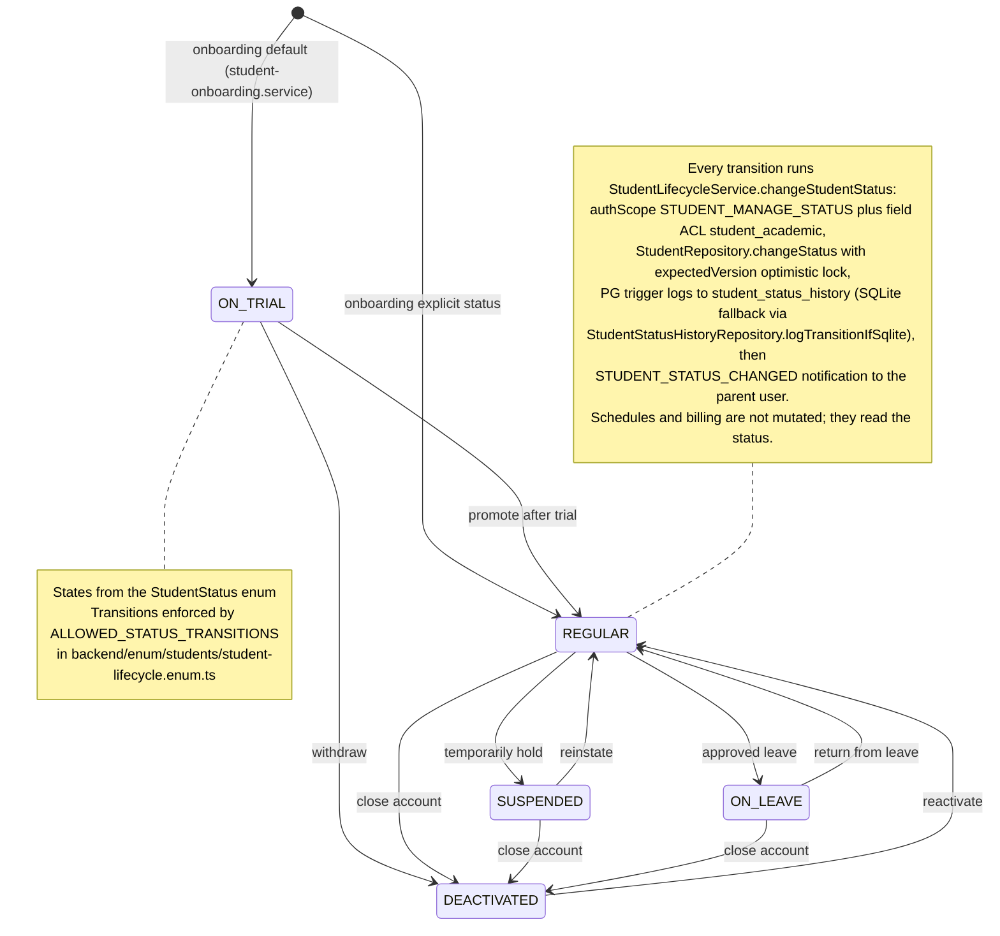

# Student Lifecycle & Status Transitions

A student moves through five lifecycle states defined by the `StudentStatus` enum (`ON_TRIAL`, `REGULAR`, `SUSPENDED`, `ON_LEAVE`, `DEACTIVATED`); onboarding creates the record with `ON_TRIAL` unless a status is supplied explicitly. Managers change a student's status from the status tab of the student profile page (`app/(dashboard)/students/[id]/status/page.tsx` redirects to `profile?tab=status`, rendered by `useStudentStatusViewModel`), which calls the `changeStudentStatus` GraphQL mutation — guarded by the `STUDENT_MANAGE_STATUS` auth scope and an `expectedVersion` optimistic-lock argument. `StudentLifecycleService.changeStudentStatus` additionally enforces field-level ACL on `student_academic`, loads the student (404-style error if missing), and validates the move against the `ALLOWED_STATUS_TRANSITIONS` policy map — only `DEACTIVATED → REGULAR` (reactivation) is allowed out of the terminal-ish `DEACTIVATED` state, and an illegal move raises `invalidStatusTransition`. On acceptance, `StudentRepository.changeStatus` performs a version-checked update to the `students` table; a PostgreSQL trigger (`trg_log_student_status_history`) appends the transition to `student_status_history`, with `StudentStatusHistoryRepository.logTransitionIfSqlite` as the app-layer fallback under SQLite. Finally the parent user receives a `STUDENT_STATUS_CHANGED` notification via `dispatchWithPreferences`; notification and history-log failures are caught and logged, so they never roll back the status change itself. Schedules and billing rows are not mutated by a status change — they consume the status instead (e.g. schedule views join `students.status` for upcoming-class tracking, and parent metrics aggregate counts by `ON_LEAVE`/`SUSPENDED`).

## Key sources

- `backend/services/student/student-lifecycle.service.ts` — `changeStudentStatus` service: permission checks, transition validation, notification dispatch
- `backend/enum/students/student-lifecycle.enum.ts` — `StudentStatus` enum and `ALLOWED_STATUS_TRANSITIONS` policy map
- `shared/constants/student-lifecycle.enum.ts` — canonical shared `StudentStatus` enum values
- `backend/graphql/mutation/students/student-lifecycle.mutation.ts` — `changeStudentStatus` mutation field (auth scope, args, resolver)
- `backend/db/repo/students/student.repository.ts` (line 519) — `changeStatus` version-checked update to the `students` table
- `backend/services/student/student-status.service.ts` — `getUpcomingClasses` (schedule views reading the status)
- `backend/services/student/student-onboarding.service.ts` — initial status assignment (`ON_TRIAL` default)
- `frontend/common/views/dashboard/students/status/useStudentStatusViewModel.ts` — client view model calling the mutation with `expectedVersion`
- `app/(dashboard)/students/[id]/status/page.tsx` — redirect to `profile?tab=status`

Machine-readable copy: [lifecycle-status.mmd](./lifecycle-status.mmd)
