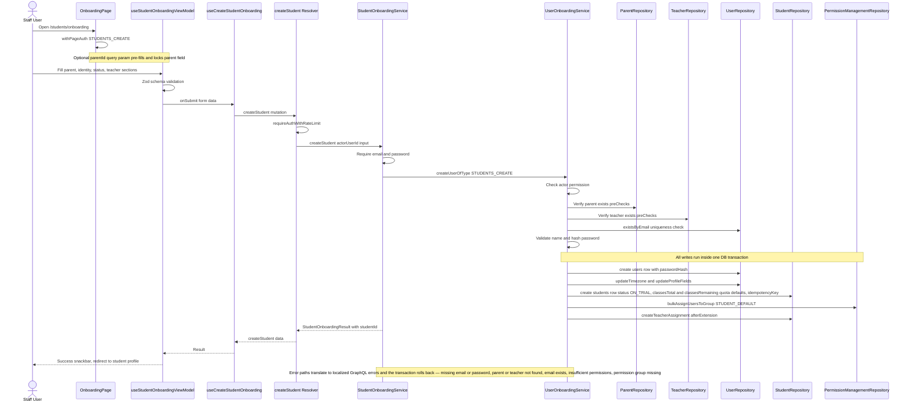

# Student Onboarding

Staff members with the `STUDENTS_CREATE` permission onboard new students from the dashboard page `/(dashboard)/students/onboarding`, which is gated by `withPageAuth`. The page renders a form with three sections — parent assignment, student info, and teacher assignment — managed by `useStudentOnboardingViewModel` with a Zod schema; a `?parentId=` query param pre-fills and locks the parent picker when the flow is launched from a parent's profile. On submit, `useCreateStudentOnboarding` sends the Apollo `createStudent` mutation to the Pothos resolver in `onboarding.mutation.ts`, which enforces auth and rate limiting before delegating to `StudentOnboardingService.createStudent`. That service requires an email and password (every student gets a login account), then runs the shared `UserOnboardingService.createUserOfType` pipeline: permission check, pre-checks that the referenced parent and teacher exist (`ParentRepository.getParentProfile`, `TeacherRepository.findById`), email-uniqueness and name validation, and bcrypt password hashing. Inside a single DB transaction it creates the `users` row (plus timezone, phone, and display-currency profile fields), creates the `students` extension row with status defaulting to `ON_TRIAL` and the `classesTotal` / `classesRemaining` quota fields defaulted to 0, assigns the `STUDENT_DEFAULT` permission group, and finally records a teacher assignment row when a primary teacher was selected. Any domain error — missing email/password, parent or teacher not found, duplicate email, insufficient permissions, or a missing permission group — rolls back the whole transaction and surfaces as a localized GraphQL error shown in the form's error banner. On success the UI shows a snackbar and redirects to the new student's profile page.

## Key sources

- `app/(dashboard)/students/onboarding/page.tsx` — page entry, `withPageAuth` permission gate
- `frontend/common/views/dashboard/students/onboarding/useStudentOnboardingViewModel.ts` — form state, Zod validation, submit wiring
- `frontend/common/views/dashboard/students/onboarding/schemas/studentOnboardingSchema.ts` — form schema
- `frontend/common/hooks/useCreateStudentOnboarding.ts` — Apollo mutation hook
- `backend/graphql/mutation/shared/onboarding.mutation.ts` — `createStudent` Pothos resolver
- `backend/services/student/student-onboarding.service.ts` — student-specific orchestration
- `backend/services/user/user-onboarding.service.ts` — shared `createUserOfType` provisioning pipeline

## Diagram

Machine-checkable copy: [onboarding.mmd](onboarding.mmd)
