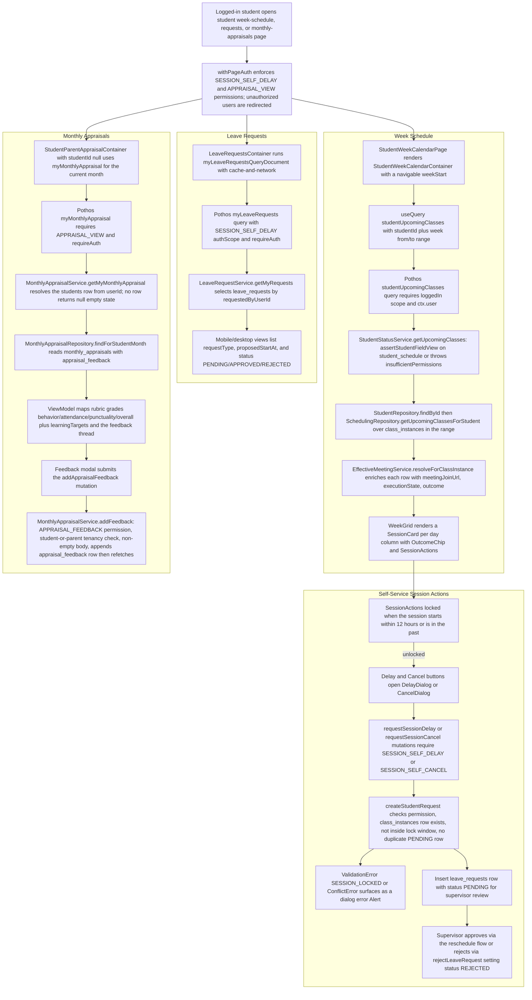

# Student Self Portal & Week Schedule

A logged-in student accesses three self-service surfaces under `app/(dashboard)/student/`: the weekly schedule, the leave-requests list, and monthly appraisals. The week-schedule page renders `StudentWeekCalendarContainer`, which paginates a week window and issues `studentUpcomingClasses`; `StudentStatusService.getUpcomingClasses` enforces the student-field ACL, loads `class_instances` for the range, and enriches each row through `EffectiveMeetingService` with the meeting join URL and execution state. Each session card exposes delay/cancel actions that are disabled within a 12-hour lock window (configurable via `SELF_SERVICE_RESCHEDULE_LOCK_HOURS`); when unlocked, the mutations `requestSessionDelay`/`requestSessionCancel` go through `LeaveRequestService`, which validates permissions, session existence, the lock window, and duplicate PENDING requests before inserting a `leave_requests` row for supervisor review. The requests page lists the student's own `leave_requests` rows via `myLeaveRequests` (`SESSION_SELF_DELAY`), and supervisors later approve or reject them (`rejectLeaveRequest` sets REJECTED, triggering reschedule/cancel flows). The monthly-appraisals page uses `myMonthlyAppraisal` (`APPRAISAL_VIEW`) which resolves the student row from the auth user id and returns null for an empty state when no appraisal (or student profile) exists. Students can also append feedback through `addAppraisalFeedback`, which requires `APPRAISAL_FEEDBACK`, a student-or-parent tenancy check, and a non-empty body, writing an `appraisal_feedback` row.

## Key sources

- `app/(dashboard)/student/week-schedule/page.tsx` — route entry rendering `StudentWeekCalendarContainer`
- `app/(dashboard)/student/requests/page.tsx` and `app/(dashboard)/__shared__/makeLeaveRequestsPage.tsx` — permission-gated requests page (`SESSION_SELF_DELAY`)
- `app/(dashboard)/student/monthly-appraisals/page.tsx` and `app/(dashboard)/__shared__/makeStudentParentAppraisalPage.tsx` — permission-gated appraisals page (`APPRAISAL_VIEW`)
- `frontend/desktop/views/dashboard/scheduling/studentWeekCalendar.desktop.tsx` — week grid, `studentUpcomingClasses` query, OutcomeChip, lock logic
- `frontend/common/views/dashboard/scheduling/session-actions/SessionActions.tsx` — delay/cancel dialogs and mutations
- `frontend/common/views/dashboard/scheduling/leave-requests/LeaveRequestsContainer.tsx` — `myLeaveRequests` query container
- `frontend/common/views/dashboard/reports/monthly-appraisal/student-parent/StudentParentAppraisalContainer.tsx` — appraisal queries and feedback modal
- `backend/graphql/query/students/student-status.query.ts` — `studentUpcomingClasses` resolver
- `backend/graphql/query/scheduling/leave-request.query.ts` and `backend/graphql/mutation/scheduling/leave-request.mutation.ts` — `myLeaveRequests`, `requestSessionDelay`, `requestSessionCancel`, `rejectLeaveRequest`
- `backend/graphql/query/reports/monthly-appraisal.query.ts` and `backend/graphql/mutation/reports/monthly-appraisal.mutation.ts` — `myMonthlyAppraisal`, `studentMonthlyAppraisals`, `addAppraisalFeedback`
- `backend/services/student/student-status.service.ts` — `StudentStatusService.getUpcomingClasses` (field ACL, repo load, meeting enrichment)
- `backend/services/leave-request/leave-request.service.ts` — create/reject/list logic, 12-hour lock, duplicate-PENDING guard
- `backend/services/monthly-appraisal/monthly-appraisal.service.ts` — `getMyMonthlyAppraisal`, `addFeedback`, tenancy checks
- `backend/db/schema/classes/scheduling.ts` (`classInstances`, `leaveRequests`) and `backend/db/schema/students/monthly-appraisals.ts` / `appraisal-feedback.ts` — tables touched

## Diagram

Machine-readable copy: [self-service-portal.mmd](./self-service-portal.mmd)
