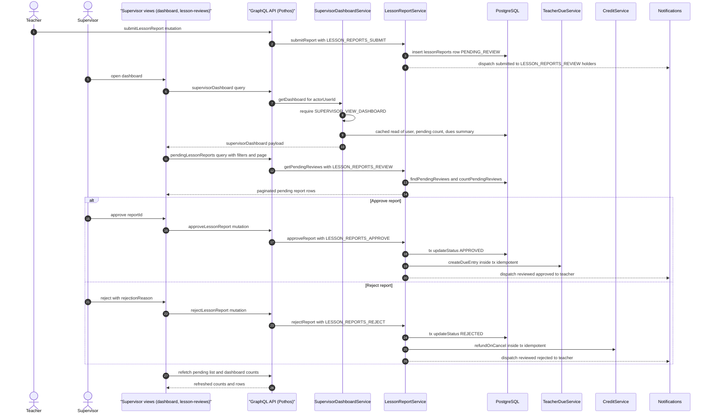

# Supervisor Review Dashboard

A teacher submits a lesson report (`submitLessonReport`), which lands in `lessonReports` as `PENDING_REVIEW` and fires a fire-and-forget notification to every holder of `LESSON_REPORTS_REVIEW`. The supervisor opens the dashboard, where `useSupervisorDashboardViewModel` issues the `supervisorDashboard` query and a `recentApprovedLessonReports` query; `SupervisorDashboardService.getDashboard` enforces `SUPERVISOR_VIEW_DASHBOARD`, serves a 30-second `cachedRead` aggregate, and assembles the supervisor name, pending-review count (`LessonReportService.getPendingReviewCount`), pending teacher-dues summary (`TeacherDueService.getPendingDuesSummary`), and a localized monthly snapshot. From there the supervisor drills into the lesson-reports page (`app/(dashboard)/lesson-reports/page.tsx`), which lists `pendingLessonReports` with teacher/student filters and pagination via `usePendingReviewsViewModel`. Approving calls `LessonReportService.approveReport`, which in one transaction sets the status to `APPROVED` and creates an idempotent `TeacherDueService.createDueEntry`; rejecting requires a non-empty reason and in the same transaction refunds the student's reserved credit via `CreditService.refundOnCancel`, then both paths notify the teacher of the decision. Edge cases: any missing permission throws a translated error, reviewing a report that is not `PENDING_REVIEW` throws `alreadyReviewed`, a blank rejection reason throws `rejectedReportsRequireReason`, a missing dashboard user throws `userNotFound`, and notification dispatch failures are logged but never roll back the transaction. After each mutation the view models refetch, keeping the pending list and dashboard counters in sync.

## Key sources

- `backend/services/supervisor/supervisor-dashboard.service.ts` — dashboard aggregate, permission gate, `cachedRead`
- `backend/graphql/query/supervisor/supervisor-dashboard.query.ts` — `supervisorDashboard` query field
- `backend/services/classes/lesson-report.service.ts` — submit / approve / reject loop, side effects, notifications
- `backend/graphql/mutation/classes/lesson-report.mutation.ts` — `approveLessonReport` / `rejectLessonReport` mutations
- `backend/graphql/query/classes/lesson-report.query.ts` — `pendingLessonReports` query
- `app/(dashboard)/lesson-reports/page.tsx` — page entry, `withPageAuth` guard
- `frontend/common/views/dashboard/supervisor/dashboard/useSupervisorDashboardViewModel.ts` — dashboard view model
- `frontend/common/views/dashboard/supervisor/lesson-reviews/usePendingReviewsViewModel.ts` — approve/reject UI flow

See [review-dashboard.mmd](./review-dashboard.mmd) for the standalone diagram file.
