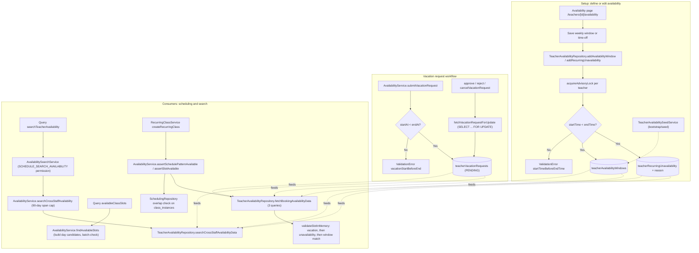

# Teacher Availability Management

Teachers and admins define a teacher's bookable week as recurring availability windows plus recurring time-off blocks, stored in `teacherAvailabilityWindows` and `teacherRecurringUnavailability`. Inserts run through `TeacherAvailabilityRepository.addAvailabilityWindow` / `addRecurringUnavailability`, which take a per-teacher advisory lock, reject inverted time ranges (`startTime >= endTime`) with a translated `ValidationError`, and record timezone plus a UTC-offset snapshot so windows stay correct across DST. Longer absences go through a small state machine: `AvailabilityService.submitVacationRequest` inserts a `PENDING` row in `teacherVacationRequests`, and `approveVacationRequest` / `rejectVacationRequest` / `cancelVacationRequest` transition it under a `SELECT ... FOR UPDATE` row lock, throwing if the request is not in the expected state. These three data sources then feed every downstream decision: `RecurringClassService.createRecurringClass` (and other booking entry points) call `AvailabilityService.assertSchedulePatternAvailable` / `assertSlotAvailable`, which batch-fetch windows, unavailability, and approved vacations in three queries and validate each occurrence in memory via `validateSlotInMemory` (vacation conflict, then unavailability conflict, then window match). Search surfaces reuse the same data read-only: the `searchTeacherAvailability` GraphQL query goes through `AvailabilitySearchService` (permission `SCHEDULE_SEARCH_AVAILABILITY`) into `AvailabilityService.searchCrossStaffAvailability` (time-range validation, 90-day span cap), while `availableClassSlots` calls `findAvailableSlots` to generate candidate slots and mark conflicts against `class_instances`. Edge cases: inverted ranges, overlapping vacations, bookings outside all windows, and date spans beyond the search cap all raise localized `ValidationError`s.

## Key sources

- `backend/services/scheduling/availability.service.ts` — service namespace: slot assertions, `findAvailableSlots`, vacation state machine, cross-staff search validation
- `backend/services/scheduling/availability.helpers.ts` — `validateSlotInMemory` (vacation → unavailability → window checks), slot bounds helpers
- `backend/db/repo/teachers/teacher-availability.repository.ts` — `addAvailabilityWindow`, `addRecurringUnavailability`, vacation CRUD with advisory locking, `fetchBookingAvailabilityData`, `searchCrossStaffAvailabilityData`
- `backend/services/schedule/availability-search.service.ts` — permission-gated search entry applying default filters
- `backend/graphql/query/scheduling/availability-search.query.ts` — `searchTeacherAvailability` query field
- `backend/services/schedule/recurring-class.service.ts` — consumes `assertSchedulePatternAvailable` before creating recurring classes
- `backend/services/seed/teacher-availability-seed.service.ts` — bootstrap/seed inserts for windows, unavailability, vacations
- `frontend/common/graphql/sharedDocuments/scheduling/availability-search.documents.ts` and `available-slots.documents.ts` — client documents for the search and slot-picker queries

## Diagram

Machine-checkable copy: [availability-setup.mmd](./availability-setup.mmd)
