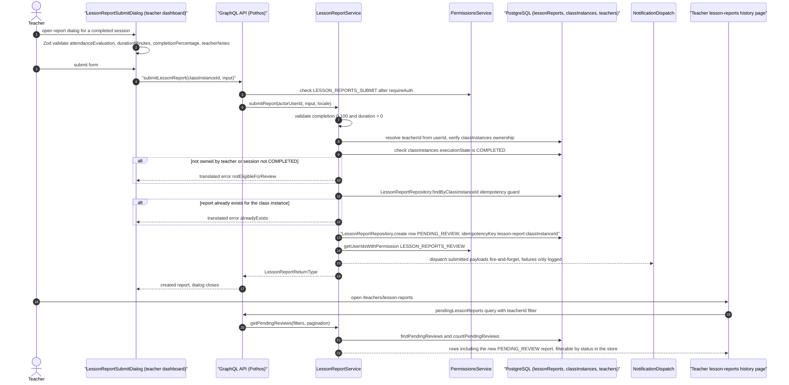

# Teacher Lesson Report Submission

After a session finishes, the teacher files a lesson report through the `LessonReportSubmitDialog` on the teacher dashboard, capturing the attendance evaluation (`PRESENT` / `ABSENT` / `LATE`), actual duration in minutes, a completion-percentage slider, and free-text teacher notes; the form is Zod-validated client-side before it fires the `submitLessonReport` GraphQL mutation. The Pothos resolver authenticates the actor and checks `LESSON_REPORTS_SUBMIT`, then delegates to `LessonReportService.submitReport`, which validates the numeric bounds, resolves the caller's teacher id, and verifies the teacher owns the class instance and that its `executionState` is `COMPLETED`. An idempotency guard (`findByClassInstanceId` plus a `lesson-report:<classInstanceId>` idempotency key) enforces at most one report per class instance before the row is inserted into `lessonReports` as `PENDING_REVIEW`. Submission then fire-and-forget notifies every holder of `LESSON_REPORTS_REVIEW` (dispatch failures are logged, never rolled back). The teacher can later review the filed report in the `/teachers/lesson-reports` history page, which loads `pendingLessonReports` filtered by teacher id and applies a client-side status filter via the Zustand store. Edge cases: missing permission throws a translated unauthorized error, a non-`COMPLETED` or foreign class instance throws `notEligibleForReview`, a duplicate throws `alreadyExists`, and invalid completion/duration throws `invalidInput`. The report then enters the supervisor review lifecycle: `APPROVED` creates an idempotent `TeacherDueService.createDueEntry`, `REJECTED` refunds reserved credit via `CreditService.refundOnCancel`, and both decisions notify the teacher back. Note: the desktop/mobile dialog wrappers and Zod schema exist, but `TeacherDashboardContainer` currently passes a placeholder noop for `onLessonReportSubmit` — the fully wired path is the `submitLessonReport` mutation and `LessonReportService.submitReport` backend documented here.

## Key sources

- `app/(dashboard)/teachers/lesson-reports/page.tsx` — page entry, `withPageAuth` guard, resolves teacher id
- `frontend/common/views/dashboard/teachers/lesson-reports/useTeacherLessonReportsViewModel.ts` — history list view model, `pendingLessonReports` query + status filter
- `frontend/common/views/dashboard/teachers/dashboard/components/LessonReportSubmitDialog.tsx` — submit form (attendance, duration, completion %, notes) with Zod validation
- `frontend/common/graphql/sharedDocuments/classes/lesson-report.documents.ts` — `submitLessonReportMutationDocument` and report query documents
- `backend/graphql/mutation/classes/lesson-report.mutation.ts` — `submitLessonReport` / `approveLessonReport` / `rejectLessonReport` mutations
- `backend/graphql/query/classes/lesson-report.query.ts` — `pendingLessonReports` and related report queries
- `backend/services/classes/lesson-report.service.ts` — `submitReport` validation, ownership/COMPLETED checks, idempotent create, reviewer notification; approve/reject side effects
- `backend/db/repo/classes/lesson-report.repository.ts` — `lessonReports` persistence and joined reads

See [lesson-report-submission.mmd](./lesson-report-submission.mmd) for the standalone diagram file.
