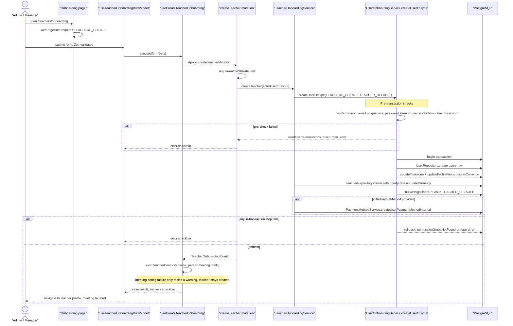

# Teacher Onboarding

An admin or manager user opens `/teachers/onboarding`, a page gated by `withPageAuth(AppPermission.TEACHERS_CREATE)`, and fills a Zod-validated form covering the teacher's core profile (name, email, password, nationality, phone, address), salary configuration (`hourlyRate` / `rateCurrency`), and an optional initial payout method. Submitting runs the `useCreateTeacherOnboarding` hook, which maps the form into a `TeacherOnboardingInput` and calls the `createTeacher` GraphQL mutation. The resolver rate-limits and authenticates the caller, then delegates to `TeacherOnboardingService.createTeacher`, which drives the shared `UserOnboardingService.createUserOfType` skeleton: pre-transaction checks (permission, email uniqueness, password strength, name validation, bcrypt hashing) followed by a single DB transaction that inserts the `users` row, writes timezone/display currency, inserts the `teachers` extension row via `TeacherRepository.create`, assigns the `TEACHER_DEFAULT` permission group, and optionally creates the initial payout payment method. Any failure inside the transaction rolls the whole provisioning back; pre-check failures return localized errors (`insufficientPermissions`, `userEmailExists`, `permissionGroupNotFound`). After a successful commit the client evicts the `teacherDirectory` Apollo cache, persists the meeting-platform config for the new teacher (a failure here only raises a warning — the teacher still exists), stores the result in the onboarding Zustand store, shows a success snackbar, and navigates to the new teacher's profile page. Availability is not seeded by this flow; it is configured afterwards on the teacher's separate availability page.

## Key sources

- `app/(dashboard)/teachers/onboarding/page.tsx` — server page, `withPageAuth` permission gate
- `frontend/common/views/dashboard/teachers/onboarding/useTeacherOnboardingViewModel.ts` — form, validation, submission view model
- `frontend/common/hooks/useCreateTeacherOnboarding.ts` — mutation execution, cache eviction, meeting-config persistence, store updates
- `backend/graphql/mutation/shared/onboarding.mutation.ts` — `createTeacher` mutation field
- `backend/services/teacher/teacher-onboarding.service.ts` — domain orchestration over the shared onboarding helper
- `backend/services/user/user-onboarding.service.ts` — `createUserOfType` permission check, pre-checks, transaction, group assignment
- `backend/services/teacher/__shared__/buildTeacherInsertPayload.ts` — teacher extension row payload (profile + salary fields)

## Diagram

Machine-checkable copy: [onboarding.mmd](./onboarding.mmd)
