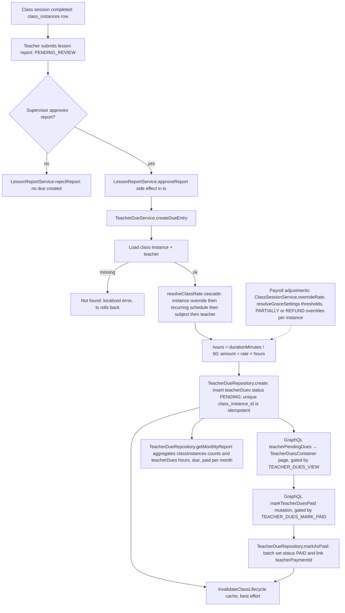

# Teacher Dues & Payroll Computation

When a teacher completes a class session and submits a lesson report, an authorized supervisor reviews it; on approval, `LessonReportService.approveReport` runs a transactional side effect that calls `TeacherDueService.createDueEntry` to convert the taught session into a payable due. The service loads the class instance and teacher (throwing a localized error if either is missing), resolves the effective hourly rate through the four-tier `resolveClassRate` cascade (instance override, then recurring schedule, then class subject, then teacher base rate), computes `hours = durationMinutes / 60` and `amount = rate × hours`, and inserts a `teacherDues` row in `PENDING` status — idempotent via the unique `class_instance_id` index. Payroll adjustments layer on top: admins can override an instance rate (`ClassSessionService.overrideRate`), grace-period thresholds come from `resolveGraceSettings` system settings, and per-instance `PARTIALLY` / `REFUND` calculation-status overrides capture deductions; on failure, cache invalidation of class-lifecycle tags is best-effort so a cache error never rolls back the due. Supervisors and the teacher themselves read state through the `teacherPendingDues` query behind `TEACHER_DUES_VIEW`, surfaced on the Teacher Dues dashboard page, and `getMonthlyReport` aggregates completed/cancelled sessions plus accrued hours, pending, and paid amounts for a month. Finally, an authorized operator batch-settles dues via the `markTeacherDuesPaid` mutation (requires `TEACHER_DUES_MARK_PAID`), which flips selected rows to `PAID` and links them to a `teacherPaymentId`. Edge cases include a soft-deleted subject silently falling back to the teacher rate and empty `dueIds` returning no rows.

## Key sources

- `app/(dashboard)/teacher-dues/page.tsx` — page entry, gated by `AppPermission.TEACHER_DUES_VIEW`
- `frontend/common/views/dashboard/supervisor/teacher-dues/useTeacherDuesViewModel.ts` — pending-dues query and mark-paid mutation wiring
- `backend/services/classes/lesson-report.service.ts` — `approveReport` side effect creating due entries
- `backend/services/teacher/teacher-due.service.ts` — due creation, rate resolution, reports, `markAsPaid`
- `backend/services/teacher/payroll-grace-settings.ts` — grace-period thresholds from system settings
- `backend/services/teacher/payroll-override.idempotency.ts` — idempotency key for payroll overrides
- `backend/services/session/class-session.service.ts` — admin rate override feeding the rate cascade
- `backend/db/repo/teachers/teacher-due.repository.ts` — `teacherDues` insert, monthly aggregation, batch paid update
- `backend/graphql/mutation/teachers/teacher-due.mutation.ts` and `backend/graphql/query/teachers/teacher-due.query.ts` — GraphQL entry points

Machine-checkable copy: [payroll-dues.mmd](./payroll-dues.mmd)
