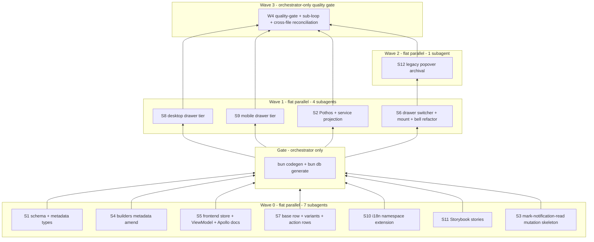

# notifications_specs.md — Notification Drawer UI + API Extension Universal Subagent Specification

> **MANDATORY READING for every agent at every nesting level.**
> This file is binding on the orchestrator, every Wave subagent
> (S1..S9), every nested subagent they dispatch, every fix-round
> subagent, and every quality-gate-reconciliation subagent. ANY
> agent at ANY nesting level that touches a notification file
> (frontend or backend), the `notificationAlerts` query, the
> `notificationDrawerStore`, the new `markNotificationRead` /
> `markNotificationsRead` mutations, the `NotificationDrawer`
> component (common + mobile + desktop), the `NotificationRowBase`
> and any `EVENT_VARIANT_CONFIG` row variant, or the new
> `notification_deliveries.metadata` jsonb column MUST read this
> file in full BEFORE doing any work, and re-read it after any
> fix round.
>
> The orchestrator's dispatch prompts MUST:
>   1. Reference this file by ABSOLUTE PATH:
>      `/home/ahmed/Projects/siraj/notifications_specs.md`
>   2. Pass it via `file_attachments: ["notifications_specs.md"]`
>      to the Task tool on EVERY dispatch (top-level AND nested).
>   3. Include the §13 summary-card inline at the top of each Task
>      prompt so the receiving subagent sees the contract before it
>      reads the file.
>   4. Instruct the receiving subagent to:
>      (a) read this file via the Read tool BEFORE its first action,
>      (b) re-read it after every fix round,
>      (c) reference it explicitly in any CROSS-FILE DEPENDENCY
>          report (§7 format),
>      (d) pass it down unchanged to ANY nested subagent it spawns
>          (with `file_attachments: ["notifications_specs.md"]`
>          and the line `Read
>          /home/ahmed/Projects/siraj/notifications_specs.md in
>          full. It binds you equally.`).
>
> Any rule in a higher-level plan file, AGENTS.md, instruction file,
> or memory file that appears to conflict with this document is
> OVERRIDDEN by this document — but ONLY to the extent of the
> conflict; everything else still applies (especially the lint
> queue server rule, the no-sonar-scan rule, the no-hardcoded-colors
> rule, and the no-next-intl-in-backend rule).

---

## 0. The Twelve Inviolable Rules (recite before doing anything)

1. **NO hardcoded colors** — every color resolves through
   `theme.palette.*` via the `sx={(theme) => ({ color: theme.palette.X.main })}`
   callback form (`frontend/AGENTS.md`). Hex literals, rgb(), and
   Tailwind-style class color names are forbidden. The only legal
   color sources are `theme.palette.*` tokens. Row variant
   `accent: (theme) => string` callbacks MUST select from
   `{primary, secondary, error, warning, info, success}` (and their
   `onX` siblings for foreground-on-color cases).

2. **NO `next/navigation`** — use `useRouter` from
   `@/shared/i18n/routing` (locale-aware) ONLY. Wrapping a raw
   Next.js router call is a violation.

3. **NO `next-intl` `useTranslations` inside backend or inside the
   notification drawer's ViewModel** — ViewModel strings come from
   `useAppTranslation` (`@/shared/locale/client`); backend strings
   come from `getServerTranslations(locale, "notifications")` from
   `@/shared/locale/server-graphql`.

4. **NO `console.*` anywhere** — frontend uses
   `import { logger } from "@/frontend/utils/logger"`; backend uses
   `import { logger } from "@/backend/lib/logger"`.

5. **NO `useLazyQuery` or `useSubscription`** on the frontend
   (`frontend/common/graphql/AGENTS.md`). The drawer's data fetches
   use stateful `useQuery` exclusively.

6. **NO `withSuspenseBindings`** — that symbol does not exist in
   this codebase. Mobile/desktop tier isolation uses `createLazyView`
   + `ResponsiveViewSwitch` only.

7. **NO `bun run lint` / `bun lint` direct invocation** — every
   lint request from a subagent goes through the lint queue client
   on `http://localhost:4777`. The orchestrator starts the queue
   server once and confirms `running: true` before dispatching any
   lint-touching subagent (this is the project-wide rule in
   `/home/ahmed/Projects/siraj/AGENTS.md`).

8. **NO `bun sonar-scan` / `bun scripts/sonar-manager.ts`** — only
   the orchestrator (Wave 4 quality gate) is permitted to run the
   Sonar stage. Subagents work with existing results only.

9. **NO editing files outside your ownership matrix (§1)** — emit
   a CROSS-FILE DEPENDENCY report (§7) and STOP. Do NOT "help by
   editing" a parallel subagent's file.

10. **NO import of `@/backend/enum` in `frontend/**`** — frontend
    consumes codegen-generated enums from
    `@/frontend/common/graphql/generated/gql/graphql-types` only
    (`frontend/AGENTS.md` rule). Use `NotificationEventType.X` from
    the codegen export, not from the backend enum.

11. **NO Toolpad `useNotifications` toast calls inside the drawer
    view layer**. Toasts are owned EXCLUSIVELY by the ViewModel
    (`useNotificationsDrawerViewModel.ts`) AND only for invoice
    approve/reject confirmations — never for "marked read" actions.

12. **`bun codegen` is the orchestrator's job, not a subagent's**.
    Subagents write GraphQL `.documents.ts` and Pothos `.pothos.ts`
    files; the orchestrator runs `bun codegen` between waves to
    regenerate `graphql-types.ts`. Subagents MUST write import paths
    against the EXPECTED post-codegen shapes (optimistic typing)
    using `@ts-expect-error`-free, fully-typed `TypedDocumentNode`
    imports from `@apollo/client` and `Operations.*` from the
    generated types namespace.

If you find yourself about to write ANY of: a hex color literal,
`useRouter` from `next/navigation`, `useTranslations` from
`next-intl`, `console.log`, `withSuspenseBindings`,
`bun run lint` in a shell, `useLazyQuery`, direct `import` from
`@/backend/enum` in a frontend file, a `useNotifications` toast
inside `.desktop.tsx` / `.mobile.tsx`, or editing a file outside
your ownership row in §1 — **STOP. You are about to violate the
rules. Re-read sections 1-6 below.**

---

## 1. File ownership strict-mode matrix (no subagent edits files it doesn't own)

| Subagent | Owns (creates/edits ONLY these files) |
|---|---|
| **S1 — Schema + metadata types** | `backend/db/schema/communications/communications.ts` (add `metadata` jsonb column), `backend/types/notifications/notification-alerts.metadata.types.ts` (NEW), `backend/types/notifications/notification-alerts.types.ts` (extend `NotificationAlertReturnType`), `backend/types/notifications/index.ts` (barrel only) |
| **S2 — Pothos + service projection** | `backend/graphql/pothos/notifications/notification-alerts.pothos.ts` (expose 5 new fields), `backend/services/notification/notification-alerts.service.ts` (extend select + map metadata + add `markOneAlertRead`), `backend/graphql/pothos/notifications/notification-metadata.pothos.ts` (NEW optional if needed for JSON scalar) |
| **S3 — Per-row mutation** | `backend/graphql/mutation/notifications/mark-notification-read.mutation.ts` (NEW), `backend/graphql/mutation/notifications/index.ts` (barrel only — co-owned with S6 re-export pattern; serialize via §9) |
| **S4 — Builders metadata amendment** | `backend/services/notification/notification-payloads.builders.ts` (extend builders to populate `metadata` on each `CommunicationPayload`), `backend/types/notifications/communications.types.ts` (extend `CommunicationPayload` shape with optional `metadata?: NotificationMetadata` if the existing shape does not already carry it — CREATE-only; S4 reports CROSS-FILE if file is owned by another layer) |
| **S5 — Frontend store + ViewModel + Apollo documents** | `frontend/common/stores/notificationsDrawerStore.ts` (NEW), `frontend/common/stores/index.ts` (barrel only), `frontend/common/views/dashboard/components/navbar/notifications/types/notificationDrawer.types.ts` (NEW), `frontend/common/views/dashboard/components/navbar/notifications/types/index.ts` (NEW), `frontend/common/views/dashboard/components/navbar/notifications/useNotificationsDrawerViewModel.ts` (NEW), `frontend/common/graphql/sharedDocuments/notifications/notification-alerts.documents.ts` (extend query + add `markNotificationReadMutationDocument`) |
| **S6 — Drawer switcher + mount + bell refactor** | `frontend/common/views/dashboard/components/navbar/notifications/NotificationDrawer.tsx` (NEW switcher), `frontend/common/views/dashboard/components/DashboardClientBridge.tsx` (mount the drawer), `frontend/common/views/dashboard/components/navbar/NotificationButton.tsx` (refactor to toggle store instead of opening popover) |
| **S7 — Common base row + variants + per-action rows** | `frontend/common/views/dashboard/components/navbar/notifications/rows/NotificationRowBase.tsx` (NEW), `frontend/common/views/dashboard/components/navbar/notifications/rows/RowMarkReadAction.tsx` (NEW), `frontend/common/views/dashboard/components/navbar/notifications/rows/RowViewEntityAction.tsx` (NEW), `frontend/common/views/dashboard/components/navbar/notifications/rows/RowRescheduleAction.tsx` (NEW), `frontend/common/views/dashboard/components/navbar/notifications/rows/RowInvoiceApproveRejectAction.tsx` (NEW), `frontend/common/views/dashboard/components/navbar/notifications/rows/notificationRowVariants.tsx` (NEW), `frontend/common/views/dashboard/components/navbar/notifications/rows/NotificationDrawerRow.tsx` (NEW), `frontend/common/views/dashboard/components/navbar/notifications/emptyState/NotificationDrawerEmptyState.tsx` (NEW), `frontend/common/views/dashboard/components/navbar/notifications/rows/index.ts` (NEW barrel) |
| **S8 — Desktop drawer tier** | `frontend/desktop/views/dashboard/components/navbar/notifications/notificationDrawer.desktop.tsx` (NEW), `frontend/desktop/views/dashboard/components/navbar/notifications/index.ts` (NEW barrel if project convention uses barrel-per-tier-folder) |
| **S9 — Mobile drawer tier** | `frontend/mobile/views/dashboard/components/navbar/notifications/notificationDrawer.mobile.tsx` (NEW), `frontend/mobile/views/dashboard/components/navbar/notifications/index.ts` (NEW barrel if needed) |
| **S10 — i18n namespace extension** | `shared/locale/notifications/notifications.types.ts` (extend type schema with drawer keys), `shared/locale/en/notifications/index.ts` (add drawer strings), `shared/locale/ar/notifications/index.ts` (add drawer strings) |
| **S11 — Storybook stories** | `frontend/common/views/dashboard/components/navbar/notifications/rows/NotificationRowBase.stories.tsx` (NEW), `frontend/common/views/dashboard/components/navbar/notifications/rows/NotificationDrawerRow.stories.tsx` (NEW) |
| **S12 — Legacy popover archival** | `frontend/common/views/dashboard/components/navbar/NotificationPanel.tsx` (DELETE in Wave 3 after drawer is live; archive to `NotificationPanel.legacy.tsx` first, then delete in Wave 4). Co-owned file with S6 — serialize via §9. |

**Barrel file co-ownership disclaimer**: when two subagents both need
to add exports to the same `index.ts` barrel (e.g. `backend/graphql/mutation/notifications/index.ts`,
`frontend/common/stores/index.ts`), the orchestrator coordinates by
issuing the barrel edit only AFTER the parallel content-creating
subagents have finished, OR by pre-creating the barrel with all
required exports in Wave 0. If a barrel conflict arises in flight,
the second writer MUST emit CROSS-FILE DEPENDENCY (§7) instead of
racing edits.

**If you need to edit a file you do NOT own**: emit a CROSS-FILE
DEPENDENCY report (§7) and STOP. The orchestrator dispatches a
reconciliation subagent.

---

## 2. Imports — what files MAY and MAY NOT bring in

### `backend/services/**` wiring subagents MAY import:

1. `@/backend/services/notification/notification-payloads.builders`
2. `@/backend/services/notification/notification-dispatch.helpers`
3. `@/backend/db/repo` (existing repos)
4. `@/backend/lib` (logger)
5. `@/backend/enum` (NotificationEventType, NotificationChannel, AppPermission)
6. `@/backend/types` (existing domain types, the new `NotificationMetadata`)
7. `@/shared/locale/server-graphql` (`getServerTranslations`)

### `backend/services/**` MUST NOT import:

1. `@/backend/services/communication/communication.service.ts` directly
2. `@/backend/db/repo/notifications/notification.repository.ts` directly
3. `notistack`, `next-intl`'s `useTranslations`, `enqueueSnackbar`
4. `console.*` — use `logger` from `@/backend/lib`
5. `zod` validators in services

### `frontend/common/**/*.ts(x)` MAY import:

1. `@/frontend/common/graphql/generated/gql/graphql-types` (codegen enums)
2. `@/frontend/common/graphql/sharedDocuments/notifications/*`
3. `@apollo/client/react` `useQuery`/`useMutation` (NOT `useLazyQuery`, NOT `useSubscription`)
4. `@/shared/locale/client` — `useAppTranslation`
5. `@/frontend/common/stores/notificationsDrawerStore`
6. Existing UI primitive imports (`StatusBadge`, `MobileCardListItem` if needed)
7. `@/frontend/common/components/auth/RequirePermission`
8. `@/frontend/common/utils/profileHref` (`classHref`, `studentProfileTabHref`, `ownProfileHref`)
9. `@/shared/i18n/routing` (`useRouter`)

### `frontend/common/**/*.ts(x)` MUST NOT import:

1. `@/backend/enum` directly — frontend uses codegen-generated enums.
2. `next/navigation` — use `@/shared/i18n/routing`.
3. `next-intl`'s `useTranslations` — use `useAppTranslation` from `@/shared/locale/client`.
4. `@toolpad/core/useNotifications` inside presentational row components
   (only the ViewModel may use it, and only for invoice approve/reject flow).
5. `console.*` — use `logger` from `@/frontend/utils/logger`.
6. `withSuspenseBindings` — does not exist in this codebase.

### `frontend/{desktop,mobile}/.../notificationDrawer.{desktop,mobile}.tsx` MAY import:

1. The common `NotificationDrawerProps` type
2. The common row + variant modules (`NotificationDrawerRow`, `NotificationDrawerEmptyState`)
3. MUI `Drawer`, `DrawerHeader`, `Toolbar`, `List`, `IconButton`, `Typography`, `Button`
4. `@mui/icons-material` outlined icons

### Tier files MUST NOT import:

1. `useRouter` — never from `.desktop.tsx` / `.mobile.tsx`. Always
   delegate navigation to the ViewModel.
2. `useState` for query results — all data lives in the ViewModel
   and the Zustand store. Tier files MAY use `useState` for purely
   local UI animations (e.g. global hover) but NEVER for query/mutation state.
3. Direct Apollo hooks — tier files receive everything via `vm` props.

---

## 3. The Eighteen Forbidden Patterns (auto-checked by Wave 4)

Each subagent MUST self-check these grep predicates against its
touched files before reporting completion.

| ID | Pattern forbidden | Self-check grep |
|---|---|---|
| **F1** | Hardcoded color literal in any touched file | `rg -n "#[0-9a-fA-F]{3,8}\|rgb\(\|rgba\(" <touched>` → 0 (except inside `theme.palette.*` comments) |
| **F2** | `useRouter` imported from `next/navigation` anywhere in touched frontend files | `rg -n "from \"next/navigation\"" <touched>` → 0 |
| **F3** | `useTranslations` from `next-intl` anywhere touched | `rg -n "useTranslations\(" <touched>` → 0 |
| **F4** | `console.*` anywhere in touched files | `rg -n "console\." <touched>` → 0 |
| **F5** | `useLazyQuery` or `useSubscription` anywhere touched frontend | `rg -n "useLazyQuery\|useSubscription" <touched>` → 0 |
| **F6** | `import .* from "@/backend/enum"` anywhere in `frontend/` touched | `rg -n 'from "@/backend/enum' <touched>` → 0 |
| **F7** | `withSuspenseBindings` anywhere touched | `rg -n "withSuspenseBindings" <touched>` → 0 |
| **F8** | Running raw eslint bypassing the lint queue (no longer an issue — `bun run lint` IS the lint queue client; just don't bypass the queue server) | inspect shell history → orchestrator restarts the subagent |
| **F9** | `bun sonar-scan` or `sonar-manager` run by a non-orchestrator subagent | inspect shell history |
| **F10** | Editing a file outside the ownership matrix (§1) | `git diff --name-only` of subagent commits must be ⊆ ownership row |
| **F11** | `CommunicationService.dispatch(`/`dispatchMulti(` directly from any non-notification service | `rg -n "CommunicationService\.(dispatch\|dispatchMulti)\("` <touched> → 0 |
| **F12** | `NotificationRepository.createDelivery`/`createDeliveriesBatch` directly from a non-notification service | `rg -n "NotificationRepository\.(createDelivery\|createDeliveriesBatch)\("` <touched> → 0 |
| **F13** | Hardcoded English title/body strings in any new file under `frontend/common/views/dashboard/components/navbar/notifications/` | `rg -n 'title:\s*"[A-Z][^"]+"\|body:\s*"[A-Z][^"]+"' <touched>` → 0 (only allowed inside `shared/locale/`) |
| **F14** | `useRouter().push` inside `.desktop.tsx` / `.mobile.tsx` touched files | `rg -n "useRouter\(\)" <touched>` → 0 |
| **F15** | Toolpad `useNotifications` toast hook used in any touched file that is NOT the ViewModel | `rg -n "useNotifications\(" <touched>` → 0 inside `NotificationRowBase` / `notificationDrawer.{desktop,mobile}.tsx` / variant files |
| **F16** | MUI style props (`fontWeight`, `textAlign`, `mb`, `mt`, `p`, `display`, etc.) used directly on MUI components like `Typography`, `Stack`, `Box`, `Grid` (MUI v9 breaking change from `frontend/AGENTS.md`) | grep for `<Typography[^>]*\b(fontWeight\|textAlign\|mb\|mt)\b` etc. → 0 (use `sx={{ ... }}` callback form) |
| **F17** | Icon name missing `Outlined` suffix (MUI v9 rename: `ErrorOutline` → `ErrorOutlined`, etc.) | `rg -n "ErrorOutline\|InfoOutline\|WarningOutline\|CheckCircleOutline[^d]" <touched>` → 0 |
| **F18** | Per-event-type row component branching on a raw `case "EMAIL":` etc. (use `NotificationChannel.EMAIL` enum) | `rg -n 'case "(EMAIL\|SMS\|PUSH\|ON_APP)"' <touched>` → 0 |

The escape hatch comment clauses:

| Comment | Permitted only when |
|---|---|
| `// NOTIFICATIONS-SPEC: <reason>` | Any deviation. Wave 4's auditor reviews each one. |
| `// LEGACY grandfathered: <file>:<line>` | ONLY for pre-existing files retained untouched. |

Comment clauses MUST be on the line immediately above the offending
declaration. Wave 4's auditor greps over adjacent lines.

---

## 4. Type discipline — single canonical contract per concept

### 4.1 `NotificationMetadata` discriminated union (S1 owns)

```typescript
// backend/types/notifications/notification-alerts.metadata.types.ts
export type NotificationEntityKind =
  | "invoice" | "class" | "student"
  | "complaint" | "suggestion"
  | "paymentMethod" | "schedule";

export interface NotificationMetadataBase {
  readonly entityKind: NotificationEntityKind;
  readonly entityId: string;
}

export interface InvoiceMetadata extends NotificationMetadataBase {
  readonly entityKind: "invoice";
  readonly amount?: string;
  readonly currency?: string;
  readonly newStatus?: string;
  readonly proofPending?: boolean;
}
// ... ClassMetadata, StudentMetadata, ComplaintMetadata,
//     SuggestionMetadata, PaymentMethodMetadata, ScheduleMetadata
export type NotificationMetadata =
  | InvoiceMetadata | ClassMetadata | StudentMetadata
  | ComplaintMetadata | SuggestionMetadata | PaymentMethodMetadata | ScheduleMetadata;
```

This file is the SOLE source. Frontend consumes the codegen-generated
equivalent from `Operations.NotificationMetadata`. If the codegen
shape differs, prefer extending the GraphQL surface over hand-mapping.

### 4.2 `NotificationAlertReturnType` extended (S1 owns)

```typescript
// backend/types/notifications/notification-alerts.types.ts
export type NotificationAlertReturnType = {
  id: string;                                     // opaque "notification-<deliveryId>" | "complaint-<id"
  deliveryId: string | null;                      // raw notificationDeliveries.id (null for complaints)
  type: "complaint" | "notification" | "system";
  eventType: NotificationEventType | null;         // NEW (null for complaints bucket)
  channel: NotificationChannel | null;             // NEW
  metadata: NotificationMetadata | null;           // NEW
  title: string;
  body: string | null;
  createdAt: Date;
  severity: "info" | "warning" | "error";
  readAt: Date | null;                             // NEW
};
```

Subagents MUST NOT declare duplicate ad-hoc `NotificationAlert` types.
The builder file's input shapes continue to use S1's existing types.

### 4.3 `CommunicationPayload` metadata amendment (S4 owns)

If `backend/types/notifications/communications.types.ts` does not
already expose a `metadata?: NotificationMetadata | null` field on
`CommunicationPayload`, S4 adds it. If the file is in another
subagent's ownership, report CROSS-FILE DEPENDENCY (§7).

---

## 5. Builder + dispatch discipline (S4 + existing S2 builders)

The existing `notification-payloads.builders.ts` (from Wave 1's S2)
returns `CommunicationPayload[]`. S4 amends each builder to ALSO
populate the new `metadata`:

```typescript
// existing shape — do NOT touch signatures
buildInvoiceGeneratedPayloads(parentUserId, invoice, locale?): CommunicationPayload[]
buildInvoiceStatusChangedPayloads(parentUserId, action, invoice, locale?): CommunicationPayload[]
buildPaymentMethodChangedPayloads(userId, action, locale?, metadata?): CommunicationPayload[]
buildClassLifecyclePayloads(classInstance, eventType, affectedUserIds, locale?, metadata?): CommunicationPayload[]
buildStudentLifecyclePayloads(studentId, eventType, affectedUserIds, locale?, metadata?): CommunicationPayload[]
```

Each returned payload must carry `metadata` whose `entityKind` matches
the event family:

| Builder | `metadata.entityKind` | Required fields |
|---|---|---|
| `buildInvoiceGeneratedPayloads` | `"invoice"` | `entityId=invoice.id`, `amount`, `currency` |
| `buildInvoiceStatusChangedPayloads` | `"invoice"` | `entityId=invoice.id`, `newStatus`, `proofPending` (true when action=`proofSubmitted`) |
| `buildPaymentMethodChangedPayloads` | `"paymentMethod"` | `entityId=paymentMethod.id` |
| `buildClassLifecyclePayloads` | `"class"` | `entityId=classInstance.id`, `classInstanceId=classInstance.id`, `studentName?`, `scheduledStartAt?`, `newStartAt?` |
| `buildStudentLifecyclePayloads` | `"student"` | `entityId=studentId`, `studentName?`, `oldStatus?`, `newStatus?` |

Builders remain PURE: no DB, no logger, no side-effects. Backwards
compatibility: existing `title`/`body` interpolation continues so
email/SMS channels still receive pre-rendered strings (`metadata` is
additional, not a replacement).

The `notification-deliveries` INSERT inside
`dispatchWithPreferences` / `CommunicationService.dispatchMulti`
MUST pass the `payload.metadata` into the new `notificationDeliveries.metadata`
column. If this write path is owned by another layer (S4 reports
CROSS-FILE if so), the orchestrator dispatches a follow-up wave.

---

## 6. Drawer state + ViewModel discipline (S5 owns)

### 6.1 Zustand store shape (`notificationsDrawerStore.ts`)

Non-persisted ephemeral store mirroring `parentsStore.ts` structure:

```typescript
import { create } from "zustand";

interface NotificationsDrawerState {
  readonly drawerOpen: boolean;
  setDrawerOpen: (drawerOpen: boolean) => void;
  toggleDrawer: () => void;
  openDrawer: () => void;
  closeDrawer: () => void;
}
export const useNotificationsDrawerStore = create<NotificationsDrawerState>(set => ({
  drawerOpen: false,
  setDrawerOpen: drawerOpen => set({ drawerOpen }),
  toggleDrawer: () => set(s => ({ drawerOpen: !s.drawerOpen })),
  openDrawer: () => set({ drawerOpen: true }),
  closeDrawer: () => set({ drawerOpen: false }),
}));
```

### 6.2 ViewModel shape (`useNotificationsDrawerViewModel.ts`)

Returns `NotificationsDrawerViewModel` with:

- `alerts: Operations.NotificationAlertsQuery["notificationAlerts"]["alerts"]`
- `unreadCount: number`
- `totalCount: number`
- `loading: boolean`
- `error: ApolloError | undefined`
- `markOneRead(deliveryId: string): Promise<void>` — wraps `useMutation(markNotificationReadMutationDocument)`, `refetchQueries: [notificationAlertsQueryDocument, meQueryDocument]`
- `markAllRead(): Promise<void>` — wraps `useMutation(markNotificationsReadMutationDocument)` (existing)
- `handleViewEntity(metadata: NotificationMetadata): void` — deep-link dispatcher (table below)
- `handleReschedule(classInstanceId: string): void` — `router.push(\`/reschedule?classInstanceId=${classInstanceId}\`)`
- `handleApproveInvoice(deliveryId: string, invoiceId: string): Promise<void>`
- `handleRejectInvoice(deliveryId: string, invoiceId: string): Promise<void>`
- `handleManagePreferences(): void` — `router.push(ownProfileHref())`

**`handleViewEntity` dispatch table**:

| `metadata.entityKind` | Pushed URL | Note |
|---|---|---|
| `invoice` (admin) | `/billing` | No per-invoice detail route exists today |
| `invoice` (parent) | `/billing/invoices` | Use `useUserStore` to detect role |
| `class` | `classHref(metadata.classInstanceId ?? metadata.entityId)` | Reference: `frontend/common/utils/profileHref.ts:58` |
| `student` | `studentProfileTabHref(metadata.entityId, tab)` where `tab = "quota"` if `eventType === STUDENT_QUOTA_OVERRIDDEN` else `"status"` | |
| `complaint` (admin) | `/complaints/manage` | |
| `complaint` (parent) | `/complaints` | |
| `suggestion` | `/suggestions` (verified in Wave 0) | Falls back to `/` if missing — report CROSS-FILE if route absent |
| `paymentMethod` | `ownProfileHref()` | |
| `schedule` | `/schedule` | |

All `router.push` calls live HERE ONLY — never in tier files.

**Approve/Reject invoice flow**: opens a Toolpad `useNotifications`
confirmation toast on success (`frontend/AGENTS.md` allows this in
the ViewModel). The toast fires AFTER the approve/reject mutation
completes, NOT before. The toast import lives in the ViewModel only.

---

## 7. CROSS-FILE DEPENDENCY report format

When a subagent needs to edit a file outside its ownership matrix
(§1), it MUST emit this report to the orchestrator and STOP work on
that file (continue other files in scope):

```
CROSS-FILE DEPENDENCY:
Target file: <this subagent's touched file>
Blocked by: <other file that needs changes>
Rule violated: <which rule from this spec or AGENTS.md>
Required fix: <description of what the other file needs>
Severity: BLOCKING | NON-BLOCKING
```

- **BLOCKING**: target file won't compile/lint without the other
  change. Orchestrator dispatches a follow-up wave immediately.
- **NON-BLOCKING**: target file works but is missing a feature (e.g.
  locale threading). Orchestrator queues for Wave 4 quality gate.

---

## 8. Per-file verification loop (binding on every wave)

After creating or editing any file, subagent MUST run, in order:

```bash
bun tsgo                                        # type-check (parallel-safe)
bun biome:check                                 # biome format+linter (parallel-safe)
# Lint via queue client — NEVER direct:
curl -s -X POST http://localhost:4777/lint \
  -H "Content-Type: application/json" \
  -d '{"id":"<wave>-<subagent>","files":["<touched-file-1>","<touched-file-2>"]}'
```

Or equivalently via the project sub-loop:

```bash
bun run scripts/health/sub-loop.ts <touched-file> --lifecycle lint
```

The orchestrator runs `bun quality-gate:fresh` once at Wave 4.

---

## 9. Barrel file co-ownership serialization

When ≥2 subagents own the same `index.ts` barrel:

1. **Strategy A (preferred)**: Orchestrator pre-creates the barrel in
   Wave 0 with all required exports stubbed in. Parallel subagents
   just add their file alongside.
2. **Strategy B**: Parallel subagents edit ONLY their own new content
   files; the orchestrator issues a dedicated barrel-edit Wave
   between content waves.
3. **Strategy C (fallback)**: A second writer hits a barrel already
   modified by a first writer and the contents conflict. The second
   writer MUST emit CROSS-FILE DEPENDENCY and STOP. NO force-push
   edits.

Affected barrels in this plan:
- `backend/graphql/mutation/notifications/index.ts` (S3 owns)
- `frontend/common/stores/index.ts` (S5 owns)
- `frontend/common/views/dashboard/components/navbar/notifications/types/index.ts` (S5 owns)
- `frontend/common/views/dashboard/components/navbar/notifications/rows/index.ts` (S7 owns)
- `backend/types/notifications/index.ts` (S1 owns)

No cross-wave barrel is co-owned. Strategy C should never trigger.

---

## 10. Open questions / known dependencies (resolved defaults)

| Question | Default | Rationale |
|---|---|---|
| **Dismiss** row action | DEFERRED to follow-up plan | No per-user hidden-rows table today. Ship with view/reschedule/approve-reject/mark-as-read only. |
| Old `NotificationPanel.tsx` popover | ARCHIVE in Wave 3, DELETE in Wave 4 | Once the drawer is live and Storybook green, the popover entry is fully retired. |
| `/suggestions` route | Verified absent → fall back to `/` | If route missing, S5 reports CROSS-FILE and falls back to root navigation. Don't block the drawer on a route that may not exist yet. |
| `proofPending` for `INVOICE_STATUS_CHANGED` | S4 populates from billing-service action | Builders set `metadata.proofPending = (action === "proofSubmitted")` inside `buildInvoiceStatusChangedPayloads`. |
| `CommunicationPayload.metadata` field | S4 adds the field if missing | If `communications.types.ts` is owned by another layer, report CROSS-FILE — orchestrator dispatches a one-line amendment wave. |
| `bun codegen` run order | Orchestrator runs between Wave 0 and Wave 1 | Subagents write GraphQL documents against the EXPECTED post-codegen shape using `TypedDocumentNode<Operations.NotificationAlertsQuery>` and similar. Self-typed `gql` template strings only — no hand-typed `any`. |

---

## 11. Acceptance criteria report format (binding)

Every subagent's closing message MUST include:

```
## Files changed
- <path> — <CREATED | MODIFIED | DELETED> — <one-line summary>

## Dispatch / mutation / new query sites added
- <path>:<line> — <one-line description>

## CROSS-FILE DEPENDENCIES (if any)
- Target: <file> | Blocked by: <file> | Rule: <rule id> | Required fix: <description> | Severity: BLOCKING | NON-BLOCKING

## Acceptance criteria LOCAL (F1..F18)
- F1..F18: PASS | FAIL | N/A — <evidence>

## Per-file sub-loop.ts verification
- <path> — lifecycle <stage> — exit <code>

## Test results
- <test file> — <n pass / n fail / n skip / n expect>
```

---

## 12. Parallelization discipline (binding on orchestrator)

The orchestrator dispatches subagents in waves. Within a wave,
subagents run in parallel — they do NOT wait for each other. The
orchestrator only blocks at wave boundaries when downstream files
STRICTLY require upstream artifacts (codegen, schema migrations,
mutation registration).

To maximize parallelism:

1. **Optimistic typing**: subagents import downstream-file types via
   `@ts-expect-error`-free `TypedDocumentNode` and named exports
   that the orchestrator guarantees will exist after codegen /
   the parallel sibling finishes. The orchestrator lists every
   optimistic import path in §13.
2. **Mock-friendly stores**: every subagent tests against module
   mocks; no subagent's tests require a sibling subagent's file at
   runtime (only at typecheck time, after codegen).
3. **Flattened waves**: the orchestrator combines Wave 0 + Wave 1 +
   Wave 2 subagents into one wide wave wherever possible (see
   §14); cross-wave barriers exist only for `bun codegen` and
   `bun db generate` (both orchestrator-only).

If a subagent has nothing blocking it, the orchestrator MUST NOT
hold it back behind an unrelated wave. Independent work streams
proceed in parallel even if other streams are still mid-flight.

---

## 13. Summary card (paste inline at the top of every Task prompt)

```
=== NOTIFICATIONS-SPEC SUMMARY (binding — read /home/ahmed/Projects/siraj/notifications_specs.md in full before any action) ===

12 inviolable rules:
  1 NO hardcoded colors        — use theme.palette.* callbacks only
  2 NO next/navigation         — use @/shared/i18n/routing
  3 NO next-intl useTranslations in backend or ViewModel
  4 NO console.*               — use logger from @/backend/lib | @/frontend/utils/logger
  5 NO useLazyQuery / useSubscription
  6 NO withSuspenseBindings    — does not exist
  7 NO bun run lint direct     — use lint queue client on localhost:4777
  8 NO bun sonar-scan by subagents — orchestrator only
  9 NO edits outside your ownership matrix (§1) — emit CROSS-FILE (§7) instead
 10 NO @/backend/enum in frontend — use codegen enums from graphql-types
 11 NO Toolpad useNotifications toasts except in the ViewModel's invoice approve/reject flow
 12 bun codegen is the orchestrator's job — subagents write TypedDocumentNode imports optimistically

Ownership (§1):
  S1 schema + metadata types
  S2 Pothos + service projection
  S3 mark-notification-read mutation
  S4 builders metadata amendment (+ CommunicationPayload.metadata if missing)
  S5 frontend store + ViewModel + Apollo documents
  S6 drawer switcher + DashboardClientBridge mount + NotificationButton refactor
  S7 base row + variants + per-action rows (common-tier)
  S8 desktop drawer tier file
  S9 mobile drawer tier file
  S10 shared/locale i18n extension
  S11 Storybook stories
  S12 legacy popover archival

Optimistic typing — these imports are guaranteed post-codegen; write them now:
  - Operations.NotificationAlertsQuery  (extended shape with eventType/channel/metadata/deliveryId/readAt)
  - Operations.MarkNotificationReadMutation
  - NotificationEventType (codegen enum) — replace any backend-enum import

Exit formats (§11): files changed | dispatch sites | cross-file deps | F1..F18 verdicts | sub-loop verdicts | test results.

Pass-down rule: every nested subagent must receive this file via file_attachments:["notifications_specs.md"]
AND the line "Read /home/ahmed/Projects/siraj/notifications_specs.md in full. It binds you equally."

Re-read after every fix round. Cap fix loops at 3. PASS/PARTIAL/FAIL verdict in §11 format.
=== END NOTIFICATIONS-SPEC SUMMARY ===
```

---

## 14. Maximum-parallelism wave plan (binding on orchestrator)

The orchestrator dispatches 13 subagents (S1..S12 + W4) across 4
waves. **No subagent waits for another within the same wave.**
Cross-wave barriers exist ONLY for `bun codegen` (between Wave 1
and Wave 2) and `bun db generate` (between Wave 1 and Wave 2 — the
drizzle migration is generated by the orchestrator once after S1
finishes).



### Why Wave 0 can run completely flat:

- **S1 schema+types**: writes pure type files + adds one column to
  the existing schema. No dependency on codegen. ⚡
- **S3 mutation skeleton**: writes the GraphQL mutation file by
  hand (Pothos schema is hand-written, not codegen). Imports
  `NotificationAlertsService.markOneAlertRead` optimistically
  (S2 implements it in Wave 1; S3's skeleton is type-compatible
  because S1's type definitions already define the input shape). ⚡
- **S4 builders amendment**: adds `metadata` to the existing
  builder functions. The `metadata` type comes from S1. Use
  `@ts-expect-error` if `NotificationMetadata` symbol is not
  available at edit time — orchestrator resolves at Wave 1 gate. ⚡
- **S5 store+ViewModel+Apollo docs**: writes GraphQL documents
  against the EXPECTED post-codegen shape. The store file is
  pure. ⚡
- **S7 base row + variants + action rows**: writes tier-neutral
  common components. Variant config imports codegen
  `NotificationEventType` enum — Wave 2 codegen has not run yet.
  S7 uses `@ts-expect-error` ONCE at the import line OR writes
  the variant config against the soft-string union of event types.
  The orchestrator relints after codegen. ⚡
- **S11 Storybook stories**: writes stories for `NotificationRowBase`
  and one variant row. Stories use mocked alert fixtures; no
  dependency on codegen. ⚡
- **S10 i18n**: writes pure locale strings. No dependency. ⚡

### Wave 2 / wave 3 / wave 4 justification:

- **Gate** (`bun codegen` + `bun db generate`): the orchestrator
  regenerates `graphql-types.ts` and applies the metadata migration
  once. This single gate is the only barrier.
- **Wave 2** (4 parallel): S2 (Pothos + service), S6 (switcher +
  mount + bell), S8 (desktop), S9 (mobile). All can proceed because
  codegen has settled and types exist on the frontend.
- **Wave 3** (1 subagent): S12 archives the legacy popover after the
  new drawer is fully wired — this is a separate deletion-only
  subagent so it doesn't race the mount refactor (S6 owns
  `NotificationButton.tsx`).
- **Wave 4** (orchestrator only): runs `bun quality-gate:fresh`,
  per-file `sub-loop.ts` reconciliation, resolves BLOCKING
  CROSS-FILE dependencies from Waves 0-3.

---

End of `notifications_specs.md`. Re-read this file before any
action. Pass it down to every nested subagent. The summary card
(§13) is the only part you may inline verbatim into a Task prompt.
