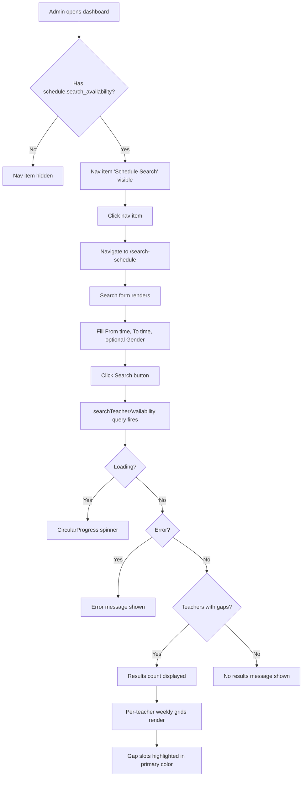

# Schedule Availability Search

**Route:** `/search-schedule`
**Permission:** `schedule.search_availability`
**Role:** Admin (access), Teacher (no access)

---

## Flow Diagram

---

## Desktop Scenarios

### D1: Nav item visible for Admin

| Step | Action | Expected |
|------|--------|----------|
| 1 | Login as Admin | Dashboard loads |
| 2 | Observe sidebar navigation | "Schedule Search" nav item visible with `SearchOutlined` icon |
| 3 | Click nav item | Navigate to `/search-schedule` page |

### D2: Search form renders correctly

| Step | Action | Expected |
|------|--------|----------|
| 1 | Login as Admin, navigate to `/search-schedule` | Page loads |
| 2 | Observe page title | "Schedule Availability Search" heading visible |
| 3 | Observe form | Three inputs visible: "From" (time), "To" (time), "Gender" (select) |
| 4 | Check defaults | From defaults to 08:00, To defaults to 17:00, Gender defaults to "All" |
| 5 | Observe button | "Search" button with search icon visible |

### D3: Form submission triggers query with results

| Step | Action | Expected |
|------|--------|----------|
| 1 | Login as Admin, go to `/search-schedule` | Form visible |
| 2 | Leave defaults (08:00 - 17:00, All genders) | Form populated |
| 3 | Click "Search" button | Loading spinner appears briefly |
| 4 | Wait for results | Results count text: "{count} teachers with {gaps} available slots" |
| 5 | Observe teacher cards | Each teacher has a card with name, gender chip, timezone |
| 6 | Observe weekly grids | 7-column grid per teacher (Mon-Sun), gap slots highlighted in primary color |

### D4: Gender filter narrows results

| Step | Action | Expected |
|------|--------|----------|
| 1 | Login as Admin, go to `/search-schedule` | Form visible |
| 2 | Select "Female" from Gender dropdown | Dropdown shows "Female" selected |
| 3 | Click "Search" | Query fires with gender: "FEMALE" |
| 4 | Observe results | Only female teachers appear in results |

### D5: Empty state when no matching teachers

| Step | Action | Expected |
|------|--------|----------|
| 1 | Login as Admin, go to `/search-schedule` | Form visible |
| 2 | Set time range with no availability (e.g., 02:00 - 03:00) | Form populated |
| 3 | Click "Search" | Query fires |
| 4 | Observe results area | "No available time slots found for the selected criteria." message |

### D6: Teacher does NOT see nav item

| Step | Action | Expected |
|------|--------|----------|
| 1 | Login as Teacher | Teacher dashboard loads |
| 2 | Observe sidebar | "Schedule Search" nav item is **not** visible |
| 3 | Attempt to navigate to `/search-schedule` directly | Page renders empty (RequirePermission hides all content) |

### D7: Query does not fire before form submission

| Step | Action | Expected |
|------|--------|----------|
| 1 | Login as Admin, go to `/search-schedule` | Page loads |
| 2 | Observe page | Form visible, no loading spinner, no results section |
| 3 | Verify network | No `searchTeacherAvailability` GraphQL query was sent (skip: !searchInput) |

---

## Mobile Scenarios

### M1: Form stacks vertically on mobile

| Step | Action | Expected |
|------|--------|----------|
| 1 | Login as Admin on mobile viewport, go to `/search-schedule` | Page loads in mobile layout |
| 2 | Observe form | Inputs stack vertically (flexWrap: "wrap"), not side-by-side |
| 3 | Observe button | "Search" button spans full width or is at bottom of form |

### M2: Weekly grid adapts to mobile

| Step | Action | Expected |
|------|--------|----------|
| 1 | Login as Admin on mobile, search with defaults | Results render |
| 2 | Observe teacher grid | Grid uses single column on mobile (`gridTemplateColumns: { xs: "1fr", md: "repeat(7, 1fr)" }`) |
| 3 | Each day card | Stacks vertically, readable on narrow screen |
