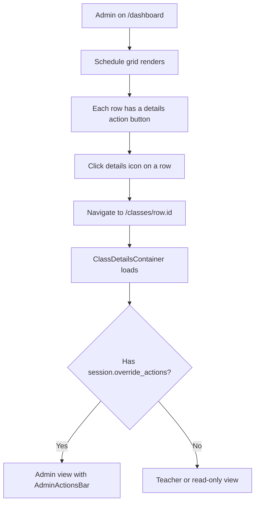

# Schedule Grid Navigation (Admin Dashboard)

**Route:** `/dashboard` → `/classes/[id]`
**Permission:** `schedule.view_list`
**Role:** Admin

---

## Flow Diagram

---

## Desktop Scenarios

### D1: Navigate to class details from grid row

| Step | Action | Expected |
|------|--------|----------|
| 1 | Login as Admin, go to `/dashboard` | Schedule grid renders with rows |
| 2 | Click the details `IconButton` on any schedule row | Browser navigates to `/classes/[id]` where `[id]` is the row's UUID |
| 3 | Observe the URL | URL contains the locale prefix and the class instance ID |
| 4 | Observe the page | `ClassDetailsContainer` loads and renders class details |

### D2: Grid row ID is a real UUID

| Step | Action | Expected |
|------|--------|----------|
| 1 | Login as Admin, go to `/dashboard` | Schedule grid renders |
| 2 | Inspect a row's details link or hover over the button | The link/href contains a valid UUID (not a display ID like `#CLS-123`) |

### D3: Schedule filters persist during navigation

| Step | Action | Expected |
|------|--------|----------|
| 1 | Login as Admin, go to `/dashboard` | Grid shown |
| 2 | Apply a teacher filter and search term | Grid narrows |
| 3 | Click details on a filtered row | Navigates to class details |
| 4 | Navigate back to `/dashboard` | Filters are reset (or preserved based on implementation) |

---

## Mobile Scenarios

### M1: Navigate to class details from mobile card

| Step | Action | Expected |
|------|--------|----------|
| 1 | Login as Admin on mobile, go to `/dashboard` | Schedule card list renders |
| 2 | Tap on a schedule card or its action button | Navigates to `/classes/[id]` |
| 3 | Observe the page | Class details page loads in mobile layout |

### M2: Back navigation from class details on mobile

| Step | Action | Expected |
|------|--------|----------|
| 1 | From class details page on mobile | Page rendered |
| 2 | Tap browser back or in-app back button | Returns to `/dashboard` |
| 3 | Observe the dashboard | Schedule list reappears correctly |
