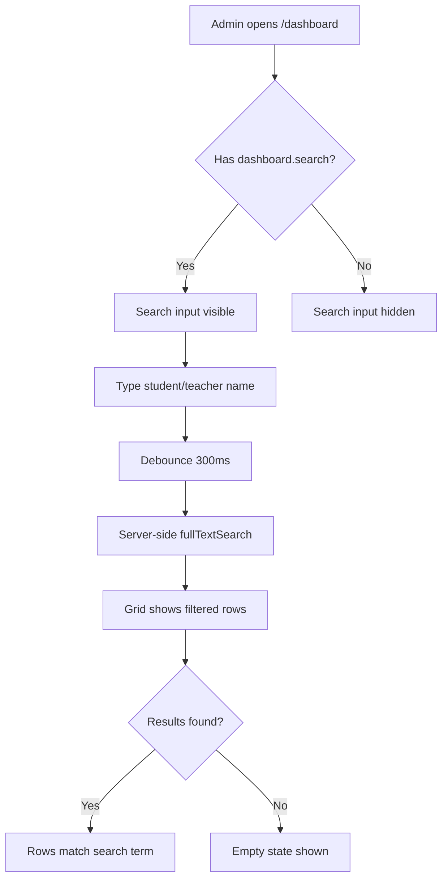

# Schedule Search (Admin Dashboard)

**Route:** `/dashboard`
**Permission:** `dashboard.search`
**Role:** Academy Admin

---

## Flow Diagram

---

## Desktop Scenarios

### D1: Search input visibility with permission

| Step | Action | Expected |
|------|--------|----------|
| 1 | Login as Academy Admin | Dashboard loads |
| 2 | Navigate to `/dashboard` | Schedule overview section renders |
| 3 | Observe the schedule header area | Search `TextField` is visible above the data grid |

### D2: Search input hidden without permission

| Step | Action | Expected |
|------|--------|----------|
| 1 | Login as user without `dashboard.search` | Dashboard loads |
| 2 | Navigate to `/dashboard` | Schedule overview renders |
| 3 | Observe the schedule header area | Search `TextField` is **not** rendered |

### D3: Server-side search by student name

| Step | Action | Expected |
|------|--------|----------|
| 1 | Login as Academy Admin, go to `/dashboard` | Schedule grid shows all rows for selected date |
| 2 | Type a student name (e.g., "Ahmed") in search | After debounce, grid updates |
| 3 | Observe grid rows | Only rows where student name matches "Ahmed" are shown |
| 4 | Clear search input | All rows for the date reappear |

### D4: Server-side search by teacher name

| Step | Action | Expected |
|------|--------|----------|
| 1 | Login as Academy Admin, go to `/dashboard` | Schedule grid shows all rows |
| 2 | Type a teacher name in search | After debounce, grid updates |
| 3 | Observe grid rows | Only rows where teacher name matches are shown |

### D5: Search with no results

| Step | Action | Expected |
|------|--------|----------|
| 1 | Login as Academy Admin, go to `/dashboard` | Schedule grid populated |
| 2 | Type a non-existent name (e.g., "XYZNONAME") | After debounce, grid updates |
| 3 | Observe grid | Empty state or "no results" message displayed |

### D6: Search combined with date filter

| Step | Action | Expected |
|------|--------|----------|
| 1 | Login as Academy Admin, go to `/dashboard` | Today's schedule shown |
| 2 | Change date filter to a different day | Grid updates to that day's schedule |
| 3 | Type a search term | Grid filters within the selected date only |

### D7: Search combined with teacher filter

| Step | Action | Expected |
|------|--------|----------|
| 1 | Login as Academy Admin, go to `/dashboard` | Schedule grid shown |
| 2 | Select a teacher from the teacher filter dropdown | Grid shows only that teacher's classes |
| 3 | Type a student name in search | Grid narrows to matching student within selected teacher's classes |

---

## Mobile Scenarios

### M1: Search input visibility on mobile

| Step | Action | Expected |
|------|--------|----------|
| 1 | Login as Academy Admin on mobile viewport | Dashboard loads in mobile layout |
| 2 | Navigate to `/dashboard` | Schedule card list renders |
| 3 | Observe the header area | Search input is visible (may be collapsible or in a search bar) |

### M2: Search filtering on mobile card list

| Step | Action | Expected |
|------|--------|----------|
| 1 | Login as Academy Admin on mobile, go to `/dashboard` | Schedule cards shown |
| 2 | Tap search and type a student name | Card list filters to matching results |
| 3 | Clear search | All cards reappear |

### M3: Search with no results on mobile

| Step | Action | Expected |
|------|--------|----------|
| 1 | Login as Academy Admin on mobile, go to `/dashboard` | Schedule cards shown |
| 2 | Type a non-existent name | Empty state displayed in mobile-friendly layout |
