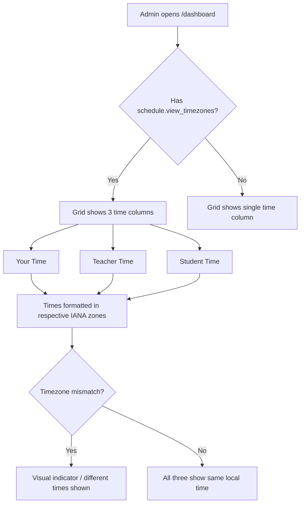

# Timezone Columns (Admin Dashboard)

**Route:** `/dashboard`
**Permission:** `schedule.view_timezones`
**Role:** Admin

---

## Flow Diagram

---

## Desktop Scenarios

### D1: Three timezone columns visible with permission

| Step | Action | Expected |
|------|--------|----------|
| 1 | Login as Admin (has `schedule.view_timezones`) | Dashboard loads |
| 2 | Navigate to `/dashboard` | Schedule overview data grid renders |
| 3 | Observe column headers | Three time columns visible: **Your Time**, **Teacher Time**, **Student Time** |

### D2: Single time column without permission

| Step | Action | Expected |
|------|--------|----------|
| 1 | Login as user without `schedule.view_timezones` | Dashboard loads |
| 2 | Navigate to `/dashboard` | Schedule overview data grid renders |
| 3 | Observe column headers | Only a single **Time** column shown (mapped from `yourTime`) |

### D3: Timezone values reflect correct IANA zones

| Step | Action | Expected |
|------|--------|----------|
| 1 | Login as Admin, go to `/dashboard` | Grid with timezone columns shown |
| 2 | Find a row where student has `timezoneOverride: "Europe/London"` and teacher is in `Africa/Cairo` | |
| 3 | Compare the three time columns | **Your Time** = viewer's local time, **Teacher Time** = Africa/Cairo formatted, **Student Time** = Europe/London formatted |

### D4: Student timezone fallback chain

| Step | Action | Expected |
|------|--------|----------|
| 1 | Login as Admin, go to `/dashboard` | Grid shown |
| 2 | Find a row for a student with `timezoneOverride: null` | |
| 3 | Observe Student Time column | Time formatted using parent's timezone (e.g., `Africa/Cairo`) |
| 4 | Find a row for a student whose parent also has default timezone | |
| 5 | Observe Student Time column | Time formatted using system `default_timezone` setting (UTC) |

### D5: Timezone mismatch visual indicator

| Step | Action | Expected |
|------|--------|----------|
| 1 | Login as Admin, go to `/dashboard` | Grid shown |
| 2 | Find a row where teacher and student are in different timezones | |
| 3 | Observe the three time values | The times differ numerically, reflecting the actual timezone offset |

---

## Mobile Scenarios

### M1: Timezone display on mobile cards

| Step | Action | Expected |
|------|--------|----------|
| 1 | Login as Admin on mobile viewport | Dashboard in mobile layout |
| 2 | Navigate to `/dashboard` | Schedule card list renders |
| 3 | Observe a schedule card | Card shows timezone information (your time, teacher time, student time) if permission is granted |

### M2: Single time on mobile without permission

| Step | Action | Expected |
|------|--------|----------|
| 1 | Login as user without `schedule.view_timezones` on mobile | Dashboard in mobile layout |
| 2 | Navigate to `/dashboard` | Schedule card list renders |
| 3 | Observe a schedule card | Card shows only a single time value |

### M3: Timezone values on mobile are readable

| Step | Action | Expected |
|------|--------|----------|
| 1 | Login as Admin on mobile, go to `/dashboard` | Schedule cards shown |
| 2 | Observe timezone labels on a card | All three times are legible, not truncated, and clearly labeled |
