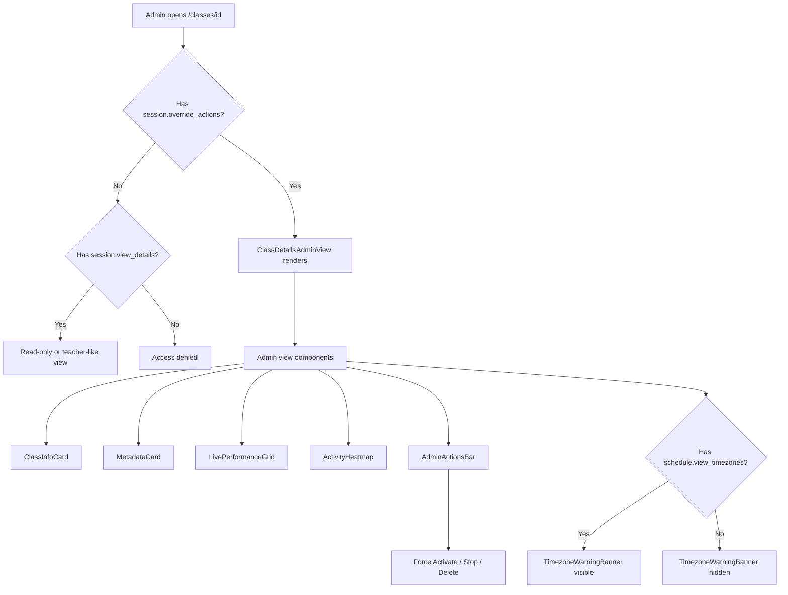

# Admin Class Details View

**Route:** `/classes/[id]`
**Permissions:** `session.view_details`, `session.override_actions`, `schedule.view_timezones`
**Role:** Academy Admin

---

## Flow Diagram

---

## Desktop Scenarios

### D1: Admin view renders with full permissions

| Step | Action | Expected |
|------|--------|----------|
| 1 | Login as Academy Admin, navigate to `/classes/[id]` | `ClassDetailsAdminView` renders |
| 2 | Observe page sections | ClassInfoCard, MetadataCard, LivePerformanceGrid, ActivityHeatmap all visible |
| 3 | Observe AdminActionsBar | Force Activate, Stop, Delete buttons present |

### D2: Performance grid displays data

| Step | Action | Expected |
|------|--------|----------|
| 1 | Login as Academy Admin, navigate to a completed class at `/classes/[id]` | Admin view renders |
| 2 | Observe LivePerformanceGrid | Shows engagement score, assessment progress, focus level, session health, latency |

### D3: Activity heatmap displays data

| Step | Action | Expected |
|------|--------|----------|
| 1 | Login as Academy Admin, navigate to a class with performance data | Admin view renders |
| 2 | Observe ActivityHeatmap | Heatmap visualization renders with `heatmapData` array values |

### D4: Class info card shows complete details

| Step | Action | Expected |
|------|--------|----------|
| 1 | Login as Academy Admin, navigate to `/classes/[id]` | Admin view renders |
| 2 | Observe ClassInfoCard | Shows course name, instance ID, scheduled date, start/end time, duration, status, remarks |

### D5: Metadata card shows student and teacher info

| Step | Action | Expected |
|------|--------|----------|
| 1 | Login as Academy Admin, navigate to `/classes/[id]` | Admin view renders |
| 2 | Observe MetadataCard | Student name, grade, level, avatar; Teacher name, title, avatar displayed |

### D6: Timezone warning banner with mismatch

| Step | Action | Expected |
|------|--------|----------|
| 1 | Login as Academy Admin (has `schedule.view_timezones`), navigate to class with timezone mismatch | Admin view renders |
| 2 | Observe TimezoneWarningBanner | Banner visible showing timezone difference details |

---

## Mobile Scenarios

### M1: Admin view on mobile layout

| Step | Action | Expected |
|------|--------|----------|
| 1 | Login as Academy Admin on mobile, navigate to `/classes/[id]` | Admin view in mobile layout |
| 2 | Observe the page | Cards stack vertically, all sections accessible via scroll |

### M2: Performance grid on mobile

| Step | Action | Expected |
|------|--------|----------|
| 1 | Login as Academy Admin on mobile, navigate to class with performance data | Mobile admin view |
| 2 | Observe LivePerformanceGrid | Data presented in mobile-friendly format (cards or horizontal scroll) |

### M3: Admin actions on mobile

| Step | Action | Expected |
|------|--------|----------|
| 1 | Login as Academy Admin on mobile, navigate to `/classes/[id]` | Mobile admin view |
| 2 | Observe admin actions | Actions accessible (toolbar, bottom sheet, or overflow menu) |
| 3 | Tap an action (e.g., Stop) | Action executes with confirmation if needed |
