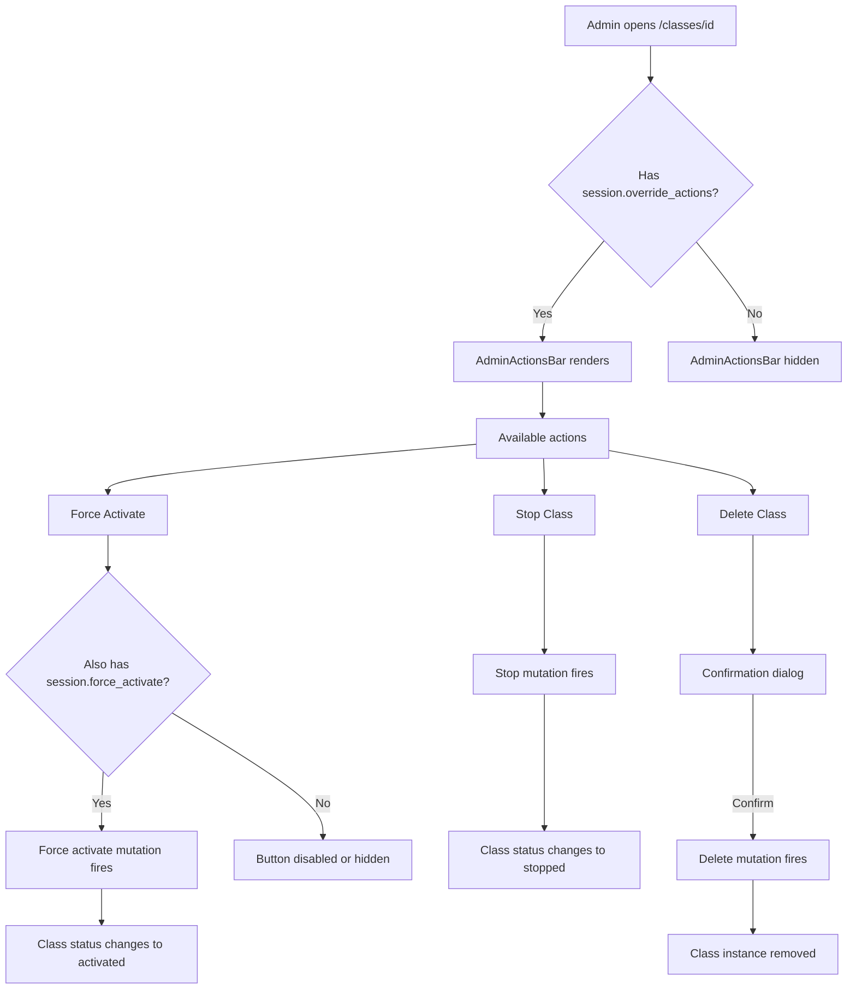

# Admin Override Actions (Class Details)

**Route:** `/classes/[id]`
**Permissions:** `session.override_actions`, `session.force_activate`, `session.reschedule`, `session.revert`
**Role:** Academy Admin

---

## Flow Diagram

---

## Desktop Scenarios

### D1: AdminActionsBar visible with permission

| Step | Action | Expected |
|------|--------|----------|
| 1 | Login as Academy Admin (has `session.override_actions`) | Dashboard loads |
| 2 | Navigate to `/classes/[id]` for any class instance | Class details page loads |
| 3 | Observe the page | `AdminActionsBar` is rendered with action buttons (Force Activate, Stop, Delete) |

### D2: AdminActionsBar hidden without permission

| Step | Action | Expected |
|------|--------|----------|
| 1 | Login as user without `session.override_actions` | Dashboard loads |
| 2 | Navigate to `/classes/[id]` | Class details page loads |
| 3 | Observe the page | `AdminActionsBar` is **not** rendered |

### D3: Force activate a class

| Step | Action | Expected |
|------|--------|----------|
| 1 | Login as Academy Admin, navigate to a pending class at `/classes/[id]` | Class details with AdminActionsBar shown |
| 2 | Click **Force Activate** button | Mutation fires |
| 3 | Observe the page | Class status updates to "activated", UI reflects new state |
| 4 | Check for success feedback | Success toast or inline confirmation shown |

### D4: Force activate without `session.force_activate` permission

| Step | Action | Expected |
|------|--------|----------|
| 1 | Login as user with `session.override_actions` but without `session.force_activate` | Class details loads |
| 2 | Observe AdminActionsBar | Force Activate button is disabled or hidden |

### D5: Stop a class instance

| Step | Action | Expected |
|------|--------|----------|
| 1 | Login as Academy Admin, navigate to an active class at `/classes/[id]` | Class details shown |
| 2 | Click **Stop** button in AdminActionsBar | Stop mutation fires |
| 3 | Observe the page | Class status changes to "stopped" |

### D6: Delete a class instance

| Step | Action | Expected |
|------|--------|----------|
| 1 | Login as Academy Admin, navigate to `/classes/[id]` | Class details shown |
| 2 | Click **Delete** button in AdminActionsBar | Confirmation dialog appears |
| 3 | Confirm deletion | Delete mutation fires |
| 4 | Observe result | Class instance is removed, user redirected or page shows deletion state |

### D7: Delete cancellation

| Step | Action | Expected |
|------|--------|----------|
| 1 | Login as Academy Admin, navigate to `/classes/[id]` | Class details shown |
| 2 | Click **Delete** button | Confirmation dialog appears |
| 3 | Cancel the dialog | Dialog closes, class instance unchanged |

---

## Mobile Scenarios

### M1: AdminActionsBar on mobile

| Step | Action | Expected |
|------|--------|----------|
| 1 | Login as Academy Admin on mobile, navigate to `/classes/[id]` | Class details in mobile layout |
| 2 | Observe the page | Admin actions are accessible (may be in a collapsible toolbar or bottom action sheet) |

### M2: Force activate on mobile

| Step | Action | Expected |
|------|--------|----------|
| 1 | Login as Academy Admin on mobile, navigate to a pending class | Mobile class details shown |
| 2 | Tap Force Activate | Mutation fires, status updates |
| 3 | Observe feedback | Success indication shown in mobile-friendly format |

### M3: Delete confirmation on mobile

| Step | Action | Expected |
|------|--------|----------|
| 1 | Login as Academy Admin on mobile, navigate to `/classes/[id]` | Mobile class details shown |
| 2 | Tap Delete | Mobile confirmation dialog or bottom sheet appears |
| 3 | Confirm | Class deleted, appropriate navigation or state update |
